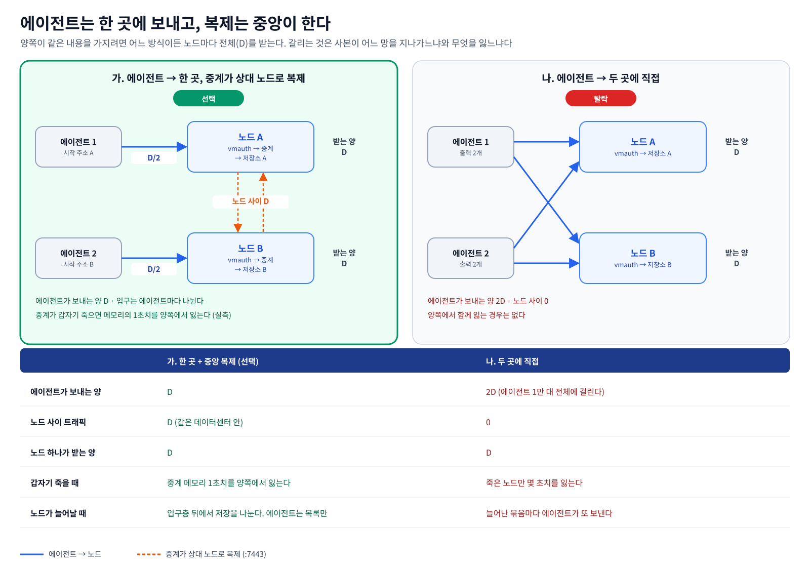
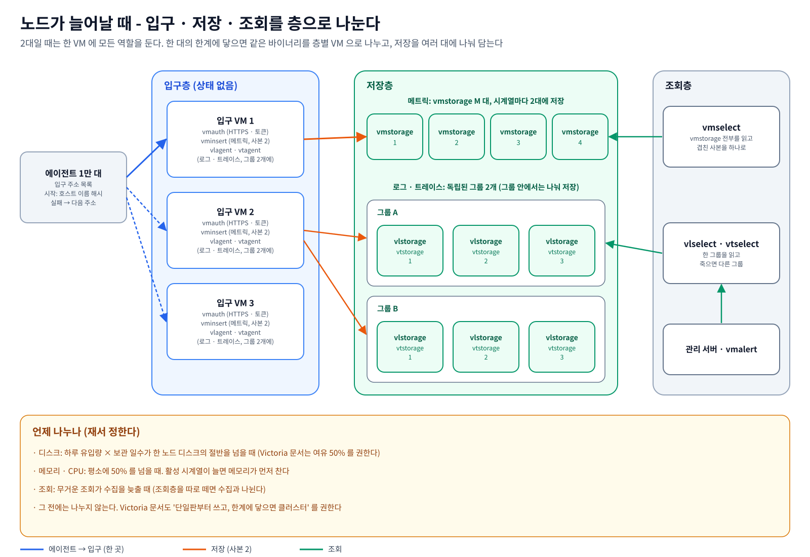

# 모니터링 이중화 설계 (Active-Active, Victoria 계열)

---

## 한 장 요약


**노드 안 · 노드 사이 상세 흐름** (포트 · 경로 · 복제 방향, 5.1절에서 설명)


| 질문 | 답 |
|---|---|
| 무엇을 만드나 | 노드 2대가 똑같은 일을 하는 모니터링 백엔드. 메트릭은 VictoriaMetrics, 로그는 VictoriaLogs, 트레이스는 VictoriaTraces |
| 양쪽 저장소는 어떻게 같아지나 | 노드마다 있는 **Victoria 중계 에이전트(vmagent · vlagent · vtagent)가 양쪽 저장소에 똑같이 기록**한다. 한쪽이 죽으면 그쪽 몫을 디스크에 쌓았다가 돌아오면 보낸다 (4절) |
| 에이전트는 | **OCB 로 만든 커스텀 OpenTelemetry Collector** 하나. 공식 부품에 없는 기능(GPU · NPU 수집, 로그 원천 자동 선택, Windows 패킷 트레이스, vSphere, 하이퍼바이저의 GPU-VM 매핑, 노드 전환 출력)은 자체 부품으로 만든다 (3.5, 8절) |
| 중계를 OTel Collector 가 아니라 Victoria 에이전트로 하는 이유 | 기존 Prometheus(remote_write · scrape)와 Influx · Loki 형식 수집기를 받는 입구가 **Victoria 쪽에서는 기본 기능이고 OTel 쪽에서는 alpha** 다. 큐를 바이트 단위로 보고 남은 양으로 조회 복귀를 정하는 공식 HA 절차가 있다 (3.4) |
| VIP 는 | **쓰지 않는다.** VIP 는 같은 L2 대역 안에서만 넘어간다. 대신 **에이전트가 노드 주소를 모두 알고, 그중 한 곳에만** 보낸다. 시작 주소는 호스트 이름으로 정해 에이전트마다 나뉘고, 실패하면 목록의 다음 주소로 보낸다. 노드마다 입구 프록시(vmauth)가 있어 로컬 부품이 죽으면 상대 노드로 넘긴다 (3.3, 3.10) |
| 에이전트가 양쪽에 직접 보내지 않는 이유 | 양쪽이 같은 내용을 가지려면 어느 방식이든 노드마다 전체를 받는다. 에이전트가 양쪽에 보내면 서버 수만큼 송신량이 2배가 되고, 중앙이 복제하면 같은 데이터센터 안의 노드 사이 트래픽으로 끝난다 (3.11) |
| 노드는 몇 대 | **2대로 시작한다.** 로드밸런서 전용 노드도, split-brain 판정 노드도 없다 (3.9). 한 대의 디스크 · 메모리 한계에 닿으면 입구 · 저장 · 조회를 층으로 나누고 저장을 여러 대에 나눠 담는다. 에이전트는 주소 목록만 바뀐다 (3.12) |
| 알림은 | **Victoria 계열.** 노드마다 vmalert, Alertmanager 두 대가 클러스터. Grafana 는 쓰지 않는다 (3.8) |
| Prometheus 와는 | 수집(remote_write 1.0 · OTLP), 조회(Prometheus HTTP API · PromQL), 규칙(Prometheus 형식), Alertmanager 가 그대로 맞는다. 관리 서버가 **두 저장소가 함께 지원하는 것만** 쓰면 메트릭 저장소를 Prometheus ↔ VictoriaMetrics 로 주소만 바꿔 오갈 수 있다 (9절) |
| AI 반도체는 | 에이전트 안의 수신기가 **벤더 도구를 직접 읽는다.** NVIDIA 는 nvidia-smi + NVML GPM(보조 바이너리 `cmp-gpm`), AMD 는 `amd-smi --json`, Rebellions 는 `rbln-smi -j`, Furiosa 는 순수 Go 라이브러리. **exporter 컨테이너 · podman · nvidia-container-toolkit 이 필요 없다** (3.6) |
| OS · SELinux | **CGO 를 끈 정적 바이너리 하나**(OCB 기본값). NVML GPM 을 여는 부분만 glibc 동적 보조 바이너리(`cmp-gpm`)로 뺐다 (3.6). 컨테이너가 없어 SELinux 장치 라벨 문제가 없다. 라벨은 CIL 정책 모듈로 넣는다 (8.3) |

---

## 1. 목표와 요구사항

| # | 요구 | 이 설계에서 |
|---|---|---|
| R1 | 양쪽이 다 살아 있는 Active-Active | 노드 2대가 수집 · 중계 · 저장 · 조회 · 알림을 모두 한다 |
| R2 | 로드밸런싱으로 부하 분산 | 에이전트마다 시작 노드가 달라 입구를 나누고, 관리 서버가 조회를 나눈다. 저장은 노드가 늘어날 때 나눈다 (3.11, 3.12) |
| R3 | 양쪽 저장소가 항상 같은 내용 | 중계 에이전트의 이중 기록 + 목적지별 디스크 큐 |
| R4 | 프록시로 이중화, L2 에 묶이지 않기 | 노드마다 vmauth 입구. 진입 주소는 L3(라우팅)만 되면 된다 |
| R5 | AI 반도체(NVIDIA · AMD · NPU) 수집 | 에이전트 수신기가 벤더 CLI · 라이브러리를 직접 읽는다 |
| R6 | 저장소 · 중계 · 알림은 Victoria 계열, Prometheus · OTel 과 호환 | 14.1 호환표, 9절 |
| R7 | 메트릭 · 로그(journald · syslog · Windows 이벤트 로그) · 트레이스(eBPF · Windows) · vSphere | 에이전트 하나 + 중앙 vSphere 수집기 |
| R8 | OS 와 SELinux 에 상관없이 도는 에이전트 | 정적 바이너리 하나(GPM 만 보조 바이너리), 컨테이너 없음 |
| R9 | Grafana 없이 | 알림은 vmalert · Alertmanager, 화면은 관리 서버 |
| R10 | 나중에 Prometheus ↔ Victoria 를 오갈 수 있게 | 두 저장소의 공통 API 만 쓰는 조회 구조 (9.2) |

**처음 나오는 말**
- **L2 / L3**: L2 는 같은 네트워크 대역(같은 스위치 도메인) 안의 통신, L3 는 라우터를 거쳐 대역을 넘는 통신이다.
- **VRRP / VIP**: 두 서버가 가상 IP(VIP) 하나를 나눠 갖는 규약이다. keepalived 가 구현한다. VIP 가 넘어갈 때 GARP(같은 L2 안에 "이 IP 는 이제 내 MAC" 이라고 알리는 패킷)를 쓰므로 같은 L2 안에서만 동작한다.
- **OCB**(OpenTelemetry Collector Builder): OpenTelemetry Collector 에 필요한 부품만 골라 빌드하는 공식 도구. 포크가 아니라 부품 목록 파일로 만든다.
- **중계 에이전트**: 각 노드에서 데이터를 받아 양쪽 저장소에 나눠 쓰는 Victoria 쪽 프로그램(vmagent · vlagent · vtagent). 4절.
- **ECMP**(Equal-Cost Multi-Path): 라우터가 같은 목적지로 가는 비용이 같은 경로 여러 개에 연결을 나눠 보내는 기능.
- **호스트 이름 해시**: 서버 이름을 숫자로 바꾼 값. 같은 서버는 늘 같은 값이 나오고 서버들 사이에는 고르게 퍼지므로, 이 값으로 시작 노드를 고르면 따로 설정하지 않아도 에이전트가 노드들에 고르게 나뉜다.
- **관리 서버**: 화면 · API 를 제공하고 알림 정책을 관리하는 애플리케이션. 이 문서에서는 저장소를 조회하고 알림 규칙을 내주는 쪽으로만 다룬다.

---

## 2. 전체 구조

| 층 | 무엇 | 어디서 |
|---|---|---|
| 수집 | OCB 에이전트 (서버마다 하나), OBI(eBPF 트레이스, 별도 프로세스), 중앙 vSphere 수집기 | 각 서버, 중앙 |
| 진입 | vmauth 하나가 입구 3개(수집 4318 · 조회 8443 · 노드 사이 7443)를 HTTPS 로 받음 | 노드 A · B 각각 |
| 중계 | vmagent · vlagent · vtagent | 노드 A · B 각각, 양쪽 저장소에 기록 |
| 저장 | VictoriaMetrics · VictoriaLogs · VictoriaTraces | 노드 A · B 각각, 같은 내용 |
| 알림 | vmalert, Alertmanager (클러스터) | 노드 A · B 각각 |
| 조회 · 관리 | 관리 서버 (Prometheus API · LogsQL · Jaeger API 로 조회) | 별도 |

---

## 3. 설계 결정 - 후보와 고른 이유

결정마다 **어떤 방법들이 있는지**, **무엇을 골랐는지**, **왜 골랐는지**, **무엇을 포기했는지**를 적는다.

### 3.1 양쪽 저장소를 같게 유지하는 방법


| 방법 | 어떻게 동작하나 | 얻는 것 | 잃는 것 |
|---|---|---|---|
| **① 중계 에이전트가 양쪽에 기록** (선택) | 중계 에이전트가 같은 데이터를 저장소 A · B 에 각각 보낸다. 목적지마다 디스크 큐가 따로 있어 한쪽이 죽으면 그쪽 몫만 쌓아 둔다 | 노드 1대가 죽어도 쓰기가 안 멈춘다. 정족수가 필요 없어 2노드로 충분하다. 각 노드가 완전한 사본이다 | 디스크 2배. 큐 한도를 넘는 장애는 빈 구간을 수동으로 보충해야 한다 |
| ② 저장소 클러스터의 복제 기능 | VictoriaMetrics 클러스터의 `replicationFactor=2` 처럼 저장소가 스스로 복제 | 조회 시 두 사본을 합쳐 빈틈이 없다. 노드 추가로 확장 | **로그 · 트레이스는 저장소 복제 기능이 없다.** VictoriaLogs 클러스터는 나눠 저장만 한다. 컴포넌트 수도 3배 |
| ③ 공유 오브젝트 스토리지 | Loki · Tempo · Thanos 가 같은 S3 버킷을 공유 | 장기 보관이 싸다 | 2노드 MinIO 는 노드 1대 장애에 쓰기가 멈춘다. 버티려면 3노드 이상 + Ceph 등이 필요하다 |
| ④ 저장소끼리 사후 동기화 | 주기적으로 export → import | 저장소를 안 건드린다 | 주기만큼 늘 어긋난다. 로그 · 트레이스용 도구가 없다 |

**고른 이유**
- 노드가 2대뿐이다. 정족수가 필요한 방식은 2대에서 1대가 죽으면 쓰기를 멈춘다. ①은 각 노드가 서로를 기다리지 않는다.
- **Victoria 쪽 공식 HA 권장안이 ①이다.** VictoriaLogs 문서는 독립된 인스턴스들에 사본을 보내는 것을 HA 로 적고, vlagent 로 복제 · 버퍼링한다. VictoriaTraces 문서도 "두 개 이상 인스턴스 + 여러 목적지로 보내기" 를 권한다.
- 메트릭 · 로그 · 트레이스가 **같은 방식**이라 운영 절차가 하나다.

**나중에 다시 볼 조건**: 한 노드 디스크 · 메모리에 안 들어갈 만큼 커지면 입구 · 저장 · 조회를 층으로 나누고 메트릭은 ②(VictoriaMetrics 클러스터의 `replicationFactor=2`)로 저장을 나눈다. 로그 · 트레이스는 ①을 그룹 단위로 그대로 쓴다 (3.12).

### 3.2 저장소 제품

| 후보 | 메트릭 | 로그 | 트레이스 | 판단 |
|---|---|---|---|---|
| **Victoria 계열** (선택) | VictoriaMetrics | VictoriaLogs | VictoriaTraces | 세 신호 모두 **같은 모양의 중계 에이전트(복제 + 디스크 큐)**가 공식으로 있다. 단일 바이너리, Apache-2.0 |
| InfluxDB v1 + Loki + Tempo | InfluxDB | Loki | Tempo | InfluxDB v1 OSS 는 클러스터가 없고 v3 HA 는 Enterprise 다 |
| Prometheus + Thanos | Prometheus/Thanos | Loki | Tempo | 메트릭 컴포넌트만 6종이고 오브젝트 스토리지가 필요하다 |
| Grafana LGTM | Mimir | Loki | Tempo | 셋 다 오브젝트 스토리지 + 정족수 링이 기본이라 2노드에 맞지 않다 |

**고른 이유**
- 복제를 저장소 밖(중계 에이전트)에서 한다는 3.1 의 결정을 세 신호 모두에 같은 도구로 적용할 수 있는 것이 Victoria 계열뿐이다.
- **Prometheus · OTel 호환**(R6): 메트릭은 Prometheus 의 수집 · 조회 · 규칙 형식을, 세 신호 모두 OTLP 를 받는다 (14.1).
- 라이선스와 관리 상태 (2026-10-31 GitHub 조회):

| 저장소 | 라이선스 | 최신 릴리스 | 비고 |
|---|---|---|---|
| VictoriaMetrics | Apache-2.0 | v1.155.0 (2026-10-26) | 별 17,976 |
| VictoriaLogs | Apache-2.0 | v1.53.0 (2026-10-01) | 별 2,436 |
| VictoriaTraces | Apache-2.0 | v0.12.1 (2026-10-23) | **0.x 버전**. README 에 "작업 중, 저장 형식과 API 가 바뀔 수 있다" 고 적혀 있다 |

**포기한 것**: 조회 언어가 셋으로 나뉜다. 메트릭은 PromQL(+MetricsQL), 로그는 LogsQL, 트레이스는 Jaeger API 다.

### 3.3 진입점 이중화 - L2 VIP 대신 L3


**질문**: keepalived VIP 는 VRRP 라 L2 에서만 동작한다. OpenStack 은 라우터 · 포트 설정을, VMware 는 포트그룹 정책을 따로 봐야 한다. HAProxy 같은 프록시로 L3 까지 고려한 이중화가 되나?

**답: 된다.** 주소를 하나(VIP)로 모으는 것을 그만두고, **보내는 쪽이 노드 주소를 다 알게** 했다. 그러면 라우팅만 되는 어디서나 같은 방식으로 동작한다.

| 후보 | 어떻게 | 얻는 것 | 잃는 것 | 판단 |
|---|---|---|---|---|
| ① keepalived VIP (VRRP) | VIP 를 한 노드가 갖고, 그 노드의 프록시가 양쪽에 나눈다 | 클라이언트는 주소 하나만 안다 | 두 노드가 같은 L2 여야 한다. OpenStack 은 allowed-address-pairs · VRRP 보안그룹, Floating IP 를 붙이면 DVR · OVN 에서 문제 보고가 있다. VMware 는 포트그룹 보안 정책을, NSX 는 세그먼트 정책을 따로 본다. 2노드 split-brain 판정 노드가 필요하다. VIP 자체는 Active-Standby 다 | 탈락 |
| **② 보내는 쪽이 주소 목록 + 노드마다 입구 프록시** (선택) | 에이전트 출력에 노드 주소를 모두 넣는다. 평소에는 한 곳에만 보내고, 실패하면 목록의 다음 주소로 보낸다 (3.11). 각 노드의 입구 프록시(vmauth)는 로컬 중계를 먼저 쓰고, 로컬이 죽었으면 상대 노드 중계로 보낸다 | 라우팅만 되면 다른 대역 · 다른 사이트 · OpenStack · VMware · 베어메탈 구분 없이 같다. 두 노드가 늘 같이 일한다. 넘겨줄 주소가 없어 split-brain 이 없다. 플랫폼 설정이 필요 없다 | 에이전트가 주소 목록을 알아야 한다. 에이전트에 주소 전환 exporter 를 만든다 (8.1). 노드 주소가 바뀌면 설정을 다시 내린다 | **선택** |
| ③ DNS 이름 하나에 IP 2개 | 에이전트가 이름으로 보낸다 | 설정이 짧다 | 현장마다 DNS 를 우리가 관리한다는 보장이 없다. 일반 DNS 는 죽은 노드를 빼지 않는다 | 보조. 사람이 쓰는 이름에만 |
| ④ BGP anycast (FRR · BIRD) | 두 노드가 같은 /32 주소를 라우터에 광고한다 | 주소 하나로 L3 이중화 | 망 담당과 라우터 협조가 필요하다. OpenStack VM 이 Neutron 라우터와 BGP 를 맺는 공식 방법은 찾지 못했다(neutron-dynamic-routing 은 바깥 라우터로 광고만 한다). NSX T0 는 BGP 이웃을 받지만 워크로드 VM 이 직접 맺는 문서는 찾지 못했다. AWS VPC 라우터도 VM 과 BGP 를 맺지 않는다 | 탈락 |
| ⑤ 플랫폼 로드밸런서 (Octavia, NSX ALB) | 플랫폼이 VIP 와 헬스 체크를 관리 | 우리가 VRRP 를 운영하지 않는다 | 플랫폼마다 설정이 다르다. Octavia OVN 프로바이더는 TCP · UDP 만, NSX 기본 LB 는 Avi(NSX ALB, 상용)로 넘어가는 중이다 | 탈락 |
| ⑥ OSPF 로 같은 /32 광고 | 입구 VM 이 OSPF 영역에 들어가 같은 주소를 광고, 라우터가 ECMP 로 나눈다 | ④와 같다 | OSPF 는 같은 링크에서 멀티캐스트로 이웃을 찾으므로 VM 이 라우터와 같은 대역에 있어야 한다. VM 이 그 영역의 라우팅 구성원이 되어 망 담당이 꺼린다. 클라우드 라우팅 서비스는 BGP 만 받는다 | 탈락 |
| ⑦ VPN 위에 VRRP | 입구 VM 끼리 VPN(VXLAN 등)으로 가상 L2 를 만들고 그 위에서 VIP 를 넘긴다 | 입구 VM 끼리는 L2 처럼 동작 | VIP 를 옮겼다는 알림(GARP)이 VPN 안에서만 퍼진다. 에이전트가 있는 실제 망은 VIP 의 위치를 모른다. 에이전트 서버까지 VPN 에 넣어야 하고, VIP 는 여전히 Active-Standby 다 | 탈락 |
| ⑧ Calico 처럼 소프트웨어 BGP | 라우터 없이 서버들끼리 BGP 로 경로를 주고받는다 | 플랫폼 기능이 필요 없다 | Calico 의 BGP 도 참여한 노드끼리만 통한다. 에이전트 서버 1만 대마다 BGP 데몬과 터널(IPIP · VXLAN)을 깔아야 하고, 그 결과는 "살아 있는 입구의 주소로 보낸다" 는 ②의 주소 목록과 같다 | 탈락 |

**고른 이유**
- 요구는 "L2 에 묶이지 않는 완벽한 이중화" 다. ②는 **에이전트와 노드 사이에 IP 라우팅만** 요구한다.
- **진짜 Active-Active 다.** VIP 방식은 VIP 를 가진 노드의 프록시 하나가 모든 진입을 받는다. ②는 에이전트마다 시작 노드가 달라 두 노드가 나눠 받는다.
- **에이전트를 우리가 빌드하므로** 주소 전환을 에이전트에 넣는 비용이 작다 (8.1 `cmpotlp`).
- ④ 부터 ⑧ 은 모두 "주소 하나" 를 만들려는 방법이다. **L3 에서 죽어도 살아 있는 주소 하나는 VM 만으로 만들 수 없다.** 라우터(BGP · OSPF), 플랫폼(LB), 에이전트 서버마다 깔 것(VPN · BGP) 중 하나가 필요하다. 그 일이 결국 "살아 있는 입구로 보내기" 이고, ②의 주소 목록이 그것을 에이전트 안에서 아무것도 더 깔지 않고 한다.

**알고 써야 할 점**
- **노드 간 단절 시**(6절 ③) 두 노드가 각자 받으므로 잠시 내용이 다르다. 복구되면 큐가 비며 같아진다. 조회는 단절 동안 한 노드에 고정한다.
- **방화벽**: 에이전트가 있는 대역에서 두 노드의 수집 포트(4318) 하나만 열려 있으면 된다 (5절).
- **OpenStack 밖에서 들어올 때**: 노드마다 Floating IP 를 따로 붙이면 된다. VIP 포트에 Floating IP 를 붙이는 방식에서 나던 DVR · OVN 문제는 생기지 않는다.

### 3.4 중계 - OTel Collector 가 아니라 Victoria 에이전트


에이전트가 OTel 이니 중계도 OTel Collector 게이트웨이(중앙에 둔 Collector 가 exporter 2개로 양쪽에 보내는 구성)로 하는 길이 있다. **이 길도 된다.** OTel Collector 도 exporter 마다 `file_storage` 큐를 붙이면 재시작해도 남는 목적지별 큐가 생긴다. 그래도 Victoria 에이전트를 고른 이유는 아래다.

| 비교 | OTel Collector 게이트웨이 | Victoria 중계 (선택) |
|---|---|---|
| 기존 Prometheus 의 remote_write 받기 | `prometheusremotewrite` 수신기, **alpha** | vmagent 기본 기능 |
| prometheus.yml scrape 설정 그대로 | `prometheus` 수신기 (beta, 일부 설정 차이) | vmagent 가 `-promscrape.config` 로 그대로 읽음 |
| Influx · Loki 형식 수집기 받기 | Influx 수신기, `loki` 수신기 **alpha** | vmagent · vlagent 기본 기능 |
| 큐를 보는 단위 | 배치 개수(`queue_size` 기본 1000 배치). 가득 차면 버림 | 목적지별 **바이트**(`-remoteWrite.maxDiskUsagePerURL`). 넘으면 오래된 것부터 버림 |
| 복구 노드를 조회에 다시 넣는 판단 | 큐 크기 지표를 따로 해석 | 미전송 바이트 지표가 0 이 되면 복귀 (공식 절차) |
| 저장소로 보내는 형식 | OTLP (저장소가 다시 변환) | Victoria 내부 형식(`/insert/native`) · remote_write |
| 공식 HA 문서 | Victoria 문서에 없음 | VictoriaLogs · VictoriaTraces HA 문서가 이 구성을 적는다 |
| 메트릭 가공 | processor 가 풍부 | relabel, stream aggregation(미리 합쳐 줄이기) |
| 트레이스 가공 | **tail sampling**(끝난 트레이스를 보고 남길지 정하기)이 있다 | vtagent 에 없음 (예정) |
| 성숙도 | Collector 본체는 안정 | vmagent 오래됨, vlagent 표기 없음, **vtagent 는 2026-08 신규 0.x** |
| 프로세스 수 | 1개로 3신호 | 신호마다 1개, 3개 |

**정리하면**
- 에이전트(서버마다): 수집과 가공 → **OTel(OCB)**. 서버에서 무엇을 어떻게 읽는지가 중요한 자리다.
- 중계(중앙 2곳): 복제와 버퍼, 그리고 Prometheus 생태계의 입구 → **Victoria**. 저장소와 같은 방식이라 큐 · 복구 · 중복 제거 절차가 문서로 맞물린다.
- **다시 볼 조건 (트레이스만)**: vtagent 가 PoC 에서 불안하거나 tail sampling 이 필요해지면 트레이스만 OTel 게이트웨이로 바꾼다. 에이전트는 `:4318` 그대로라 중앙 vmauth 의 `/v1/traces` 행선지만 바꾸면 된다.

### 3.5 각 서버에 깔 에이전트 - OCB 커스텀 OTel Collector


| 후보 | 판단 |
|---|---|
| A. Telegraf + 자체 플러그인 | 보류. 플러그인 생태계가 넓고 정적 바이너리다. 다만 로그를 메트릭 모양(필드 · 태그)으로 다루고, 트레이스는 기본 파이프라인 밖이며, 디스크 버퍼가 실험적 기능이다. 출력마다 노드 전환을 따로 손봐야 한다 |
| B. Victoria 에이전트만 | 탈락. vmagent 는 메트릭만, vlagent 는 받기 위주다. journald · Windows 이벤트 로그를 직접 읽지 못해 수집기가 따로 필요하고, 호스트 메트릭은 exporter 를 따로 깔아야 한다 |
| **C. 커스텀 OTel Collector (OCB)** | **선택.** 공식 부품으로 되는 것은 공식 부품으로, 없는 기능은 자체 부품으로 만든다 (8.1) |
| D. Grafana Alloy | 탈락. 자체 부품을 넣으려면 Alloy 를 포크해야 한다 |

**고른 이유**
- **세 신호가 한 체계다.** 로그 · 트레이스가 1급 자료형이고, 같은 파이프라인 · 큐 · 재시도를 쓴다.
- **디스크 큐가 성숙하다.** `file_storage` 로 재시작해도 남는 큐를 쓴다.
- **eBPF 권한을 분리할 수 있다.** OBI(OpenTelemetry eBPF Instrumentation, Beyla 를 기증한 것)를 별도 프로세스로 띄워 높은 권한을 그쪽에만 준다.
- **포크가 아니다.** 부품 목록 파일 + 자체 부품 저장소만 유지하므로 업스트림을 따라가기 쉽다.
- **원격 관리 규약(OpAMP)** 이 있어 나중에 배포 도구 없이 설정을 내릴 길이 있다.

**치르는 것**: 자체 부품을 만들고 검증해야 한다(8.1). 호스트 메트릭은 OTel 표준 이름을 쓴다(8.2).

### 3.6 AI 반도체 수집 - exporter 컨테이너 없이


**질문 1**: 여러 관점에서 보면 dcgm-exporter 보다 nvidia-smi · GPM 을 직접 걷는 것이 낫지 않나?

**답: 고객 서버 · 하이퍼바이저에 에이전트를 까는 제품이라면 그렇다.** "설치 범위" 와 "어디서나 도는가" 가 지표 깊이보다 무겁다.

| 관점 | dcgm-exporter | nvidia-smi + NVML GPM (자체 수신기) |
|---|---|---|
| 서버에 더 까는 것 | 컨테이너 런타임 + nvidia-container-toolkit(최소 `-base`), 또는 DCGM 패키지(추천 패키지를 따라 openmpi · CUDA 라이브러리까지 끌어온다) | **없음.** nvidia-smi 와 libnvidia-ml 은 드라이버에 들어 있다 |
| 런타임 영향 | toolkit 이 컨테이너 런타임 설정을 바꾼다. `--gpus` 방식은 docker 재시작이 필요하다 | 없음 |
| vGPU | NVIDIA 문서상 호스트 · 게스트 모두 미지원 | 게스트는 nvidia-smi 일부 지표 (PoC 의 T4 vGPU 게스트에서 40개). 하이퍼바이저는 hypervisor 수신기가 `nvidia-smi vgpu -q` 로 vGPU 마다 (8.5), MIG 기반 vGPU 사용률은 NVML GPM |
| MIG | 지원 | GPM 으로 MIG 인스턴스별 (Hopper 이상). nvidia-smi 의 사용률 조회는 MIG 에서 미지원 |
| Windows | 문서에 apt · dnf 설치만 있다 (확인 필요) | nvidia-smi 지원. GPM 은 Windows 미지원 |
| OS · SELinux | 컨테이너가 `/dev/nvidia*` 를 열려면 SELinux 에서 `label=disable` 이나 `nvidia-container-selinux` 가 필요하다 | 에이전트가 nvidia-smi 와 보조 바이너리 `cmp-gpm` 을 실행만 한다 |
| 지표 깊이 | 프로파일 지표(`DCGM_FI_PROF_*`, Volta 이상), NVLink, 행 재매핑, 프로세스별 | nvidia-smi 로 사용률 · 메모리 · 온도 · 전력 · ECC · PCIe replay · 클럭 사유 · vGPU 라이선스. **GPM 은 Hopper 이상만**이라 Ampere(A100) 이하에서는 프로파일 지표(텐서 · DRAM 실가동률)를 잃는다 |
| 유지보수 | NVIDIA 가 유지. DCGM ↔ exporter 버전 짝 관리 | 우리 코드. nvidia-smi XML 스키마 버전 대응이 필요하다 |

**결정**: **nvidia-smi + GPM 을 기본**으로 한다. GPU Operator 처럼 dcgm-exporter 가 **이미 깔린 곳**만 `prometheus` 수신기로 긁는다. 우리가 깔지는 않는다.

**GPM 은 보조 바이너리 `cmp-gpm` 으로 뺐다**

- **처음 나오는 말**: **purego** 는 C 컴파일러(cgo) 없이 Go 에서 공유 라이브러리(`libnvidia-ml.so`)를 열어 함수를 부르는 라이브러리다. **정적 바이너리**는 필요한 것을 모두 안에 넣어 glibc 판에 상관없이 도는 실행 파일이고, **동적 바이너리**는 실행할 때 시스템의 glibc 를 불러 쓴다.
- purego 로는 본체를 정적으로 둘 수 없다. 공유 라이브러리를 여는 `dlopen` 은 libc 의 동적 로더(`ld.so`)가 하는 일이다. 그래서 purego 를 쓰면 `CGO_ENABLED=0` 이어도 실행 파일이 libc · libdl · libpthread 에 동적 링크된다. 정적 바이너리에는 그 로더가 없다.
- 그래서 에이전트 본체 `cmp-otelcol` 은 정적으로 두고, NVML 을 여는 코드만 보조 바이너리 `cmp-gpm`(glibc 동적)으로 뺐다. accelerator 수신기가 수집 주기마다 `cmp-gpm` 을 nvidia-smi 와 겹쳐 실행하고 표준 출력의 JSON 을 읽는다. `cmp-gpm` 이 없거나 돌지 못하는 서버에서는 GPM 지표만 빠진다 (`poc/agent/accelerator/README.md`).
- 실행 비용 (PoC .73, T4 vGPU 게스트):

| 실행 | 걸린 시간 | CPU 시간 |
|---|---|---|
| `cmp-gpm` 실제 1회 (T4 는 GPM 미지원이라 건너뜀) | 35ms | 33ms |
| 탐침 시험 바이너리 20회 평균 (NVML 열기 · 장치 훑기 · GPM 지원 확인 · 닫기) | 28ms | 25ms |
| `nvidia-smi` | 42ms | 37ms |

- GPM 을 지원하는 장치에서는 샘플 두 개 사이를 기다리느라 `sample_interval`(기본 1s)만큼 더 걸린다. 이 시간은 대기라 CPU 를 쓰지 않는다.

- **T4 vGPU 는 nvidia-smi 로 충분하다.** T4 는 Hopper 이전이라 GPM 이 값을 주지 않고, 게스트에서 nvidia-smi 로 40개 지표가 나온다. GPM 이 꼭 필요한 곳은 **MIG 기반 vGPU** 다. 드라이버가 그 vGPU 의 사용률을 `N/A` 로 주므로 GPM 으로만 사용률을 얻는다. Hopper 이상에서 텐서 · DRAM 실가동률 같은 프로파일 지표가 필요할 때도 GPM 이다.

**질문 2**: AMD · NPU exporter 를 쓰려면 똑같이 컨테이너 런타임(podman 등)이 필요하지 않나?

**답: exporter 를 쓰면 그렇다. 그래서 exporter 를 쓰지 않는다.**

| 벤더 | 벤더 exporter 배포 방식 | 컨테이너 없이 쓸 길 | 고른 것 |
|---|---|---|---|
| AMD | Device Metrics Exporter: 컨테이너 · Helm, 또는 **Ubuntu 22.04/24.04 전용 deb**(`amdgpu-exporter`, `gpuagent` 서비스 동반). rpm 은 문서에 없다 | `amd-smi metric --json` (사용률 · 메모리 · 전력 · 온도 · ECC · XGMI 등) | accelerator 수신기의 **AMD 백엔드** (JSON 파서) |
| Rebellions | rbln-metrics-exporter: Helm · docker, 사전 빌드 바이너리 없음, `rbln-smd` 데몬에 기댐, **사용권이 Apache 아님** | `rbln-smi -j` (드라이버 패키지에 포함) | **Rebellions 백엔드** |
| FuriosaAI | furiosa-metrics-exporter: Helm · apt (Ubuntu 22.04+ · 커널 6.3+) | `furiosa-smi-go` v1.0.0: 순수 Go(CGO 없음, v0.7.0 까지는 cgo), sysfs 를 직접 읽음, Apache-2.0. go 1.27.2 를 요구한다 | **Furiosa 백엔드** (라이브러리를 바이너리에 넣음) |

- rocm-smi 는 AMD 가 단계 폐지하고 amd-smi 로 옮기라고 하므로 쓰지 않는다.
- **이름 맞추기**: 수신기가 같은 값을 벤더 이름(`nvidia.gpu.*` 등)과 공통 이름(`accelerator.gpu_util`, `accelerator.mem_used`, `accelerator.temp`, `accelerator.power`, `accelerator.ecc_*`) 둘로 내고, `vendor` · `source` 속성을 붙인다 (8.2). NVIDIA ↔ AMD 대응표는 14.3.
- **추론 엔진**(vLLM · Furiosa-LLM `/metrics`)은 원래 HTTP 로 열려 있으니 `prometheus` 수신기로 긁는다.

### 3.7 조회를 어디로 보내나

| 후보 | 판단 |
|---|---|
| **관리 서버가 두 노드 주소를 알고 나눠 조회 + 노드마다 vmauth 입구 (선택)** | 수집과 같은 원칙이다. 조회 입구는 노드마다 `:8443` 하나다. 조회하는 쪽이 관리 서버 · vmalert 정도라 주소 2개를 아는 것이 어렵지 않다. vmauth 는 Victoria 문서가 조회 경로 앞단에 권하는 부품이다 |
| 공용 로드밸런서 하나 | 그것이 또 하나의 단일 장애점이 되고, 이중화하려면 다시 VIP 가 필요하다 |

**지켜야 할 규칙**: **복구된 노드는 큐를 다 받을 때까지 조회에서 빼야 한다.** Victoria 문서도 "버퍼가 다 전송된 뒤에 조회를 받게 한다" 고 적는다. vmauth 는 백엔드를 주기적으로 검사하지 않고 실패한 요청으로만 장애를 알아채므로(3.10), 이 판단은 관리 서버가 한다: 상대 노드 중계의 미전송 바이트 지표(`vmagent_remotewrite_pending_data_bytes` 등)가 0 이 될 때까지 복구된 노드에는 조회를 보내지 않는다. **아직 구현하지 않았다** (PoC 에서 정한다).

### 3.8 알림 - Victoria 계열로


**Grafana 를 쓰지 않는 이유**
- 알림을 Grafana 로 평가하면 관리 서버가 조직 · 폴더 · contact point · 정책 · 규칙을 Grafana API 로 맞춰야 하고, 2노드면 Grafana 도 2대라 규칙 동기화가 또 필요하다.
- 3축(메트릭 · 로그 · 트레이스) 화면은 관리 서버가 그린다. 저장소마다 내장 UI 도 있다: 메트릭은 vmui(`:8428/vmui`), 로그는 VictoriaLogs UI(`:9428/select/vmui`), 트레이스는 VTUI(`:10428/select/vmui`, v0.12.0 부터). **셋을 한 화면에 묶은 공식 UI 는 찾지 못했다.** 운영자가 직접 들여다볼 때는 내장 UI 로 충분하다.
- Grafana 는 AGPL-3.0(v8.0.0 부터)이다.

**구성**

| 부품 | 어디서 | 하는 일 |
|---|---|---|
| vmalert | 노드 A · B 각각, 같은 규칙 | 메트릭 규칙(PromQL), 로그 · 트레이스 규칙(`type: vlogs`, VictoriaTraces 는 v1.106.0 부터)을 평가한다. 기록 규칙 결과는 `-remoteWrite.url` 로 다시 쓴다 |
| Alertmanager | 노드 A · B, 클러스터(`--cluster.peer`) | 두 vmalert 가 같은 알림을 보내도 라벨이 같으면 하나로 줄인다 |
| 관리 서버 | 별도 | 알림 정책을 관리하고 규칙 파일을 HTTP 로 내준다. Alertmanager webhook 을 받아 발송한다 |

- **공식 HA 방식 그대로다.** vmalert 문서: 같은 설정의 vmalert 를 여러 대 두고, `-notifier.url` 로 **모든** Alertmanager 를 가리킨다. VictoriaMetrics 쪽은 `-dedup.minScrapeInterval` 을 평가 주기와 같게 둔다. Alertmanager 문서: Alertmanager 앞에 로드밸런서를 두지 말고 목록으로 다 가리킨다.
- **규칙을 HTTP 로 내준다.** vmalert 의 `-rule` 은 HTTP 주소를 받는다. 관리 서버가 규칙을 HTTP 로 내주면 두 vmalert 가 같은 것을 가져가므로 파일 배포가 필요 없다.
- **상태 복구**: vmalert 는 시작할 때 `-remoteRead.url` 로 `ALERTS_FOR_STATE` 를 읽어 대기 중이던 알림 상태를 되살린다. `-remoteWrite.url` 과 같이 줘야 한다.
- **Prometheus 규칙 형식과 맞는다.** 다만 `eval_delay`, `concurrency`, `limit` 같은 vmalert 전용 필드와 MetricsQL 확장 함수를 쓰면 Prometheus 에서 그대로 안 돈다. 9.2 의 "오갈 수 있게" 를 지키려면 규칙에서 이것들을 쓰지 않는다.
- **라이선스**: vmalert Apache-2.0, Alertmanager Apache-2.0.

**확인 필요**: 한 vmalert 가 메트릭 규칙과 로그 규칙을 함께 평가하려면 데이터소스를 경로로 나눠야 한다. 로컬 vmauth 가 경로(`/metrics/...` → VictoriaMetrics, `/metrics/select/logsql/...` → VictoriaLogs)로 나눠 주는 것으로 잡았다. PoC 에서 본다.

### 3.9 노드는 몇 대인가

**2대다.** 저장소 2대에 로드밸런서 전용 노드 1대를 더하는 구조가 아니다.

| 역할 | 어디서 |
|---|---|
| 입구 (vmauth) | 노드 A · B 각각. 로컬 부품을 먼저 쓰고, 죽었으면 상대 노드로 넘긴다 |
| 중계 (vmagent · vlagent · vtagent) | 노드 A · B 각각. 각자 양쪽 저장소에 기록 |
| 저장 (Victoria 3종) | 노드 A · B 각각. 같은 내용 |
| 알림 (vmalert · Alertmanager) | 노드 A · B 각각. Alertmanager 둘이 클러스터 |
| split-brain 판정 | **필요 없다.** 넘겨줄 VIP 가 없다 |

로드밸런서를 따로 두면 그것이 또 하나의 단일 장애점이 되고, 그것을 이중화하려면 다시 VIP 가 필요해진다. 그래서 입구 프록시(vmauth)를 각 노드에 두고 에이전트가 노드 주소를 다 알게 했다. 한 대로 감당이 안 될 만큼 커지면 노드를 층으로 나눈다 (3.12).

### 3.10 입구 프록시 - HAProxy 대신 vmauth

각 노드의 입구(수집 · 조회 · 노드 사이)를 맡는 프록시로 HAProxy 와 vmauth 를 비교했다. PoC 에서 처음에는 HAProxy 로 구성했다가 vmauth 로 바꿨다.

| 비교 | HAProxy (배포판 RPM) | **vmauth (선택)** |
|---|---|---|
| 배포 | 배포판마다 다른 패키지, 동적 링크 | **공식 이미지 `victoriametrics/vmauth`.** 다른 Victoria 부품과 같은 방식으로 올린다 (5.5) |
| SELinux | `haproxy_t` 에 갇힌다. **PoC(Rocky 10.2)에서 `haproxy_connect_any` 없이는 4318 · 7443 을 열지 못하고 시작에 실패했다.** 이 거부는 AVC 로도 남지 않았다 | 다른 Victoria 부품처럼 컨테이너(`container_t`, host 네트워크)로 돈다. 불리언이 필요 없다 (PoC 에서 AVC 0건) |
| 경로로 나누기 · 앞말 떼기 | 된다 | 된다 (`src_paths`, `drop_src_path_prefix_parts`) |
| 로컬 먼저, 죽으면 상대 노드 | 된다 (`backup`, `nbsrv`) | 된다 (`load_balancing_policy: first_available`) |
| 상태 검사 | 주기적으로 검사한다 | **실패한 요청으로만 알아챈다** (`-failTimeout`). 첫 실패 요청은 다음 백엔드로 다시 보낸다 (`retry_status_codes`) |
| HTTPS | 된다 | 된다 (`-tls`, PoC 에서 확인) |
| 출발지 IP 제한 | 된다 | **Enterprise 전용**(`ip_filters`). 그래서 경로를 토큰으로 막는다 (5.4) |
| 유지 | 배포판이 패치 | Victoria 릴리스와 같이 올린다. Apache-2.0 |

**고른 이유**: 다른 Victoria 부품과 같은 방식(공식 이미지, 5.5)으로 깔리고, SELinux 를 따로 풀 필요가 없다. 출발지 제한이 없는 것은 토큰과 OS 방화벽으로 메운다.

### 3.11 에이전트는 한 곳에 보낸다 - 두 곳에 직접 보내기와 비교



**질문**: 분산 모니터링과 양쪽 동기화가 최종 목적이다. 에이전트가 둘 중 한 곳으로 쏘고 노드끼리 동기화하는 것과, 에이전트가 두 노드에 다 쏘는 것 중 무엇이 이득인가?

전체 에이전트가 보내는 양을 D 라고 하면 이렇다.

| | **가. 에이전트 → 한 곳, 중계가 상대 노드로 복제** (선택) | 나. 에이전트 → 두 곳에 직접 |
|---|---|---|
| 에이전트가 보내는 양 | D | 2D |
| 노드 사이 트래픽 | D (방향마다 D/2) | 0 |
| 노드 하나가 받는 양 | D (에이전트에게서 D/2, 상대 노드에게서 D/2) | D (전부 에이전트에게서) |
| 노드 하나가 저장하는 양 | 전체 | 전체 |
| 갑자기 죽을 때 | 중계가 메모리에 들고 있던 약 1초치를 **양쪽에서** 잃는다 (7.1 실측) | 죽은 노드에서만 몇 초치를 잃는다. 양쪽에서 함께 잃는 경우는 없다 |
| 에이전트 | 주소 목록 중 한 곳에 보내고, 실패하면 다음 주소 (`cmpotlp`) | 표준 출력 두 개에 각각 디스크 큐 |
| 중앙 | 중계가 복제, 노드 사이 7443 | 복제가 필요 없다 |
| 노드가 늘어날 때 (3.12) | 입구층 뒤에서 저장을 나눈다. 에이전트는 주소 목록만 바뀐다 | 늘어난 묶음마다 에이전트가 또 보내야 한다 |

**먼저 알아둘 것**: 양쪽 저장소가 같은 내용을 가지려면 **어느 방식이든 노드마다 전체(D)를 받아 저장한다.** "한 곳으로만 쏴서 분산" 해도 그 절반은 상대 노드에서 다시 들어온다. 2대가 모두 전체 사본을 가지는 한 저장 부하는 나뉘지 않는다. 나뉘는 것은 입구(에이전트마다 시작 노드가 다르다)와 조회(어느 노드에 물어도 같은 답)다. 저장까지 나누려면 3.12 처럼 저장 노드를 늘려 데이터를 나눠 담는다.

**고른 이유**
- **에이전트가 1만 대 규모로 늘어날 것을 본다.** 나는 서버마다 송신량이 2배가 되고 그것이 서버 수만큼 쌓인다. 가는 사본 하나가 같은 데이터센터 안의 노드 사이 링크를 한 번 지나간다.
- **늘릴 때 에이전트가 그대로다.** 가는 저장을 나눠도 에이전트는 "입구 주소 목록 중 한 곳" 그대로다. 나는 저장 묶음이 늘 때마다 에이전트의 출력이 늘어난다.
- **노드가 받는 양은 같다.** 나를 고른다고 노드 부담이 줄지 않는다.

**포기한 것**: 입구 노드의 중계가 갑자기 죽으면 받았다고 응답한 약 1초치를 양쪽에서 잃는다(7.1). 나에는 없는 손실이다. 정상 종료 · 노드 정지 · 노드 사이 단절에서는 잃지 않았다(시험 2 · 3 · 4).

**에이전트의 주소 고르기 규칙** (`cmpotlp`, 8.1)

| 규칙 | 왜 |
|---|---|
| 노드 주소를 **모두** 목록에 넣는다 | 노드가 늘어도 목록만 바뀐다 |
| 평소에는 **한 곳에만** 보낸다 | 송신량 1배 |
| **시작 주소 = 호스트 이름의 해시** 로 고른다 | 모든 에이전트가 첫 주소에 몰리지 않는다. 서버마다 다른 설정을 내려 줄 필요가 없다 |
| 실패(연결 실패 · 5xx · 시간 초과)하면 **목록의 다음 주소**, 끝이면 처음으로 | 어느 노드가 죽어도 살아 있는 곳을 찾는다 |
| **몇 분마다 시작 주소로 돌아가기를 시도** 한다 | 죽었던 노드가 살아나도 아무도 안 돌아가면 부하가 한쪽에 남는다 |
| 보내기 전에 디스크 큐에 먼저 쌓는다 | 전환하는 동안 잃지 않는다 (PoC 에서 노드 강제 재시작 때 실패한 전송 0) |

### 3.12 노드가 늘어날 때 - 저장을 나눠 담는 때



**2대일 때는 한 VM 에 모든 역할을 둔다** (지금 PoC). 노드마다 입구(vmauth), 중계, 저장소, 알림이 다 있고 저장소는 단일판이다. 노드마다 전체 사본이라 저장 부하는 나뉘지 않는다(3.11).

**한 대로 감당이 안 되면 역할을 층으로 나눈다.** 같은 Victoria 바이너리를 층별 VM 에 나눠 놓는 것이다.

| 층 | 무엇 | 몇 대 | 하는 일 |
|---|---|---|---|
| 입구층 | vmauth + vminsert(메트릭) + vlagent · vtagent(로그 · 트레이스) | 받는 양에 맞춰 | 에이전트가 이 중 한 곳에 보낸다. 상태(데이터)를 갖지 않아 어느 것이 받아도 같다 |
| 저장층 (메트릭) | vmstorage M 대 | 디스크 · 메모리에 맞춰 | vminsert 가 `-replicationFactor=2` 로 시계열마다 **M 대 중 2대**에 쓴다. 대수를 늘리면 한 대가 맡는 양이 2/M 으로 준다 |
| 저장층 (로그 · 트레이스) | vlstorage · vtstorage 그룹 2개 | 그룹마다 N 대 | 로그 · 트레이스 클러스터는 복제를 하지 않고 나눠 저장만 한다(VictoriaLogs 문서). 그래서 서로 독립된 그룹 2개를 두고 중계가 그룹마다 사본을 하나씩 쓴다 |
| 조회층 | vmselect · vlselect · vtselect | 조회량에 맞춰 | vmselect 는 vmstorage 전부를 읽고 겹친 사본을 하나로 합친다. 로그 · 트레이스는 한 그룹을 읽고, 죽으면 다른 그룹을 읽는다 |

**언제 나누나 - 재서 정한다**
- Victoria 문서는 **"단일판부터 쓰고, 한계에 닿으면 클러스터로"** 를 권한다. 단일판도 자원에 비례해 커지고(수직 확장), 문서의 사례에는 단일판 한 대가 초당 150만 샘플 · 활성 시계열 5천만을 받는 것이 있다. 클러스터는 부품이 나뉘는 만큼 복잡하고 자원을 더 쓴다.
- 나누는 신호:
  - **디스크**: 하루 유입량 × 보관 일수가 한 노드 디스크의 절반을 넘을 때. 문서는 여유 공간 50% 를 권한다.
  - **메모리 · CPU**: 평소 사용률이 50% 를 넘을 때. 문서는 둘 다 50% 여유를 권한다. 활성 시계열이 늘면 메모리가 먼저 찬다.
  - **조회**: 무거운 조회가 수집을 늦출 때. 조회층을 떼면 수집과 나뉜다.
- 하루 유입량은 PoC 시험 13 으로 잰다. 그 전에는 나누지 않는다.

**나눠도 바뀌지 않는 것**: 에이전트는 "입구 주소 목록 중 한 곳" 그대로다. 입구층 VM 주소로 목록만 다시 내린다.

**PoC 에서 미리 본 것** (VictoriaMetrics 클러스터판 v1.155.0, 버린 시험): vminsert `-replicationFactor=2` 로 쓰는 중에 저장 노드 하나를 61초 죽였다 살렸다.
- 양쪽을 합쳐 읽는 vmselect 는 보낸 24,100 샘플을 모두 돌려줬다. 죽어 있는 동안은 "일부만 조회됨"(`isPartial: true`) 표시가 붙었다.
- 죽었던 저장 노드만 읽으면 16,000 이었고 3분 뒤에도 같았다. **vminsert 는 죽은 저장 노드 몫을 쌓아 두지 않고, 돌아와도 채우지 않는다.** 빈틈은 조회할 때 다른 사본으로 메워 보일 뿐이다.
- 그래서 사본 하나가 빈 채로 다른 사본까지 잃으면 그 구간이 드러난다. 저장층을 나눈 뒤의 보충 방식은 따로 정한다 (확인 필요).

---

## 4. Victoria 중계 에이전트는 어떻게 동작하나


세 가지가 같은 모양이다. **받아서 → (가공) → 목적지마다 디스크 큐에 넣고 → 양쪽 저장소에 보낸다.** 형식 변환은 중계에서 끝나고 저장소에는 Victoria 내부 형식으로 들어간다.

| 항목 | vmagent | vlagent | vtagent |
|---|---|---|---|
| 신호 | 메트릭 | 로그 | 트레이스 |
| 받는 것 | OTLP/HTTP(`/opentelemetry/v1/metrics`), Prometheus remote_write, Influx line protocol(`/write`), Graphite · Datadog 등, Prometheus 형식 scrape | VictoriaLogs 가 받는 것 전부: OTLP/HTTP(`/insert/opentelemetry/v1/logs`), Loki push, Elasticsearch bulk, jsonline, syslog, journald, Datadog, Splunk | OTLP/HTTP(`/insert/opentelemetry/v1/traces`, :10429), OTLP/gRPC(`-otlpGRPCListenAddr` 를 주면) |
| 가공 | relabel(라벨 고치기 · 지우기), stream aggregation, OTLP 이름 변환 옵션 | 스트림 필드 고르기 | span 을 저장 형식으로 |
| 보내는 형식 | remote_write | `/insert/native` | `/insert/native` |
| 여러 목적지 | `-remoteWrite.url` 을 여러 번 주면 **기본이 복제**. `-remoteWrite.shardByURL` 을 켜면 나눠 보낸다(이 설계는 안 씀) | 복제. 목적지마다 버퍼 | 복제. 목적지마다 디스크 버퍼 |
| 디스크 큐 | 목적지마다 `-remoteWrite.tmpDataPath` 아래. 먼저 쌓인 것부터 보낸다 | 같음 | 같음 |
| 큐 한도 | `-remoteWrite.maxDiskUsagePerURL` 을 넘으면 버린다 | 넘으면 가장 오래된 로그부터 버린다 | 가장 오래된 span 부터 버린다 |
| 처음 나온 때 · 성숙도 | 오래된 부품, v1.155 | v1.25.0(2025-07) 배포본부터 들어 있음. 안정 · 실험 표기는 문서에 없다 | **v0.11.0(2026-08-14) 에 "basic vtagent" 로 처음 나옴.** OTLP 출력 · tail sampling 은 "곧" 으로 적혀 있다 |
| 라이선스 | Apache-2.0 | Apache-2.0 | Apache-2.0 |

**OpenTelemetry 와는 어떻게 맞물리나**

| 무엇 | 동작 |
|---|---|
| 들어오는 OTLP | 세 중계 모두 OTLP/HTTP 를 받는다. **gRPC 는 vtagent 만** 문서로 확인했다. 그래서 에이전트는 OTLP/HTTP 로 보낸다 |
| 메트릭 이름 | 기본은 OTel 이름(점 포함) 그대로다. `-opentelemetry.usePrometheusNaming` 을 주면 `process.cpu.time` → `process_cpu_time_seconds_total` 처럼 바꾼다. 이 설계는 켠다 (9.2 에서 Prometheus 와 이름을 맞추기 위해) |
| resource 속성 | 메트릭은 기본으로 전부 라벨이 된다. `-opentelemetry.promoteResourceAttributes` 등으로 고른다. 로그는 전부 스트림 필드가 되고 `VL-Stream-Fields` 헤더로 바꾼다. 트레이스는 확인 필요 |
| delta 지표 | VictoriaMetrics v1.132.0 부터 그대로 저장한다. 문서는 누적값으로 바꿔 보내라고 권한다. 에이전트에서 누적값으로 바꿀 `deltatocumulative` 는 PoC 빌드에는 아직 없다 (필요하면 contrib deltatocumulative 프로세서를 넣는다) |

**알고 써야 할 점**
- 한 목적지가 오래 죽어 있을 때 다른 목적지로 보내는 것이 막히지 않는지는 문서에 분명히 적혀 있지 않다. PoC 시험 ②에서 본다.
- vmagent 는 디스크 큐를 끄면(`-remoteWrite.disableOnDiskQueue`) 과부하 때 버리거나 429 를 돌려준다. 이 설계는 디스크 큐를 켠다.

### 4.3 "동기화" 의 정확한 뜻

중계는 양쪽 저장소를 **쓸 때 복제**한다. 두 저장소를 비교해서 다른 부분을 맞추는 일은 하지 않는다.

| 하는 것 | 하지 않는 것 |
|---|---|
| 받은 데이터를 목적지마다 따로 보낸다 (로컬 저장소, 상대 노드) | 두 저장소의 내용을 비교하기 |
| 보내지 못한 몫은 목적지별 디스크 큐에 쌓았다가 다시 보낸다 | 큐 한도를 넘어 버려진 구간을 나중에 채우기 |
| 큐가 0 이면 그 시점까지는 양쪽이 같다고 볼 수 있다 | 중계를 거치지 않고 한쪽 저장소에만 들어간 데이터를 옮기기 |

그래서 **모든 쓰기는 중계를 거쳐야 한다.** 저장소에 직접 쓰면 그 노드에만 남는다. 이 설계에서 저장소가 `127.0.0.1` 에서만 듣는 것도 이 때문이다.

### 4.4 중계 에이전트만으로 서버 에이전트가 될 수 있나

**부분적으로만 된다.** vmagent · vlagent · vtagent 는 원래 서버에 까는 에이전트로도 쓰이고, Windows 빌드도 있다(vmutils · vlutils · vtutils 의 windows-amd64 배포본). 다만 각자 **받는 일** 이 중심이고, 서버에서 직접 **걷는 일** 은 일부만 한다.

| 무엇을 걷나 | Victoria 에이전트만으로 | 빈 곳 |
|---|---|---|
| 호스트 메트릭 (CPU · 메모리 · 디스크) | vmagent 는 직접 걷지 않는다. node_exporter · windows_exporter 를 따로 깔고 vmagent 가 긁는다 | 서버마다 exporter 하나 더 |
| GPU · NPU | 벤더 exporter 가 있어야 긁는다 | exporter 컨테이너 문제가 그대로 돌아온다 (3.6) |
| 로그 파일 | vlagent 가 직접 읽는다 (`-fileCollector.glob`) | |
| journald | vlagent 는 journald 를 **받는다** (systemd-journal-upload 가 보내는 것). 직접 읽지는 않는다 | 서버마다 journal-upload 설정 |
| syslog | vlagent 가 syslog 를 받는다 | |
| Windows 이벤트 로그 | 지원하지 않는다 (vlagent 도움말에 이벤트 로그 옵션 없음) | **수집기가 따로 필요** |
| 트레이스 | vtagent 는 OTLP 를 받기만 한다. eBPF · 앱 계측은 하지 않는다 | OBI 나 SDK 가 따로 필요 |
| 노드 2개 전환 | 목적지 여러 개는 **복제**다. 한쪽이 실패하면 다른 쪽으로 보내는 전환이 아니다 | 서버마다 양쪽 노드에 다 보내면 서버 쪽 트래픽이 2배 |

**그래서 서버 에이전트는 OTel(OCB) 로 했다** (3.5 후보 B). Victoria 에이전트만 쓰면 서버마다 node_exporter + vmagent + vlagent + (OBI) 를 깔아야 하고, Windows 이벤트 로그는 여전히 다른 수집기가 필요하다. 중계 자리에서는 복제와 디스크 큐가 바로 필요한 기능이라 Victoria 에이전트가 맞다 (3.4).

---

## 5. 입구와 포트


**vmauth 하나가 바깥 포트 셋을 HTTPS 로 받는다.** 나머지 부품은 모두 `127.0.0.1` 에서만 듣는다. 두 노드의 설정이 같고, 다른 것은 자기 주소와 상대 주소뿐이다.

| 바깥 포트 | 누가 쓰나 | 경로 → 부품 | 필요한 토큰 | 방화벽에서 열 출발지 |
|---|---|---|---|---|
| **4318** 수집 | 에이전트 · 앱 · 기존 Prometheus | `/v1/metrics` → vmagent, `/v1/logs` → vlagent, `/v1/traces` → vtagent, `/api/v1/write` → vmagent | 없음 | 에이전트가 있는 대역 |
| **8443** 조회 | 관리 서버 · vmalert | `/metrics/...` → VictoriaMetrics, `/logs/...` → VictoriaLogs, `/traces/...` → VictoriaTraces (앞말을 떼고 넘긴다) | 조회 토큰 | 관리 서버 |
| **7443** 노드 사이 | 상대 노드만 | `/vm` · `/vl` · `/vt` → 저장소, `/vmagent` · `/vlagent` · `/vtagent` → 중계, `/am` → Alertmanager | 노드 사이 토큰 | 상대 노드 |
| **9094** (TCP · UDP) | 상대 Alertmanager | Alertmanager 클러스터 상태 맞추기. UDP 라 vmauth 로 묶지 않는다 | - | 상대 노드 |

**노드 안에서만 쓰는 포트** (`127.0.0.1`)

| 부품 | 포트 | 하는 일 |
|---|---|---|
| VictoriaMetrics · VictoriaLogs · VictoriaTraces | 8428 · 9428 · 10428 | 저장 · 조회 |
| vmagent · vlagent · vtagent | 8429 · 9429 · 10429 | 중계. 로컬 저장소와 상대 노드 `:7443/vm` 등에 복제 |
| vmalert | 8880 | 규칙 평가. 데이터소스 `https://자기:8443/metrics`, 기록 `https://자기:4318/api/v1/write` |
| Alertmanager | 9093 | 상대 vmalert 는 `:7443/am` 으로 들어온다 |
| vmauth 자체 | 8427 | vmauth 의 상태 · 지표 · 재적재. 바깥 포트에서는 열지 않는다 |

**로컬 먼저, 죽으면 상대 노드로**: 경로마다 백엔드 목록을 `[로컬, 상대 노드 :7443/...]` 순서로 두고 `first_available` 로 쓴다. 로컬로 보낸 요청이 연결 실패나 502 · 503 · 504 로 끝나면 같은 요청을 상대 노드로 다시 보낸다.

**한 프로세스로 받는 이유**: 서비스가 하나라 관리가 쉽다. 대신 설정이 하나라 경로가 세 포트에 모두 열리므로, **누가 어느 경로를 쓸 수 있는지는 토큰으로 가른다** (5.4). vmauth 가 죽으면 세 입구가 같이 멈추지만, 수집은 에이전트가 상대 노드로, 조회는 관리 서버가 상대 노드로 넘어가므로 노드 하나가 죽은 것과 같다.

### 5.1 노드 사이 상세 구조


| 흐름 | 지나가는 길 |
|---|---|
| 에이전트 → 저장소 | 에이전트 → 노드 A `:4318` (vmauth) → `127.0.0.1:8429` vmagent → ① `127.0.0.1:8428` VictoriaMetrics, ② 노드 B `:7443/vm` → B 의 `127.0.0.1:8428` |
| 노드 A 의 중계가 죽었을 때 | 에이전트 → 노드 A `:4318` → (로컬 vmagent 가 없음) → 노드 B `:7443/vmagent` → B 의 vmagent → 양쪽 저장소 |
| 노드 A 가 통째로 죽었을 때 | 에이전트가 다음 주소(노드 B `:4318`)로 보낸다. B 의 중계는 A 몫을 디스크 큐에 쌓는다 |
| 관리 서버 → 조회 | 노드 A `:8443/metrics/...` → 앞부분을 떼고 `127.0.0.1:8428`. 로컬 저장소가 죽었으면 노드 B `:7443/vm` |
| vmalert | 데이터소스 `:8443/metrics`(로그 규칙은 `/metrics/select/logsql/` 이 VictoriaLogs 로), 기록 `:4318/api/v1/write`, 알림 `127.0.0.1:9093` 과 노드 B `:7443/am` |
| Alertmanager 끼리 | 노드 IP `:9094` (TCP · UDP) 로 상태를 맞춰 같은 알림을 한 번만 보낸다 |

로그(`/v1/logs` → vlagent → `/vl`)와 트레이스(`/v1/traces` → vtagent → `/vt`)도 메트릭과 같은 모양이다.

### 5.2 8443 과 7443 은 각각 무엇을 하나

**8443 (조회 입구)**: vmauth 가 조회 토큰을 확인하고, 경로 앞부분으로 저장소를 고르고, 앞부분을 떼고 노드 안의 `127.0.0.1` 저장소로 넘긴다. 로컬 저장소가 죽어 있으면 같은 요청을 상대 노드 `:7443/vm` 등으로 넘긴다.

| 들어온 경로 | 넘기는 곳 | 실제로 가는 경로 |
|---|---|---|
| `/metrics/api/v1/query?...` | VictoriaMetrics `127.0.0.1:8428` | `/api/v1/query?...` |
| `/logs/select/logsql/query?...` | VictoriaLogs `127.0.0.1:9428` | `/select/logsql/query?...` |
| `/traces/select/jaeger/api/...` | VictoriaTraces `127.0.0.1:10428` | `/select/jaeger/api/...` |
| `/metrics/select/logsql/...` | VictoriaLogs | vmalert 가 데이터소스 주소를 `/metrics` 하나로 쓰기 때문에 둔 예외 |

**7443 (노드 사이 입구)**: 상대 노드만 부르는 문이다. 노드 사이 토큰이 없으면 vmauth 가 거부한다 (출발지 IP 제한은 OS 방화벽 · 보안그룹으로). 경로의 첫 조각으로 노드 안의 부품을 고르고, 그 조각을 떼고 넘긴다.

| 누가 부르나 | 왜 | 경로 → 받는 부품 |
|---|---|---|
| 상대 노드의 중계(vmagent · vlagent · vtagent) | **평소 복제.** 같은 데이터를 이 노드 저장소에도 쓴다 | `/vm/api/v1/write` → VictoriaMetrics, `/vl/insert/native` → VictoriaLogs, `/vt/insert/native` → VictoriaTraces |
| 상대 노드의 vmauth :4318 | 상대 노드의 중계가 죽었을 때 수집 예비 | `/vmagent/...` · `/vlagent/...` · `/vtagent/...` → 이 노드의 중계 |
| 상대 노드의 vmauth :8443 | 상대 노드의 저장소가 죽었을 때 조회 예비 | `/vm/...` · `/vl/...` · `/vt/...` → 이 노드의 저장소 |
| 상대 노드의 vmalert | 알림을 두 Alertmanager 에 모두 보내기 | `/am/api/v2/alerts` → 이 노드의 Alertmanager |

### 5.3 평소 복제는 누가 하나

**저장소가 하는 것이 아니다. 중계 에이전트가 한다.**

- 두 노드의 VictoriaMetrics · VictoriaLogs · VictoriaTraces 는 서로를 모른다. 클러스터로 묶지 않은 단일 노드판이고, 저장소끼리 데이터를 주고받지 않는다.
- 데이터를 처음 받은 노드의 중계가 같은 데이터를 **두 번 보낸다.** 한 번은 자기 노드 저장소(`127.0.0.1`)로, 한 번은 상대 노드 `:7443` 을 거쳐 상대 저장소로 보낸다. vmagent 라면 `-remoteWrite.url` 을 두 개 주는 것이 전부다.
- 목적지마다 디스크 큐가 따로 있어서, 상대 노드가 죽어 있으면 그쪽 몫만 쌓아 두었다가 돌아오면 보낸다 (7절).
- 그래서 "양쪽이 같다" 는 보장은 중계와 그 큐에서 나온다. 저장소 쪽에서 맞춰 주는 것은 없다. 큐 한도를 넘는 장애는 사람이 보충해야 하는 이유다.
- 저장소 클러스터의 복제 기능(VictoriaMetrics 클러스터의 `replicationFactor`)을 쓰지 않은 이유는 3.1절에 있다. 로그 · 트레이스는 저장소 쪽 복제 기능이 없어서, 세 신호를 같은 방식으로 맞추려면 중계가 맡아야 한다.

### 5.4 HTTPS 와 토큰

**HTTPS**: 바깥 포트 셋은 모두 HTTPS 다. 설치할 때 작은 사설 CA 를 만들고, 그 CA 로 서명한 서버 인증서(SAN 에 두 노드 IP)를 두 노드에 같이 넣는다. 받는 쪽은 둘 중 하나를 고른다 (`TLS_VERIFY`).

| 방식 | 받는 쪽 설정 | 막는 것 |
|---|---|---|
| `skip` (PoC 기본) | 인증서를 검증하지 않는다 (`tlsInsecureSkipVerify`) | 엿보기 |
| `ca` | 사설 CA 파일로 검증한다 (`tlsCAFile`) | 엿보기, 다른 서버가 노드인 척하기 |

인증서 하나로 스스로 서명한 인증서는 CA 로 검증하면 거부된다(PoC 에서 curl 오류 60). 그래서 CA 와 서버 인증서를 나눴다.

**토큰**: 요청 헤더 `Authorization: Bearer <토큰>` 으로 보내는 긴 비밀 문자열이다. vmauth 는 토큰에 따라 열어 주는 경로가 다르다.

| 토큰 | 붙여 보내는 쪽 | 열리는 경로 |
|---|---|---|
| 없음 | 에이전트 · 앱 · 기존 Prometheus | 수집 경로만 |
| 조회 토큰 | 관리 서버, vmalert | `/metrics` · `/logs` · `/traces` |
| 노드 사이 토큰 | 두 노드의 중계 · vmalert · vmauth | `/vm` · `/vl` · `/vt` · `/vmagent` · `/vlagent` · `/vtagent` · `/am` |

- 토큰이 없으면 노드 사이 경로로 저장소에 바로 써서 복제를 건너뛸 수 있다. 토큰이 이것을 막는다.
- 중계는 목적지가 둘(로컬 · 상대)이라 토큰 · TLS 옵션을 목적지 순서대로 준다 (`-remoteWrite.bearerTokenFile=,<토큰 파일>`: 로컬은 비우고 상대에만).
- 토큰과 인증서는 배포할 때 한 번 만들어 두 노드에 같은 것을 넣는다. 저장소에는 넣지 않는다. 노드에서는 root 와 서비스 계정만 읽는다.
- PoC 에서 확인한 것: 조회 토큰 없이 401, 조회 토큰으로 노드 사이 경로를 부르면 거부(400).

### 5.5 설치 위치와 폴더 구조

**중앙 노드의 부품은 모두 컨테이너로 띄운다** (Podman + podman-compose). 이미지는 각 제품의 공식 이미지(`victoriametrics/*`, `prom/alertmanager`)를 그대로 쓴다. 노드는 인터넷에 나가지 않으므로 Podman RPM · podman-compose · 이미지를 묶음으로 올려 오프라인으로 깐다(`poc/bin/fetch-podman.sh`, `poc/bin/fetch-images.sh`).

| 무엇 | 어떻게 |
|---|---|
| 네트워크 | 모든 컨테이너가 `network_mode: host`. 듣는 주소 · 포트는 5절 그대로다 (바깥은 vmauth 4318 · 8443 · 7443, Alertmanager 9094) |
| 실행 계정 | 컨테이너 안 프로세스를 서비스 계정의 uid · gid 로 돌린다. 설정 · 데이터 파일 소유가 호스트와 같다 |
| 설정 · 데이터 | 호스트의 `BASE_DIR` 아래를 같은 경로로 bind mount 한다 |
| 다시 띄우기 | `restart: always`. 프로세스가 죽으면 podman 이 다시 띄우고, 부팅 때는 podman 패키지의 `podman-restart.service` 가 띄운다 |
| 로그 | podman 이 `logs/<부품>.log` 에 쓴다 (`podman logs` 로도 본다). 50MB 를 넘으면 비우고 다시 쓴다 |
| 단일 · 이중화 | `compose.yaml` 은 같고, 달라지는 인자만 `compose/env/<부품>.env` 에 쓴다. Victoria 부품은 `-envflag.enable` 로 환경 변수에서 인자를 읽는다 |

**한 폴더 아래에 모두 둔다.** 기본은 `/cmp-mon` 이고 설치할 때 바꿀 수 있다 (`BASE_DIR`). 컨테이너 이름 앞말과 실행 계정도 같은 이름(`NAME`, 기본 `cmp-mon`)을 따른다.

```
/cmp-mon                     기준 폴더 (BASE_DIR)
├── compose/
│   ├── compose.yaml         부품 전부 (podman-compose 프로젝트 이름 = NAME)
│   ├── .env                 경로 · 계정 uid · 이미지 버전 · 자기 · 상대 주소
│   ├── env/                 부품마다 단일/이중화에 따라 달라지는 인자 (vmagent.env 등)
│   └── reconcile-metrics.sh 주기 대조 (vmctl 컨테이너가 읽는다)
├── conf/
│   ├── install.env          지울 때 쓰는 설치 정보
│   ├── gateway.yml          vmauth 경로 · 토큰 (root 와 서비스 계정만 읽음)
│   ├── scrape.yml           노드 자체 감시
│   ├── alertmanager.yml
│   ├── rules/               vmalert 규칙
│   ├── tls/                 ca.pem · server.pem · server.key
│   └── tokens/              peer.token · query.token
├── data/
│   ├── victoria-metrics/    저장소 데이터
│   ├── victoria-logs/
│   ├── victoria-traces/
│   ├── vmagent-queue/       중계 디스크 큐 (목적지별: 1_ 로컬, 2_ 상대 노드)
│   ├── vlagent-queue/
│   ├── vtagent-queue/
│   └── alertmanager/
└── logs/                    컨테이너마다 로그 파일 하나
```

| 항목 | 기본 | 바꾸는 법 |
|---|---|---|
| 기준 폴더 | `/cmp-mon` | `BASE_DIR` |
| 컨테이너 이름 | `cmp-mon-vmagent` 등 | `NAME` |
| 실행 계정 | `cmp-mon` | `SERVICE_USER`. **이미 있는 계정이면 만들지 않고 그대로 쓴다.** 지울 때(`--purge`)도 우리가 만든 계정만 지운다 |

폴더 밖에 두는 것은 Podman 패키지(RPM), `/usr/local` 의 podman-compose, 컨테이너 이미지 · 컨테이너(podman 저장소 `/var/lib/containers`), `podman-restart.service` 켜기뿐이다. 지우기는 기본으로 데이터를 남기고, `--purge` 를 주면 데이터 · 이미지 · 계정까지 지운다. Podman 패키지는 다른 것도 쓸 수 있어 지우지 않는다.

### 5.6 단일 노드 · 이중화 전환

같은 설치물(같은 `compose.yaml` · 같은 이미지)로 단일 노드와 이중화를 모두 만든다. 차이는 상대 노드 주소가 있는지 하나고, 설치 스크립트가 그에 따라 `compose/env/<부품>.env` 와 gateway.yml 만 다르게 쓴다.

| | 단일 노드 | 이중화 |
|---|---|---|
| 중계 목적지 (`remoteWrite_url`) | 로컬 저장소 하나 | 로컬 + 상대 노드 |
| vmauth 경로 | 수집 · 조회만 | 수집 · 조회 · 노드 사이 |
| Alertmanager | 클러스터 없음 | 두 대 클러스터 |
| 주기 대조 컨테이너 | 띄우지 않음 | 띄움 (compose 프로필 `ha`) |
| 바깥 포트 | 4318 · 8443 | 4318 · 8443 · 7443 · 9094 |

- **단일 → 이중화**: 상대 노드를 정해 두 노드에 다시 설치한다. 새 노드에는 그 시점부터 데이터가 쌓인다. 과거 메트릭은 `vmctl` 로 기존 노드에서 복사한다(`poc/bin/backfill-metrics.sh`). 로그 · 트레이스의 과거 데이터 복사는 아직 정하지 않았다. 다 채울 때까지 새 노드에는 조회를 보내지 않는다.
- **이중화 → 단일**: 상대 노드 없이 남길 노드에 다시 설치한다. 설치가 컨테이너를 모두 내렸다가 다시 만들고, 그 사이 상대 노드로 보내던 큐(`2_` 로 시작)를 지운다. 빠지는 노드는 지우기 스크립트로 정리한다.
- PoC 에서 이중화 → 단일 전환을 해 봤다 (11.1, systemd 설치 때).

---

## 6. 장애가 나면


| 경우 | 수집 | 저장 | 조회 | 사람이 할 일 |
|---|---|---|---|---|
| ① 평상시 | 에이전트마다 시작 노드가 다르다 (호스트 이름 해시). 각자 한 곳에만 보낸다 | 양쪽 같은 내용 | 관리 서버가 양쪽에 나눔 | 없음 |
| ② 노드 A 장애 | A 로 시작한 에이전트가 목록의 다음 주소(B)로 보낸다. 끊기는 시간은 요청 시간 초과 + 재시도 (PoC 에서 시간 초과 5초일 때 약 14초). 그동안 에이전트 디스크 큐가 받는다 | B 만 기록. B 의 중계가 A 몫을 큐에 쌓음 | B 만 | A 복구 후 큐가 비는 것만 확인 |
| ③ 노드 사이 단절 | 각자 받는다. VIP 가 없으니 split-brain 이 없다 | 각자 상대 몫을 큐에 쌓음. 단절 동안 두 저장소가 잠시 다르다 | 한 노드에 고정 | 연결 복구 후 큐 확인 |
| ④ 노드 A 의 중계만 죽음 | 에이전트는 모른다. A 의 vmauth 가 B 의 중계로 보낸다 | B 의 중계가 양쪽에 계속 기록 | 영향 없음 | 프로세스 재시작 |
| ⑤ 저장소만 죽음 | 영향 없음 | 양쪽 중계가 그 저장소 몫을 큐에 쌓음 | 그 노드 vmauth 가 상대 저장소로 | 저장소 재시작 |
| ⑥ vmalert · Alertmanager 한쪽 | 영향 없음 | 영향 없음 | 영향 없음 | 남은 쪽이 같은 규칙으로 알림을 계속 보낸다 |

---

## 7. 양쪽이 다시 같아지는 과정


| 상황 | 결과 | 대응 |
|---|---|---|
| 장애가 큐 한도 안 | 복구되면 자동으로 채워진다 | 없음. 큐가 0 이 된 뒤 조회에 다시 넣는다 |
| 노드가 갑자기 죽어 그 노드에서만 몇 초가 빠짐 | 상대 노드에는 있다. 큐로는 채워지지 않는다 (7.1) | 주기 대조로 상대 노드에서 복사한다 (7.2) |
| 장애가 큐 한도를 넘음 | 가장 오래된 것부터 버려져 빈 구간이 생긴다 | 메트릭은 `vmctl` 로 살아 있던 쪽의 그 구간을 복사한다. 로그 · 트레이스는 살아 있던 쪽에서 export 해 다시 넣는다 (절차는 PoC 에서 확정) |

### 7.1 갑자기 죽었을 때 잃는 것

큐가 채워 주는 것은 **디스크 큐에 들어간 데이터**뿐이다. 프로세스가 메모리에만 들고 있던 데이터는 갑자기 죽으면 사라지고, 두 저장소를 서로 비교해 메우는 장치는 없다. PoC 에서 초당 샘플 100개를 보내며 강제로 죽여 잰 결과다 (`poc/checks/crash-test.sh`).

| 죽인 것 | 받았다고 응답한 샘플 | A 저장소 | B 저장소 | 어디서 잃었나 |
|---|---|---|---|---|
| 노드 A 의 vmagent `kill -9` (1회차) | 18,100 | 18,100 | 18,000 | A 중계 메모리에 있던 B 몫 1초치 |
| 노드 A 의 vmagent `kill -9` (2회차) | 18,100 | 18,000 | 18,000 | A 중계 메모리에 있던 1초치. **양쪽 모두에서 잃음** |
| 노드 B VM 강제 재시작 (`openstack server reboot --hard`) | 23,600 | 23,500 | 22,600 | B 중계 메모리 1초치(양쪽), B 저장소가 디스크에 아직 안 쓴 9초치(B 만) |
| 노드 B VM 강제 재시작 (compose 설치에서 다시) | 23,600 | 23,600 | 22,700 | B 저장소가 디스크에 아직 안 쓴 9초치(B 만). 양쪽에서 함께 잃은 것은 없었다. 주기 대조(7.2)가 5분 안에 메웠다 |

- 받았다고 응답한 뒤 중계가 디스크 큐에 넣기 전까지(`-remoteWrite.flushInterval`, 기본 1초)의 데이터는 **양쪽에서 함께 잃는다.** 보낸 쪽은 이미 응답을 받았으므로 다시 보내지 않는다. 서버 쪽 어떤 동기화로도 되살릴 수 없다.
- 저장소가 디스크에 쓰기 전(`-inmemoryDataFlushInterval`, 기본 5초)의 데이터는 **그 노드에서만** 잃는다. 상대 노드에는 있으므로 복사해서 메울 수 있지만, 지금 구조에서는 자동으로 메워지지 않는다.
- 에이전트는 노드 B 가 꺼진 뒤 약 14초 안에 A 로 바꿔 보냈고, 실패로 끝난 전송은 없었다.
- `systemctl stop` 같은 정상 종료(시험 2 · 4)에서는 잃은 것이 없었다.
- 양쪽에서 함께 잃는 1초치는 에이전트가 한 곳에만 보내는 구조를 고르며 안고 가는 손실이다(3.11). 한 노드에서만 빠진 분량은 7.2 의 주기 대조로 메운다.

### 7.2 주기 대조 (메트릭은 PoC 에 만듦, 로그 · 트레이스는 아직)

큐가 못 채운 한쪽 빈틈(7.1)과 큐 한도를 넘은 구간을 사람 대신 메우는 작업이다. 노드마다 주기 대조 컨테이너(`cmp-mon-reconcile`, 공식 vmctl 이미지)가 5분마다 돌고, 15분 전부터 2분 전까지를 본다 (`poc/central/reconcile-metrics.sh`). 이 이미지는 Alpine 이라 bash · curl 이 없어 스크립트를 POSIX sh 와 busybox wget(HTTPS 는 OpenSSL 로 인증서 검증)으로 쓴다. 두 노드가 각자 돌리므로 어느 쪽이 빠졌든 빠진 쪽이 채운다.

| 단계 | 메트릭 | 로그 · 트레이스 |
|---|---|---|
| 1. 비교 | 몇 분마다, 몇 분 전까지의 구간을 1분 단위 샘플 수로 로컬과 상대 노드(`:7443/vm`)를 비교한다 | 1분 단위 건수(LogsQL `stats count()`)를 비교한다 |
| 2. 복사 | 상대 쪽이 많은 분만 `vmctl vm-native` 로 상대 노드에서 로컬로 복사한다 (`:7443/vm`, HTTPS · 노드 사이 토큰) | 상대 쪽이 많은 분을 상대 노드에서 내보내 로컬에 넣는다 |
| 3. 겹침 | 겹쳐 복사해도 같은 샘플은 하나로 합친다 (`-dedup.minScrapeInterval`) | **중복 제거가 없다.** 겹친 분을 통째로 넣으면 같은 로그가 두 번 남는다. 그 분을 지우고 넣을지, 빠진 줄만 골라 넣을지는 확인 필요 |

- 새 포트나 부품은 없다. 비교 · 복사는 이미 있는 노드 사이 입구(`:7443`)로 한다.
- 빈틈은 다음 대조 때까지 남는다.
- **PoC 결과**: 노드 B 의 VictoriaMetrics 를 `kill -9` 하자 3분 구간에서 B 만 6,195 샘플이 적었다(A 123,017 · B 116,822). 대조를 한 번 돌리자 빠진 1분만 복사했고(0.57초) 두 노드 모두 123,017 이 됐다 (`poc/checks/reconcile-test.sh`).
- 비교 쿼리는 1분마다 전체 시계열의 샘플 수를 센다(`sum(count_over_time({__name__=~".+"}[60s]))`). 시계열이 많아지면 무거워진다. 규모가 커지면 비교 단위를 바꿔야 한다 (확인 필요).
- vmctl 에 노드 사이 토큰을 명령줄 인자로 넘기므로 복사하는 몇 초 동안 노드의 프로세스 목록에 보인다. 노드에 접속할 수 있는 사람만 볼 수 있다.
- 조회할 때 두 노드를 합쳐 읽어 바로 메우는 방법(VictoriaMetrics 클러스터판 vmselect)도 있지만, 노드 사이에 평문 포트(8401)가 하나 더 생기고 vmauth 를 거치지 못해 고르지 않았다(바이너리 도움말에 이 연결의 TLS 옵션이 없다).

**큐 한도 정하기**: `-remoteWrite.maxDiskUsagePerURL` 를 목적지마다 준다. **목표는 최소 하루치.** 하루 유입량은 PoC 에서 재서 정한다.

**중복**: 에이전트가 재전송하면 같은 데이터가 두 번 들어갈 수 있다. 메트릭은 VictoriaMetrics 의 중복 제거(`-dedup.minScrapeInterval`)로 정리된다. 로그는 중복이 남을 수 있다. PoC 에서 빈도를 본다.

---

## 8. 에이전트 상세


### 8.1 부품 구성

원칙: **공식 부품으로 같은 동작이 나오면 공식 부품, 아니면 자체 부품.** 자체 부품은 부품마다 Go 모듈 하나로 `poc/agent/<이름>` 에 있다. 부품마다 README 가 있어 설정 · 지표 이름 · 원본과 다른 점을 적는다.

**처음 나오는 말**
- **receiver(수신기) · processor · exporter · connector**: OTel Collector 부품의 종류다. 수신기는 값을 걷고, processor 는 다듬고, exporter 는 내보낸다. connector 는 한 파이프라인의 출구이자 다른 파이프라인의 입구라서 로그를 받아 지표를 내는 것처럼 신호 종류를 바꿀 수 있다.
- **Telegraf 포크**: 기존 수집기는 Telegraf 에 자체 플러그인을 더한 것이다. 이 저장소 작성자가 만든 그 플러그인의 로직을 Telegraf 의존성 없이 옮겼다. Telegraf 원본(InfluxData, MIT)에서 온 코드의 고지는 `poc/agent/THIRD_PARTY_NOTICES.md` 에 있다.

| 기능 | 부품 | 종류 | 위치 | 원본 |
|---|---|---|---|---|
| CPU · 메모리 · 디스크 · 네트워크 · 프로세스 | hostmetrics | receiver | 공식 contrib | - |
| 프로세스 Top N 만 남기기 (CPU 상위 10개와 메모리 상위 10개의 합집합) | **top10process** | processor | `poc/agent/top10process` | Telegraf 포크 (procstat 수정분) |
| 시스템 로그: rsyslog 파일 · journald · Windows 이벤트 로그 중 **있는 것을 자동으로 고르기**, syslog 서버, 데몬 · 컨테이너가 연 로그 파일 자동 발견(`services`) | **unifiedlog** | receiver | `poc/agent/unifiedlog` | Telegraf 포크 (unifiedlog · journald · procdiscovery). Windows 이벤트 로그 읽기는 Telegraf 원본 win_eventlog |
| GPU · NPU | **accelerator** (백엔드 NVIDIA · AMD · Rebellions · Furiosa) | receiver | `poc/agent/accelerator` | NVIDIA 는 Telegraf 포크 (nvidia_smi 확장 · nvidia_gpm). AMD · Rebellions · Furiosa 는 새로 만듦 |
| NVML GPM 재기 | `cmp-gpm` | 보조 실행 파일 (glibc 동적) | `poc/agent/accelerator/cmd/cmp-gpm` | Telegraf 포크 (nvidia_gpm). accelerator 가 주기마다 실행한다 (3.6) |
| GPU 오류 로그(XID)와 GPU 지표 잇기, XID 횟수 지표 | **gpujoin** | connector | `poc/agent/gpujoin` | 새로 만듦 (원본에 XID 코드가 없다) |
| Windows HTTP · DB 요청 트레이스 | **winpackettrace** | receiver | `poc/agent/winpackettrace` | Telegraf 포크. OBI 는 Windows 를 지원하지 않는다 |
| 스크립트 실행 결과 | **exec** | receiver | `poc/agent/exec` | Telegraf 원본 exec (포크에 수정분 없음). contrib 에 exec 수신기가 없다 |
| vSphere 성능 카운터 · 이벤트 (ESXi syslog 는 unifiedlog syslog 서버) | **vsphere** | receiver | `poc/agent/vsphere` | Telegraf 포크 (원본 vsphere + 이벤트 수집). 공식 vcenter 수신기는 alpha 이고 호스트 CPU ready 같은 카운터가 없다 |
| 하이퍼바이저의 GPU-VM 매핑 · vGPU 사용률 · 브리지 IP · VM 정보(uuid · MAC) | **hypervisor** | receiver | `poc/agent/hypervisor` | 기존 관리 서버 스크립트 (8.5) |
| 노드 2개 중 살아 있는 쪽으로 보내기 | **cmpotlp** + `file_storage` | exporter | `poc/agent/cmpotlp` | 새로 만듦 |
| 호스트 정보 · `host.id` · `host.mac` 덮어쓰기 · 메모리 한도 · 묶기 | resourcedetection · resource · memory_limiter · batch | processor | 공식 | - |
| OBI · 앱이 보내는 것 | otlp | receiver | 공식 | - |
| Linux eBPF 트레이스 | OBI → 에이전트 `otlp` 수신기 | 별도 프로세스 | 공식 | OBI 의 Collector 수신기는 alpha · Linux amd64/arm64 라 기본으로 두지 않는다. 포크의 beyla 는 옮기지 않았다 |
| 이미 있는 exporter · 추론 엔진 | prometheus | receiver | 공식 | PoC 빌드에는 아직 안 넣었다 |
| 로그 가공 (레벨 판정 등) | transform (OTTL) | processor | 공식 | PoC 빌드에는 아직 안 넣었다 |
| delta 지표를 누적값으로 | deltatocumulative | processor | 공식 contrib | PoC 빌드에는 아직 없다. 필요하면 넣는다 (4절, 9.2) |

**`cmpotlp` 를 직접 만드는 이유**: 공식 부품으로는 깔끔하게 안 된다. failoverconnector 는 alpha 이고, 출력 쪽 큐를 켜면 실패를 큐가 찬 뒤에야 알아채 전환이 늦다(issue #50234). 큐 관련 panic 이슈(#47229)도 열려 있다. loadbalancingexporter 는 해시로 나누는 부품이라 실패한 데이터를 다른 곳으로 다시 보내지 않는다. 그래서 **큐에 먼저 쌓고, 꺼내서 보낼 때 살아 있는 주소를 고르는** 출력을 만든다. 죽은 노드 몫으로 데이터가 묶이지 않는다. 평소에는 한 주소에만 보낸다. **시작 주소는 호스트 이름의 해시로** 정해 에이전트마다 고르게 나뉜다. 실패하면 목록의 다음 주소로 넘어가고, **몇 분마다 시작 주소로 돌아가기를 시도**한다. 돌아가지 않으면 죽었던 노드가 살아나도 부하가 한쪽에 남는다 (3.11).

**gpujoin 이 processor 가 아니라 connector 인 이유**: XID 로그에서 횟수 지표(`nvidia.gpu.xid.count`)를 만들려면 로그를 받아 지표를 내야 한다. processor 는 받은 신호 그대로만 내보내므로 못 한다. 같은 부품이 accelerator 지표에서 PCI 주소 → GPU 표를 배우고, XID 로그 줄에 GPU 속성을 붙인다.

**설정 틀의 흐름** (`poc/agent/config.yaml.tmpl`)

| 파이프라인 | 받기 → 다듬기 → 보내기 |
|---|---|
| 지표 | hostmetrics · accelerator · otlp (하이퍼바이저면 + hypervisor) → memory_limiter → top10process → resourcedetection → resource(`host.id`, `host.mac`) → batch → cmpotlp, gpujoin |
| 로그 | unifiedlog · otlp → memory_limiter → gpujoin → (XID 줄에 GPU 속성) → resourcedetection → resource → batch → cmpotlp |
| XID 지표 | gpujoin → resourcedetection → resource → batch → cmpotlp |
| 트레이스 | otlp (Windows 는 + winpackettrace) → memory_limiter → resourcedetection → resource → batch → cmpotlp |

- top10process 는 batch 앞에 둔다. 한 묶음이 hostmetrics 한 번 수집분이어야 상위 N 을 바르게 고른다.
- exec · vsphere 는 설정 파일에 예시만 두고 기본으로 끈다.

**빌드** (`poc/Makefile`)
- `make agent` 가 OCB 설정 파일(`poc/agent/builder-config.yaml`)로 본체 `cmp-otelcol` 을 빌드한다. 자체 부품은 `replaces` 로 이 저장소의 폴더를 그대로 쓴다. `CGO_ENABLED=0` 이고, Linux 판이 정적 바이너리가 아니면 빌드를 멈춘다.
- 같은 생성 소스로 Windows 판(`cmp-otelcol.exe`)을, accelerator 모듈에서 `cmp-gpm` 을 따로 빌드한다.
- **Go 1.27.2 이상이 필요하다.** accelerator 모듈이 쓰는 `furiosa-smi-go` v1.0.0 이 go 1.27.2 를 요구한다. 설치된 go 가 낮으면 `GOTOOLCHAIN=auto` 가 툴체인을 내려받는데, 인터넷이 없는 빌드 기계에서는 Go 1.27.2 를 미리 깔거나 툴체인 모듈을 GOPROXY 로 줘야 한다.
- `make test` 는 `poc/agent` 아래 Go 모듈마다 `go test` 를 돌린다.

### 8.2 메트릭 이름

| 지표 | 이름 정책 | 예 |
|---|---|---|
| 호스트 메트릭 (hostmetrics) | OTel 표준 이름 | `system.cpu.time` → 저장 시 `system_cpu_time_seconds_total` |
| GPU · NPU 벤더 이름 | `<벤더>.<장치>.` 앞말. 단위는 도구가 준 그대로 (MiB 등). 그 벤더만의 지표까지 볼 때 쓴다 | `nvidia.gpu.*`, `amd.gpu.*`, `rebellions.npu.*`, `furiosa.npu.*`. NVIDIA 는 `nvidia.mig.*` · `nvidia.gpm.*` · `nvidia.process.*` 도 |
| GPU · NPU 공통 이름 | `accelerator.` 앞말. 벤더가 섞인 대시보드 · 알림에 쓴다. 단위를 하나로 맞췄다 (메모리는 By, 온도는 Cel, 전력은 W) | `accelerator.gpu_util`, `accelerator.mem_used`, `accelerator.temp`, `accelerator.power`, `accelerator.ecc_corrected` |
| 하이퍼바이저 | `hypervisor.` 앞말, vGPU 는 `nvidia.vgpu.*` + 공통 이름 `accelerator.*` | `hypervisor.gpu.mapping`, `nvidia.vgpu.utilization.gpu` |
| 그 밖의 자체 수신기 | 수신기가 정한 이름 (부품 README) | `vsphere.*`, `nvidia.gpu.xid.count` |
| exporter 를 긁은 것 | exporter 원래 이름 | |

- 속성 이름은 OTel semconv 를 따른다 (`hw.id`, `hw.model`, `host.id`). semconv 에 없는 것은 부품 앞말을 붙인다 (`accelerator.pci_bus_id`).
- GPU · NPU 의 모든 포인트에 `vendor`(백엔드 이름)와 `source`(값을 얻은 도구, 예 `nvidia-smi` · `nvml-gpm`)가 붙는다.
- 벤더 이름 ↔ 공통 이름 대응 전체는 `poc/agent/accelerator/README.md` 의 "공통 이름" 표다.

### 8.3 어느 OS 에서나 도는 에이전트


**원칙**: **바이너리 하나, 컨테이너 없음.** exporter 를 컨테이너로 돌리면 OS 마다 다른 컨테이너 런타임을 맞춰야 하고, GPU 장치를 컨테이너에 넘기는 일과 그 SELinux 라벨까지 따라온다. 컨테이너를 없애면 이 문제가 통째로 사라진다.

| 무엇 | 어떻게 |
|---|---|
| 배포판 독립 | 본체는 CGO 를 끈 정적 Go 바이너리 (OCB 기본값). glibc 버전에 묶이지 않는다 |
| GPU 라이브러리 | NVML GPM 만 보조 바이너리 `cmp-gpm`(purego, glibc 동적)이 연다 (3.6). `cmp-gpm` 이 못 도는 서버에서는 GPM 지표만 빠진다. GPU 가 없는 서버에서는 accelerator 가 조용히 꺼진다 |
| 벤더 CLI | nvidia-smi · amd-smi · rbln-smi 를 실행만 한다. 드라이버와 같이 깔린다. Furiosa 는 라이브러리(순수 Go)가 본체에 들어 있다 |
| Windows | Windows 서비스로 돈다 (PoC .162, Windows Server 2025 에서 확인) |
| eBPF | OBI 만 커널 조건이 있다. 커널 5.8 이상(RHEL 8 계열은 4.18 백포트), BTF 필요, amd64 · arm64. 조건이 안 되는 OS 에서는 트레이스만 빠지고 나머지는 돈다 |
| 사용자 이름 | 정적 바이너리는 LDAP · SSSD 처럼 NSS 로만 풀리는 사용자 이름을 못 풀어 `process.owner` 가 빠질 수 있다 |

**설치 구조** (`poc/README.md` 의 "에이전트" 절)

| 단계 | 무엇 |
|---|---|
| 1. 빌드 | `make agent-package` → Linux 묶음 `cmp-otelcol-<버전>-linux-amd64.tar.gz` (`bin/cmp-otelcol` · `bin/cmp-gpm` · `systemd/cmp-otelcol.service` · `install.sh` · `uninstall.sh` · 설정 틀), Windows 묶음 `...-windows-amd64.zip` (`cmp-otelcol.exe` · `install.ps1` · `uninstall.ps1` · 설정 틀). 두 묶음에 고지 파일과 라이선스가 들어간다 |
| 2. 서비스 파일 | 서비스 정의는 스크립트 안에 쓰지 않고 파일로 따로 둔다 (`poc/agent/systemd/cmp-otelcol.service`: root, `Restart=always`, 부팅 때 켜짐). Windows 는 `install.ps1` 이 서비스 `cmp-otelcol` 을 LocalSystem · 자동 시작 · 실패하면 5초 뒤 다시 띄움으로 만든다 |
| 3. 원격 설치 | `poc/bin/install-agent.sh` 가 묶음을 대상 VM 에 올리고 설치 스크립트를 돌린다. Linux 는 SSH(키 또는 비밀번호, root 가 아니면 sudo), Windows 는 WinRM HTTPS(5986). 점프 호스트가 있으면 SSH 터널로 지난다. 인자로 중앙 노드 수집 주소 목록(`--nodes`)을 받는다 |
| 4. 대상에서 | Linux `install.sh` 는 **root 로만** 돈다. `/cmp-agent` 아래 `bin` · `conf` · `data`(디스크 큐) · `logs` 를 만들고, SELinux 가 켜져 있으면 CIL 모듈을 넣고, 설정 틀을 채워 서비스 파일을 복사하고 서비스를 켠다. Windows 는 `C:\cmp-agent` 에 같은 구조 |
| 5. 다시 돌리기 · 지우기 | 다시 돌려도 된다 (바이너리 · 설정 · 서비스만 새것으로, 큐는 그대로). `--uninstall` 은 서비스 · 유닛 · SELinux 모듈 · logrotate · `bin` · `conf` · `logs` 를 지우고, `data` 는 `--purge` 일 때만 지운다 |

- **비밀번호는 파일과 명령줄 인자에 남기지 않는다.** 환경 변수 `AGENT_PASSWORD` 에서 읽고, 없으면 프롬프트로 받는다. SSH 는 `sshpass -e` 로 넘긴다. Windows 는 비밀번호만 된다.
- `host.id` · `host.mac`: 설치 스크립트가 SMBIOS uuid 와 NIC MAC 목록을 읽어 설정에 넣는다 (8.5).
- `--role hypervisor` 를 주면 hypervisor 수신기를 켠다 (Linux 만).

**SELinux (RHEL · Rocky 등 enforcing)**
- **처음 나오는 말**: SELinux 는 파일과 프로세스에 라벨(type)을 붙이고 라벨끼리 무엇을 허용할지 정책으로 정한다. `bin_t` 는 실행 파일 라벨, `unconfined_service_t` 는 정책 제약을 거의 받지 않는 서비스 도메인이다.
- 실행 파일을 `bin_t` 로 라벨링하면 systemd 가 그 서비스를 `unconfined_service_t` 로 띄운다 (Red Hat 의 Dan Walsh 설명, RHEL 7 SELinux 가이드). 그러면 로그 읽기 · 벤더 CLI 실행이 정책에 막히지 않는다. **PoC 노드 A(Rocky 10.2, Enforcing)에서 프로세스가 `unconfined_service_t` 로 돌았고 AVC(거부 기록)는 0건이었다** (11.1).
- 라벨은 `chcon` 으로 붙이지 않는다. `chcon` 은 전체 재라벨링(`restorecon -R`, `/.autorelabel`) 때 정책 기본값으로 돌아간다.
- `semanage` 도 쓰지 않는다. `semanage` 는 `policycoreutils-python-utils` 패키지에 있어 **없는 서버가 있다.** 대신 라벨 규칙을 담은 작은 **CIL 정책 모듈** `cmp_agent_files` 를 만들어, SELinux 를 쓰면 늘 있는 `semodule` 로 넣는다. 재라벨링해도 유지되고, 지울 때 `semodule -r` 로 뺀다. 설치 폴더의 하위 폴더마다 라벨을 준다: `bin` 은 `bin_t`, `conf` 는 `etc_t`, `data` 는 `var_lib_t`, `logs` 는 `var_log_t`, 기준 폴더는 `usr_t`. (중앙 노드도 처음에는 이 방식이었다가 컨테이너로 바꾸며 뺐다. 아래 "중앙 노드")
- 정책 기본값만으로 되는 위치도 있다. `/opt/<이름>/bin` 은 기본 정책이 처음부터 `bin_t` 로 잡는다. `/cmp-agent` 같은 위치는 기본값이 `default_t` 라서 모듈이 필요하다.
- 컨테이너를 안 쓰므로 `container_t` · `/dev/nvidia*` 장치 라벨(`xserver_misc_device_t`) · `:z` 마운트 문제가 생기지 않는다.
- OBI 는 별도 프로세스로 root 또는 CAP_BPF · PERFMON 등을 준다. 에이전트 본체는 PoC 에서 root 로 돈다(설치 결정). SELinux 가 BPF 로드를 막는지는 공식 문서에 언급이 없어 PoC 에서 본다.
- **입구 프록시**: 배포판 HAProxy 는 `haproxy_t` 도메인에 갇혀 `haproxy_connect_any` 없이는 4318 · 7443 을 열지 못했다(PoC). 그래서 입구를 vmauth 로 바꿨다(3.10). vmauth 는 다른 중앙 부품처럼 컨테이너로 돈다.
- **중앙 노드**: 에이전트와 달리 중앙 노드는 컨테이너다(5.5). GPU 장치를 넘길 일이 없어 위의 컨테이너 문제가 없다. container-selinux 정책 아래 프로세스는 `container_t`, bind mount 하는 `conf` · `data` 는 podman 이 `:z` 로 `container_file_t` 라벨을 붙인다. 그래서 중앙 노드에는 CIL 모듈이 필요 없다. host 네트워크로 4318 · 8443 · 7443 · 9094 를 여는 데 불리언이 필요 없었다 (PoC 에서 AVC 0건).

### 8.4 vSphere 수집

- ESXi 에는 에이전트를 깔 수 없어 중앙에서 vCenter API 를 폴링한다. 같은 `cmp-otelcol` 바이너리를 vSphere 설정으로 띄운다: `vsphere` 수신기 + unifiedlog syslog 서버(ESXi 원격 syslog) + `cmpotlp`. vCenter 지표는 다른 호스트의 값이라 `host.id` 를 덮어쓰지 않도록 파이프라인을 따로 둔다.
- 수집기는 한 곳에서만 돈다. 두 곳에서 돌리면 vCenter 부하가 두 배가 되고 이벤트가 중복된다. 이 수집기를 어느 노드에서 돌리고 장애 때 어떻게 넘길지는 관리 서버 이중화와 함께 정한다.
- 설정을 바꿨을 때 다시 읽는 방식(파일 감시 또는 재시작)은 PoC 에서 정한다.
- PoC 는 vCenter 흉내 서버(vcsim)로만 시험했다. 실제 vCenter 로는 아직 안 돌렸다.

### 8.5 하이퍼바이저 수집

**무엇이 바뀌나**: 기존 관리 서버는 하이퍼바이저에 깐 telegraf 의 exec 로 셸 스크립트 두 개(GPU-VM 매핑, 하이퍼바이저 IP)를 60초마다 돌려 InfluxDB 에 썼다. 이것을 에이전트의 **hypervisor 수신기**(Go)로 옮겼다 (사용자 결정). 판단 규칙은 스크립트와 같고, 결과는 다른 지표처럼 OTLP 로 중앙에 간다.

**무엇을 모으나** (KVM/libvirt, OpenStack 컴퓨트 노드 포함)

| 무엇 | 어디서 읽나 | 지표 |
|---|---|---|
| GPU 와 VM 의 매핑 (passthrough, vGPU, MIG 기반 vGPU, 미할당) | sysfs(`/sys/bus/pci/devices`, mdev), libvirt 도메인 XML(`virsh`, kolla 의 `nova_libvirt` 컨테이너 우선), `nvidia-smi vgpu -q` | `hypervisor.gpu.mapping` (할당 1, 미할당 0) |
| 물리 GPU 의 활성 vGPU 수 | `nvidia-smi vgpu -q` | `hypervisor.gpu.vgpu.active` |
| vGPU 마다 사용률 · 메모리 · 인코더 · 라이선스 | `nvidia-smi vgpu -q` | `nvidia.vgpu.*` + 공통 이름 `accelerator.*` |
| OVS 브리지의 IPv4 | `ovs-vsctl` (kolla 의 `openvswitch_vswitchd` 컨테이너 우선) | `hypervisor.network.bridge.ipv4` |
| 실행 중인 VM 마다 게스트와 잇는 키 (도메인 uuid, NIC MAC) | libvirt 도메인 XML(`<uuid>`, `<interface>` 의 `<mac address>`) | `hypervisor.vm.info` (값 1) |

- 물리 GPU 자체의 사용률 · 온도는 같은 호스트의 accelerator 수신기가 낸다. 여기서 다시 내지 않는다.
- 도구가 없으면(GPU 없음, OVS 없음) 그 부분만 건너뛴다. 같은 설정을 모든 하이퍼바이저에 깔 수 있다.
- 설치할 때 `--role hypervisor` 로 켠다.

**게스트와 잇는 키**: 첫째는 **libvirt 도메인 uuid**(OpenStack 인스턴스 uuid 와 같다)다. 게스트 안에서는 SMBIOS system uuid 로 보인다 (Linux `/sys/class/dmi/id/product_uuid`, Windows `Win32_ComputerSystemProduct.UUID`). uuid 를 못 읽는 게스트가 있어 **NIC MAC 을 둘째 키로 덧붙였다** (사용자 결정).

| 하이퍼바이저 쪽 | 게스트 쪽 |
|---|---|
| `hypervisor.vm.uuid` | 리소스 `host.id` |
| `hypervisor.vm.mac` | 리소스 `host.mac` |
| `hypervisor.guest.pci_bus_id` | `accelerator.pci_bus_id` |

- OTel 의 `resourcedetection` 이 주는 `host.id` 는 machine-id 라 도메인 uuid 와 다르다. 그래서 **에이전트 설치 스크립트가 SMBIOS uuid 를 소문자로 읽어 `host.id` 를 덮어쓴다.** 못 읽으면 넣지 않는다.
- MAC 은 양쪽 다 **소문자 콜론 꼴을 정렬해 쉼표로 이은 한 문자열**이다 (`fa:16:3e:7e:6e:e9`). PromQL 조인은 레이블 값이 같아야 해서 한 VM 의 값을 글자까지 같게 만든다. 게스트는 설치 스크립트가 NIC(Linux 는 `/sys/class/net/*/device` 가 있는 것, Windows 는 `Get-NetAdapter -Physical`)의 MAC 을 읽어 넣는다. `resourcedetection` 의 `host.mac` 은 대문자 대시 꼴 목록이고 docker0 · veth 까지 담아 쓰지 않는다. 설치할 때 한 번 읽으므로 NIC 를 바꾸면 다시 설치한다.
- PoC 에서 .73(Linux 게스트)은 `host.id` = `product_uuid`, 노드 A(OpenStack 인스턴스)는 `host.id` = OpenStack 인스턴스 id 였다 (`openstack server show` 로 대조). `host.mac` 은 .73 · .162 모두 `virsh dumpxml` 의 `<mac address>` 와 hypervisor 수신기의 `hypervisor.vm.mac` 과 같았다 (2026-11-03).
- **레거시 BIOS 로 부팅한 Windows VM 은 SMBIOS 를 못 읽는다.** 하이퍼바이저(QEMU 8.2.2 + SeaBIOS, 머신 `pc-i440fx-noble`)가 SMBIOS 3.0 진입점(`_SM3_`)만 주고, 레거시 BIOS 로 부팅한 Windows Server 2025 는 그것을 못 읽는다. 근거: 같은 하이퍼바이저의 .73 에서 `/sys/firmware/dmi/tables/smbios_entry_point` 가 `_SM3_` 로 시작하고, .162 는 `SMBIOSPresent` 가 False · `firmware_type` 이 Legacy 이며, 두 VM 의 libvirt SMBIOS 설정(`<sysinfo>`, `<os>`)이 uuid · serial 말고 같다. 그래서 .162 는 `host.id` 를 못 넣고 **MAC 으로 잇는다.** uuid 로도 이으려면 UEFI 로 부팅하거나 32비트 진입점을 주게 해야 한다 (PoC 에서 해 보지 않음, 13절).

**기존 이름 → 새 이름**: InfluxDB 의 `gpu_vm_mapping` · `dcgm` · `net` measurement 와 태그 · 필드가 무엇으로 바뀌는지는 `poc/agent/hypervisor/README.md` 의 "기존 스크립트 대응표" 에 있다. 관리 서버의 조회를 옮길 때 이 표를 쓴다 (10절).

**원본과 다른 점** (자세한 것은 같은 README)
- 못 얻은 값을 `N/A` 문자열로 넣지 않고 속성을 달지 않는다.
- vGPU 의 게스트 주소를 `vgpu` 라는 글자 대신 실제 게스트 PCI 주소로 낸다.
- nvidia-smi 에 안 나온 mdev 를 sysfs 로 보충한다. 그래서 미할당 개수가 원본보다 적을 수 있다.

---

## 9. Prometheus 와 호환, 그리고 오가는 구조

### 9.1 Prometheus 와 같이 쓰기


| 무엇 | 어떻게 |
|---|---|
| 이미 있는 Prometheus | `remote_write` 를 노드 A · B 의 `:4318/api/v1/write` 중 하나로 추가한다. Prometheus 의 remote_write 는 목적지마다 복사하므로 하나만 넣고, 그 노드가 죽으면 Prometheus 자체 WAL 이 재시도한다 |
| 이미 있는 scrape 설정 | vmagent 가 `prometheus.yml` 의 `scrape_configs` 를 그대로 읽는다 (`-promscrape.config`) |
| exporter | 에이전트 `prometheus` 수신기나 vmagent 가 긁는다 |
| 조회 | PromQL 이 그대로 돈다. MetricsQL 은 PromQL 의 상위 호환이다 |
| 알림 규칙 | Prometheus 규칙 파일을 vmalert 가 그대로 읽는다. Alertmanager 는 같은 것이다 |
| Grafana 를 쓰는 팀 | 내장 Prometheus 데이터소스로 그대로 붙는다 (VictoriaMetrics 전용 플러그인은 AGPL-3.0) |

**Prometheus 와 다른 점**: remote_read, remote_write 2.0, exemplar 를 받지 않는다. `rate` · `increase` 가 외삽을 하지 않아 값이 Prometheus 와 조금 다르다. 전체 표는 14.1.

### 9.2 Prometheus ↔ VictoriaMetrics 를 오갈 수 있게


**질문**: 관리 서버를 Prometheus 와 Victoria 계열을 오가며 바로 전환할 수 있게 만들 수 있나?

**답: 메트릭은 된다.** 두 저장소가 **함께 지원하는 것만** 쓰면 관리 서버는 주소와 종류 설정만 바꾸면 된다. 로그 · 트레이스는 Prometheus 에 해당하는 것이 없어 이 질문의 범위가 아니다.

**두 저장소가 함께 지원하는 것**

| 영역 | Prometheus | VictoriaMetrics | 공통으로 쓸 것 |
|---|---|---|---|
| OTLP 받기 | `--web.enable-otlp-receiver`, `/api/v1/otlp/v1/metrics` | `/opentelemetry/v1/metrics` | OTLP/HTTP |
| remote_write 받기 | `--web.enable-remote-write-receiver` | 기본 | remote_write 1.0 |
| 조회 | Prometheus HTTP API | 같은 API (`/api/v1/query`, `query_range`, `series`, `labels`) | 이 API 와 **PromQL 만** |
| 규칙 | Prometheus 규칙 엔진 | vmalert (Prometheus 규칙 형식) | Prometheus 규칙 형식, vmalert 전용 필드 쓰지 않기 |
| 알림 평가기 | vmalert 는 Prometheus 도 데이터소스로 쓴다 ("any Prometheus-compatible storage", vmalert 문서) | 같음 | **vmalert 를 그대로 두고 데이터소스 주소만 바꾸는 것**이 가장 짧다 |
| Alertmanager | 같음 | 같음 | 같음 |

**관리 서버 설계 규칙**
1. **메트릭 백엔드를 설정 하나로 둔다**: 주소 + 종류(`prometheus` · `victoriametrics`). 조회 클라이언트는 Prometheus HTTP API 하나로 짠다.
2. **PromQL 만 쓴다.** MetricsQL 확장 함수(창 생략, `rollup_*` 등)는 쓰지 않는다. 꼭 필요하면 종류가 `victoriametrics` 일 때만 켜는 기능으로 따로 둔다.
3. **이름을 같게 만든다.** Prometheus OTLP 기본 변환(`UnderscoreEscapingWithSuffixes`: 밑줄로 바꾸고 단위 · 타입 접미사를 붙임)과 VictoriaMetrics `-opentelemetry.usePrometheusNaming` 이 같은 이름을 내는지는 **확인 필요**다. PoC 에서 같은 OTLP 를 두 곳에 보내 시계열 이름을 비교한다.
4. **resource 속성 승격을 같게 둔다.** Prometheus 는 기본으로 아무것도 라벨로 올리지 않고(`promote_resource_attributes`), VictoriaMetrics 는 기본으로 전부 올린다. 양쪽에 같은 목록을 준다.
5. **delta 는 에이전트에서 누적값으로 바꿔 보낸다.** Prometheus 의 delta 처리는 실험 기능(`otlp-deltatocumulative`)이다. 에이전트의 `deltatocumulative` 는 PoC 빌드에는 아직 없다 (필요하면 contrib deltatocumulative 프로세서를 넣는다).

**전환 절차**: vmagent 에 `-remoteWrite.url` 로 새 저장소를 하나 더 넣어 **양쪽에 동시에 기록**한다 → 보관 기간만큼 쌓이면 관리 서버와 vmalert 의 주소를 바꾼다 → 옛 쪽을 뺀다. 과거 데이터를 옮길 필요가 없다. Prometheus → VictoriaMetrics 로 과거 데이터를 옮기는 도구(vmctl)는 있다. 반대 방향 도구는 찾지 못해서 동시 기록으로 피한다.

**그래도 남는 차이**
- `rate` · `increase` 값이 조금 다르다. 임계값이 걸린 규칙은 전환 전에 두 쪽 결과를 나란히 본다.
- Prometheus 단일 노드에는 이 설계의 이중 기록 · 디스크 큐가 없다. Prometheus 로 갈 때도 vmagent 를 앞에 두면 같은 HA 를 얻는다.
- 장기 보관 · 다운샘플링 방식은 서로 다르다.

### 9.3 새 에이전트 지표를 PromQL 로 보기

조회 입구는 노드마다 `https://<노드>:8443/metrics/api/v1/query` (조회 토큰)다. 쿼리 목록 전체와 두 노드 비교는 `poc/checks/promql-check.sh` (`print` 로 쿼리만 낸다).

**이름 대응**: VictoriaMetrics 의 `-opentelemetry.usePrometheusNaming` 이 점을 밑줄로 바꾸고 단위 · 타입 접미사를 붙인다. 카운터는 `_total`, 단위 `1` 인 gauge 는 `_ratio` 가 붙는다. 아래는 PoC 노드의 `/api/v1/label/__name__/values` 와 로컬에서 에이전트를 돌려 쌓은 이름이다.

| OTel 이름 | 저장 이름 | 라벨 (리소스 · 포인트 속성) |
|---|---|---|
| `system.cpu.time` | `system_cpu_time_seconds_total` | `host_name`, `host_id`, `host_mac`, `os_type`, `state` |
| `system.memory.usage` | `system_memory_usage_bytes` | `state` (Linux `used` · `free` · `buffered` · `cached` · `slab_*`, Windows `used` · `free`) |
| `system.filesystem.usage` | `system_filesystem_usage_bytes` | `device`, `mountpoint`, `type`, `mode`, `state` |
| `system.network.io` | `system_network_io_bytes_total` | `device`, `direction` |
| `process.cpu.time` · `process.memory.usage` | `process_cpu_time_seconds_total` · `process_memory_usage_bytes` | `process_executable_name`, `process_pid`, `process_command_line`, `process_owner` |
| `accelerator.gpu_util` · `accelerator.mem_used` | `accelerator_gpu_util_percent` · `accelerator_mem_used_bytes` | `vendor`, `source`, `hw_id`, `hw_model`, `accelerator_pci_bus_id`, `accelerator_index` |
| `nvidia.gpu.utilization.gpu` · `nvidia.gpu.memory.used` | `nvidia_gpu_utilization_gpu_percent` · `nvidia_gpu_memory_used_MiB` | 위와 같음 |
| `nvidia.gpu.vgpu.license_status` | `nvidia_gpu_vgpu_license_status_ratio` | 위와 같음 |
| `nvidia.gpu.xid.count` | `nvidia_gpu_xid_count_total` | `nvidia_xid`, `accelerator_pci_bus_id`, `hw_id` |
| `hypervisor.vm.info` | `hypervisor_vm_info_ratio` | `hypervisor_vm_uuid`, `hypervisor_vm_mac`, `hypervisor_vm_name`, `hypervisor_vm_domain` + 하이퍼바이저 자신의 `host_*` |
| `hypervisor.gpu.mapping` | `hypervisor_gpu_mapping_ratio` | `accelerator_pci_bus_id`(물리), `hypervisor_guest_pci_bus_id`, `hypervisor_vm_uuid`, `hw_id`, `nvidia_vgpu_profile` 등 |
| `nvidia.vgpu.utilization.gpu` | `nvidia_vgpu_utilization_gpu_percent` | `hw_id`(vGPU), `hw_parent`, `hypervisor_vm_uuid` 등 |

- 에이전트 설정(`poc/agent/config.yaml.tmpl`, Windows 판도)의 hostmetrics 스크레이퍼는 `cpu` · `memory` · `load` · `filesystem` · `network` · `disk` · `paging` · `process` 다. 처음엔 `filesystem` · `network` 가 빠져 있어 PoC 에서 더했다.
- `cpu` 속성이 없다 (hostmetrics 기본이 CPU 별로 나누지 않는다). 호스트 단위 사용률은 그대로 구한다.

**쿼리 예**

```promql
# CPU 사용률 % (idle 을 뺀 비율)
100 * (1 - sum by (host_name) (rate(system_cpu_time_seconds_total{state="idle"}[5m]))
         / sum by (host_name) (rate(system_cpu_time_seconds_total[5m])))
# 메모리 사용률 %. slab 은 used 에 들어 있어 분모에서 뺀다 (hostmetrics 의 상태 정의)
100 * sum by (host_name) (system_memory_usage_bytes{state="used"})
    / sum by (host_name) (system_memory_usage_bytes{state=~"used|free|buffered|cached"})
# 파일시스템 사용률 %
100 * sum by (host_name, mountpoint) (system_filesystem_usage_bytes{state="used", type!~"tmpfs|devtmpfs|overlay|squashfs|iso9660"})
    / sum by (host_name, mountpoint) (system_filesystem_usage_bytes{type!~"tmpfs|devtmpfs|overlay|squashfs|iso9660"})
# 네트워크 bps
8 * sum by (host_name, direction) (rate(system_network_io_bytes_total{device!~"lo|docker.*|veth.*|virbr.*"}[5m]))
# GPU (공통 이름, 벤더 이름)
accelerator_gpu_util_percent
accelerator_mem_used_bytes
nvidia_gpu_utilization_gpu_percent
# 호스트마다 CPU 상위 5개 프로세스 (top10process 가 남긴 프로세스 중에서)
topk by (host_name) (5, sum by (host_name, process_executable_name, process_pid) (rate(process_cpu_time_seconds_total[5m])))
# 마지막 표본에서 지난 초
time() - max by (host_name) (max_over_time(timestamp(system_memory_usage_bytes{state="used"})[1h:1m]))
# XID 횟수. XID 가 한 번도 없으면 시계열이 없다 (첫 XID 때 생긴다)
sum by (host_name, accelerator_pci_bus_id, nvidia_xid) (increase(nvidia_gpu_xid_count_total[1h]))
```

**하이퍼바이저 VM 과 게스트 잇기** (8.5): `hypervisor_vm_info_ratio` 의 키 라벨을 `label_replace` 로 게스트의 라벨 이름(`host_id`, `host_mac`)으로 바꾸고 `on() group_left` 로 붙인다.

```promql
# uuid 로: 게스트 CPU 사용률에 VM 이름 · 하이퍼바이저를 붙인다
100 * (1 - sum by (host_id) (rate(system_cpu_time_seconds_total{state="idle", host_id!=""}[5m]))
         / sum by (host_id) (rate(system_cpu_time_seconds_total{host_id!=""}[5m])))
* on (host_id) group_left (hypervisor_vm_name, hypervisor_vm_domain, hypervisor_host)
  max by (host_id, hypervisor_vm_name, hypervisor_vm_domain, hypervisor_host) (
    label_replace(label_replace(hypervisor_vm_info_ratio{hypervisor_vm_uuid!=""},
      "host_id", "$1", "hypervisor_vm_uuid", "(.+)"), "hypervisor_host", "$1", "host_name", "(.*)"))

# MAC 으로: host_id 가 없는 게스트만 (uuid 로 이어진 게스트가 두 번 나오지 않게)
... {host_id="", host_mac!=""} ... * on (host_mac) group_left (...)
  max by (host_mac, ...) (label_replace(... hypervisor_vm_info_ratio{hypervisor_vm_mac!=""}, "host_mac", "$1", "hypervisor_vm_mac", "(.+)") ...)

# 게스트 GPU ↔ 물리 GPU: hypervisor_gpu_mapping_ratio 의 (hypervisor_vm_uuid, hypervisor_guest_pci_bus_id) 를
# 게스트의 (host_id, accelerator_pci_bus_id) 로 바꾸고, 물리 주소는 physical_pci_bus_id 로 옮겨 붙인다
```

- **키가 빈 VM 을 거른다** (`hypervisor_vm_uuid!=""`). 하이퍼바이저 지표에도 하이퍼바이저 자신의 `host_id` · `host_mac` 이 붙어 있어, `label_replace` 가 못 바꾼 시계열은 하이퍼바이저 호스트 자신의 지표와 이어진다.
- 오른쪽을 `max by` 로 키마다 하나로 줄인다. 같은 VM 이 조회 창(5분) 안에 두 하이퍼바이저에서 보이면(라이브 마이그레이션) `hypervisor_host` 가 둘이라 `group_left` 가 중복 오류를 낸다. 관리 서버는 이때 `hypervisor_host` 를 빼고 묻는다.
- 하이퍼바이저 수신기는 공통 이름(`accelerator_*`)을 낼 수 있지만(`common_names`), 에이전트 설정 틀에서는 끈다. 게스트 에이전트가 같은 vGPU 의 공통 이름을 내므로 둘 다 내면 합칠 때나 알림에서 두 번 센다. 하이퍼바이저 쪽 vGPU 값은 `nvidia_vgpu_*` 로 본다.
- 전체 쿼리 문자열은 `poc/checks/promql-check.sh` 의 `join_uuid` · `join_mac` · `join_gpu`. PoC 결과는 11.1.

**알림 규칙** (`poc/central/conf/rules/agent.yml`, 그룹 `agent`, 30초마다)

| 규칙 | 조건 | 지속 |
|---|---|---|
| `AgentNoData` | 호스트의 마지막 `system_memory_usage_bytes` 표본이 5분보다 오래됨. `absent` · `up` 으로는 못 본다 (OTLP 로 밀어 넣어 `up` 이 없고, `absent` 는 호스트를 모른다). 1시간 서브쿼리로 마지막 표본 시각을 잡아 두므로 1시간 넘게 없으면 풀린다. `host_name` 으로만 묶는다 (아래) | 1분 |
| `HostCpuHigh` | CPU 사용률 > 90% | 5분 |
| `HostMemoryHigh` | 메모리 사용률 > 90% | 5분 |
| `HostFilesystemHigh` | 파일시스템 사용률 > 90% (tmpfs 등 제외). | 5분 |
| `GpuUtilHigh` | `accelerator_gpu_util_percent` > 95 | 10분 |
| `VgpuLicenseLost` | `nvidia_gpu_vgpu_license_status_ratio == 0` | 2분 |
| `GpuXid` | `increase(nvidia_gpu_xid_count_total[5m]) > 0`, 또는 5분 전에 없던 XID 시계열. `increase` 는 새 시계열의 첫 표본을 세지 않아 첫 XID 를 놓치므로 둘째 조건을 더한다 | 바로 |

- Prometheus 규칙 형식과 PromQL 만 쓴다 (`label_replace`, 서브쿼리, `timestamp`, `topk by` 모두 PromQL). 같은 규칙과 같은 시험 입력을 `promtool test rules`(Prometheus v3.8.0)와 `vmalert-tool unittest`(v1.155.0)로 돌려 둘 다 기대한 알림을 냈다.
- `AgentNoData` 를 `host_id` · `host_mac` 까지로 묶었더니, PoC 에서 에이전트를 다시 깔아 `host_mac` 이 붙은 뒤에도 `host_mac` 없는 옛 시계열이 1시간 창에 남아 두 VM 모두 "30분 동안 없다" 로 잘못 울렸다. 그래서 `host_name` 으로만 묶는다. 다른 규칙은 5분 조회 창 안의 값만 보므로 옛 시계열이 끼지 않는다.
- 로그 규칙은 아직 없다.

---

## 10. 관리 서버가 지켜야 할 것

| 영역 | 할 일 |
|---|---|
| 메트릭 조회 | Prometheus HTTP API + PromQL. 노드 A · B 의 `:8443/metrics` 중 살아 있는 쪽. 백엔드 종류 설정 (9.2) |
| 로그 조회 | LogsQL, 노드 `:8443/logs` |
| 트레이스 조회 | Jaeger API, 노드 `:8443/traces` |
| 알림 | 규칙을 Prometheus 형식(MetricsQL 확장 없이) · LogsQL 로 만들어 HTTP 로 내주기, Alertmanager webhook 수신, 알림 상태 조회 |
| 에이전트 설정 | 노드 주소 목록을 내린다. 시작 주소는 에이전트가 호스트 이름으로 정하므로 서버마다 다르게 줄 필요가 없다. 노드를 늘리면 목록만 다시 내린다. 처음에는 배포 도구로, 나중에는 OpAMP 로 |
| 이중화 | 관리 서버 자체의 이중화(스케줄러 분산 락, DB 이중화)와 vSphere 수집기 배치는 이 문서 범위 밖이다. 따로 설계한다 |
| 하이퍼바이저 · GPU 조회 | 지금은 InfluxDB 의 `gpu_vm_mapping` · `dcgm` · `net` 을 InfluxQL 로 읽는다. 이것을 VictoriaMetrics 의 `hypervisor.*` · `nvidia.vgpu.*` · `accelerator.*` 를 PromQL 로 읽게 옮긴다 (8.5) |

**하이퍼바이저 · GPU 조회 옮기기**
- 대응표: `poc/agent/hypervisor/README.md` 의 "기존 스크립트 대응표". measurement 하나가 지표 여러 개로 갈리고(필드마다 지표 하나), 태그 이름이 속성 이름으로 바뀐다 (예: `openstack_vm_uuid` → `hypervisor.vm.uuid`, `host_bdf` → `accelerator.pci_bus_id`). 저장할 때는 점이 밑줄로 바뀐다 (4절 `usePrometheusNaming`).
- 값의 꼴이 바뀐 것을 쿼리에서 맞춘다: PCI 주소는 `63:00.0` 이 아니라 `00000000:63:00.0`, 못 얻은 값은 `N/A` 대신 속성이 없다, VM 이름이 `host` 태그가 아니라 `hypervisor.vm.name` 이다, 브리지 IP 는 쉼표로 이은 문자열이 아니라 브리지마다 한 시계열이다.
- VM 과 게스트 지표를 잇는 조인은 `hypervisor.vm.uuid` = 게스트 `host.id` 로 하고, 게스트에 `host.id` 가 없으면 `hypervisor.vm.mac` = 게스트 `host.mac` 으로 한다 (8.5). 둘 다 `hypervisor.vm.info` 에 있다.
- **이 일은 관리 서버 쪽 저장소에서 한다.** 이 저장소는 대응표와 수신기까지 낸다.

---

## 11. PoC


**구성**: 중앙 노드 2대(Rocky Linux 10, SELinux enforcing, 8 vCPU · 16GB · 80GB, compose), 에이전트 시험 VM 두 대(.73 Debian 12 + NVIDIA T4 vGPU, .162 Windows Server 2025). 에이전트의 SELinux 경로는 노드 A 에 에이전트를 깔아 본다. AMD · NPU 서버는 확보되면 더한다. 판정 노드는 필요 없다. Prometheus 1대(9.2 시험용).

**PoC 구성물은 `poc/` 에 둔다.** 중앙 노드 compose 파일과 설치 스크립트, 설정 파일, 에이전트 부품 · OCB 빌드 설정 · 설치 스크립트, 시험 절차가 들어간다. 접속 주소 같은 환경 값은 저장소에 넣지 않는다.

**중앙 노드는 컨테이너로 띄운다** (Podman 5.8 + podman-compose 1.5, 공식 이미지, 5.5). 노드에 DNS 가 없어 Podman RPM(EL10) · podman-compose wheel · 이미지 tar 를 로컬에서 받아 SSH 로 올리고, 노드에서 저장소를 모두 끈 채 설치한다. 처음 PoC 는 systemd + 정적 바이너리로 설치했고(11.1 의 2026-11-01 ~ 02 오전 결과), 같은 날 compose 로 바꿔 같은 시험을 다시 돌렸다.

**성공 기준**

| # | 시험 | 통과 조건 |
|---|---|---|
| 1 | 노드 A 전원 차단 | `cmpotlp` 가 B 로 넘어가고 끊김이 재시도 간격 안. 메트릭 · 로그 · 트레이스 빈틈 0 (file_storage 큐) |
| 2 | 노드 B 1시간 정지 후 복구 | 큐가 자동으로 비고, 같은 구간의 메트릭 샘플 수 · 로그 건수 · 트레이스 수가 A · B 에서 같다. 한 목적지가 죽어 있는 동안 다른 목적지 전송이 밀리지 않는다 |
| 3 | 노드 사이 네트워크 단절 | 각자 받고, 연결 복구 후 양쪽 건수가 같아진다 |
| 4 | 중계 프로세스만 종료 | vmauth 가 상대 노드 중계로 보내고 수집이 계속된다 |
| 5 | 큐 한도 초과 | 빈 구간이 생기는 것을 확인하고, 보충 절차로 다시 같아진다 |
| 6 | 같은 쿼리를 A · B 에 각각 | 결과가 같다 (복구 직후 노드는 drain 상태여서 조회를 안 받는다) |
| 7 | GPU | nvidia-smi · GPM 지표가 공통 이름과 원래 이름으로 쌓인다 (vGPU 게스트) |
| 8 | SELinux | enforcing 에서 Victoria 부품 · vmauth · 에이전트가 돌고 `ausearch -m avc` 가 0건. `restorecon -R` 뒤에도 서비스가 뜬다 |
| 9 | 다른 대역 | 라우팅만 되는 다른 대역 VM 에서 두 노드로 보내고, 장애 전환 뒤에도 계속 된다 |
| 10 | 알림 | vmalert 한쪽을 멈춰도 알림이 한 번만 온다. 메트릭 · 로그 규칙을 한 vmalert 가 평가한다. 규칙을 HTTP 로 가져간다 |
| 11 | Prometheus 전환 | 같은 OTLP 를 Prometheus 와 VictoriaMetrics 에 보내 시계열 이름 · 라벨이 같다. 조회와 vmalert 를 주소만 바꿔 Prometheus 로 돌린다 |
| 12 | Windows | `cmp-otelcol` 이 Windows 서비스로 돌고 이벤트 로그 · 패킷 트레이스가 나온다 |
| 13 | 하루 유입량 측정 | 신호별 하루 바이트 → 큐 한도와 디스크 크기 결정 |

### 11.1 진행 결과 (2026-11-01 ~ 11-02)

| 항목 | 결과 | 근거 |
|---|---|---|
| 중앙 2노드 설치 (`/cmp-mon`, vmauth, HTTPS · 토큰) | 됨. 두 노드 모두 서비스 9개 `active`, 로컬 부품 `/health` 200 | `poc/checks/central-health.sh` |
| 바깥 포트 | 두 노드 모두 4318 · 7443 · 8443 · 9094 만 노드 IP 에서 듣는다 (SSH 등 기존 것 제외) | `ss -ltn` |
| 토큰 | 조회 경로: 조회 토큰 200, 토큰 없이 401. 노드 사이 경로: 노드 토큰 200, 조회 토큰으로는 거부 | 위 출력 |
| 복제 | vmagent 가 로컬과 상대 노드에 같은 바이트를 보냈고, 두 노드 VictoriaMetrics 의 같은 구간 샘플 수가 같다 (HAProxy 구성 때 확인) | `vmagent_remotewrite_bytes_sent_total`, `count_over_time` |
| 시험 4: 중계만 종료 | vmauth 구성에서 노드 A 의 vmagent 를 멈춘 100초 동안 B 의 vmagent 가 remote_write 로 받은 행이 30 → 42 로 늘었다 (A 의 기록이 A 의 입구를 거쳐 B 로 넘어감). 다시 켠 뒤 두 노드의 5분 구간 샘플 수 173,398 로 같음 | `checks/failover-suite.sh 4` |
| 시험 2: 노드 B 정지 · 복구 | B 의 서비스를 모두 멈춘 3분 동안 A 는 조회 200, A 의 B 몫 큐 902,392 바이트. B 를 켜자 5초 안에 큐 0, 두 노드의 8분 구간 샘플 수 216,319 · ALERTS 16 으로 같음 | `checks/failover-suite.sh 2` |
| 시험 3: 노드 사이 통신 차단 | 노드 A 에서 B 로 가는 경로를 3분 막자(`ip route blackhole`) 각자 받으면서 A 큐 449,443 · B 큐 469,701 바이트가 쌓였다. 풀린 뒤 두 노드 모두 5초 안에 큐 0, 8분 구간 샘플 수 272,221 · ALERTS 16 으로 같음 | `checks/failover-suite.sh 3` |
| 갑작스런 종료 | 중계 `kill -9` 두 번, 노드 B 강제 재시작 한 번. 잃은 양과 위치는 7.1 | `checks/crash-test.sh relay` · `node` |
| 이중화 → 단일 전환 | 노드 A 를 단일로 다시 설치: 상대 노드 몫 큐 3개 삭제, 바깥 포트 4318 · 8443 만, 서비스 정상 | 설치 출력, 점검 |
| SELinux (systemd 설치 때) | Enforcing 에서 모든 부품(vmauth 포함)이 `unconfined_service_t`, AVC 0건. 라벨은 CIL 모듈로. 배포판 HAProxy 는 `haproxy_connect_any` 없이 시작 못 함. **다시 확인 필요**: compose 전환 때 `central-health.sh` 의 AVC 조회가 표준 입력(넘겨준 스크립트)을 로그로 읽어 늘 0건으로 나오던 것을 찾아 고쳤다 (`ausearch --input-logs`). 이 줄의 0건이 그 점검으로 본 것이면 근거가 안 된다 | `ps -eZ`, `ausearch -m avc` |
| 에이전트 전환 · 복귀 (입구 정지) | 노드 A 에 띄운 `cmp-otelcol`(시작 주소 B). 노드 B 입구를 90초 멈추자 약 5초 뒤 A 로 넘어갔고, 다시 켠 뒤 `failback_interval`(시험값 1분)에 B 로 돌아왔다. 1초 간격 메트릭이 303초 구간에서 두 저장소 모두 303 개 (빠짐 0) | `checks/agent-failover.sh stop` |
| 에이전트 전환 · 복귀 (응답 없음) | 에이전트 호스트에서 노드 B 로 가는 길을 90초 막자(blackhole) 요청 시간 초과 5초 뒤 A 로 넘어갔고, 풀린 뒤 B 로 돌아왔다. 304초 구간에서 두 저장소 모두 304 개 (빠짐 0) | `checks/agent-failover.sh cut` |
| 에이전트 평상시 | 시작 주소 B 로만 보냈다 (20초 동안 B 중계 +486 행, A 중계 +0) | 같은 스크립트 |
| 주기 대조 | 노드 B 저장소 `kill -9` 로 생긴 6,195 샘플 빈틈을 한 번에 메움 (7.2) | `checks/reconcile-test.sh` |
| 과거 메트릭 채우기 | `bin/backfill-metrics.sh` 를 HTTPS · 노드 사이 토큰으로 고쳐 1분 구간 복사 확인 | 실행 출력 |
| compose 전환 (11-02) | 두 노드의 systemd 설치(유닛 9개 · 대조 타이머 · CIL 모듈 · `/cmp-mon/bin`)를 걷어내고 compose 로 다시 설치. `/cmp-mon/data` 는 그대로 이어 썼다 (서비스 계정 uid 991 로 컨테이너 실행). 두 노드 모두 컨테이너 10개 Up, 로컬 부품 `/health` 200 | `poc/checks/central-health.sh` |
| 바깥 포트 · 토큰 (compose) | 노드 IP 에서 4318 · 7443 · 8443 · 9094(TCP · UDP) 만 듣는다 (SSH, 원래 있던 cockpit 9090 제외). 조회 토큰 200, 토큰 없이 401, 노드 사이 토큰 200, 조회 토큰으로 노드 사이 경로 400 | 위 출력, `ss -ltn` |
| SELinux (compose) | 부품은 모두 `container_t`, `conmon` 은 `container_runtime_t`, `conf` · `data` 는 `container_file_t`(`:z`). 노드 A 는 그날(UTC 0시부터) AVC 0건 (`ausearch --input-logs`). `restorecon -R` 은 라벨을 바꾸지 않는다(`container_file_t` 는 customizable type). `restorecon -RF` 로 강제로 되돌리자 그 사이 쓰기가 막혀 노드 B 에 AVC 10건, 컨테이너를 다시 띄우자 podman 이 라벨을 다시 붙였고 그 뒤 0건 | `ls -Z`, `ausearch -m avc` |
| 다시 띄우기 (compose) | `podman restart` 로 전부 다시 띄워 모두 Up · `/health` 200. 모두 멈춘 뒤 `podman-restart.service` 만 다시 돌리자 모두 Up (부팅 때 하는 일, 노드 재부팅은 안 함) | 실행 출력 |
| 시험 4 (compose) | 노드 A 의 vmagent 컨테이너를 멈춘 100초 동안 B 의 vmagent 가 remote_write 로 받은 행 4 → 18. 다시 켠 뒤 5분 구간 샘플 수 169,353 · ALERTS 10 으로 같음 | `checks/failover-suite.sh 4` |
| 시험 2 (compose) | 노드 B 컨테이너를 모두 3분 멈춘 동안 A 조회 200, A 의 B 몫 큐 1,192,437 바이트. 켜자 5초 안에 큐 0, 8분 구간 213,980 · ALERTS 16 으로 같음 | `checks/failover-suite.sh 2` |
| 시험 3 (compose) | 3분 차단 중 A 큐 624,734 · B 큐 484,458 바이트. 풀린 뒤 A 30초 · B 5초 안에 큐 0, 8분 구간 283,273 · ALERTS 16 으로 같음 | `checks/failover-suite.sh 3` |
| 주기 대조 (compose) | 노드 B 의 VictoriaMetrics 컨테이너 프로세스를 `kill -9` 하자 3분 구간 A 127,143 · B 123,490 (차 3,653). 대조 컨테이너에서 한 번 돌리자 빠진 1분만 복사(0.63초)해 둘 다 127,143 | `checks/reconcile-test.sh` |
| 중계 `kill -9` (compose) | 노드 A 의 vmagent 컨테이너 프로세스를 `kill -9` 하자 받았다고 응답한 18,100 샘플 중 A · B 모두 18,000 (1초치 100 개를 양쪽에서 잃음). systemd 때와 같은 결과다 (7.1) | `checks/crash-test.sh relay` |
| 노드 B 강제 재시작 (compose) | `openstack server reboot --hard`. 컨테이너 10개가 저절로 떴다. 받았다고 응답한 23,600 샘플 중 A 23,600 · B 22,700 (B 만 900 빠짐, 양쪽에서 함께 잃은 것은 없음). 보내는 쪽(부하 생성기)은 14초 뒤 A 로 넘어갔고 실패한 전송 0. 5분 안에 주기 대조가 1분을 복사해 B 도 23,600 | `checks/crash-test.sh node` |
| 노드 B 정상 재부팅 (compose) | `systemctl reboot`. 약 40초 안에 컨테이너 10개 Up, `podman-restart.service` active, `/health` 200, 부팅 뒤 AVC 0 | `podman ps`, 부품 `/health` curl, `ausearch --input-logs -m avc -ts boot` |
| 에이전트 통합 빌드 | `make agent`: 본체 `cmp-otelcol` 은 정적, `cmp-gpm` 은 glibc 동적, Windows 판 `cmp-otelcol.exe`. `make test` 15 패키지 통과 | `file`, `make test` |
| 에이전트 설치 .73 (Debian 12, T4 vGPU) | `install-agent.sh` 로 SSH 설치, 서비스 active. 재시작 · `kill` 뒤 되살아남, 다시 설치해도 그대로(멱등). accelerator(nvidia-smi) · top10process · journald 로그가 들어오고 `host.id` = `product_uuid`, `host.mac` = `virsh dumpxml` 의 MAC | 조회 |
| 설치한 에이전트로 전환 시험 | `install-agent.sh` 로 깐 에이전트(`--interval 1s`)의 시작 노드 입구를 멈췄다 켰다. 1초 샘플 312/312 (빠짐 0). 패키징 단계 때 두 VM 의 지표는 .73 18 · .162 10 시계열 | `checks/agent-failover.sh stop` |
| 에이전트 설치 .162 (Windows Server 2025) | WinRM 설치, 서비스 Running, 재시작 · `kill` 뒤 되살아남. 이벤트 로그가 들어온다 (구조체 문자열 필드가 비던 결함을 찾아 고침). `host.id` 는 SMBIOS 3.0 진입점만 있어 못 넣음, 대신 `host.mac` 이 지표 · 로그에 붙고 `virsh dumpxml` 의 MAC 과 같다 (8.5) | 조회 |
| 에이전트 SELinux 경로 (노드 A, Rocky 10.2 Enforcing) | 키 + sudo 로 설치. CIL 모듈 `cmp_agent_files` 적용, 라벨 `bin_t` · `etc_t` · `var_lib_t` · `var_log_t`, 프로세스 `unconfined_service_t`, AVC 0, 에이전트 로그 error · warn 0. 지표 158 시계열(`host_id` = OpenStack 인스턴스 id), journald 로그 2분 107건. `uninstall --purge` 뒤 모듈 · `/cmp-agent` · 유닛 · logrotate 가 사라지고 AVC 0, 중앙 컨테이너 10개는 그대로 | `ls -Z`, `ps -eZ`, `ausearch -m avc` |
| hypervisor 수신기 | 점프 호스트(kolla OpenStack, T4 2장)에서 한 번 실행: 매핑 8, vGPU 지표 각 8, 브리지 IPv4 1. 에이전트로 깔아 계속 돌리지는 않음 | 실행 출력 |
| 새 에이전트 지표 PromQL 조회 (11-03) | 에이전트 세 곳(.73 Linux vGPU · .162 Windows vGPU · 하이퍼바이저)을 두 노드에 같은 시각으로 물어 CPU · 메모리 · 파일시스템 · 네트워크 사용률, GPU 공통 이름 · NVIDIA 이름, vGPU 라이선스, Top 5 프로세스(CPU · 메모리), 마지막 표본 시각이 모두 나오고 두 노드 값이 같다 (16개 중 실패 0, XID 는 실제 XID 가 없어 결과 없음이 정상). 처음엔 파일시스템 · 네트워크가 비어 있어 에이전트 설정에 `filesystem` · `network` · `disk` · `paging` 스크레이퍼를 넣었다. 하이퍼바이저를 막 띄운 직후 한 번 Top N 시계열 집합이 두 노드에서 달랐고, 두 번 다시 돌려 같아졌다 | `checks/promql-check.sh` |
| 하이퍼바이저 조인 PromQL (11-03) | 점프 호스트(하이퍼바이저, Tesla T4 2장 · vGPU 8개)에 에이전트를 `--role hypervisor` 로 설치(사용자 승인). `hypervisor_vm_info` 14 · `hypervisor_gpu_mapping` 8 · `nvidia_vgpu_*` 각 8 시계열이 두 노드에 들어왔다. 조인 셋이 실제로 이어졌다: uuid 조인으로 .73 의 CPU 가 instance-0000000d 에, MAC 조인으로 .162 의 CPU 가 instance-00000006 에, 게스트 GPU(`00000000:00:05.0`) 가 물리 GPU `00000000:AB:00.0` 에. 그 전에 로컬 VictoriaMetrics 에 testdata 로 같은 조인을 먼저 시험했다. 하이퍼바이저 쪽 `accelerator.*` 공통 이름은 게스트 값과 겹쳐 알림이 두 번 울려서 끈다(`common_names: false`). 하이퍼바이저 에이전트 부담: RSS 약 133MB, CPU 30초 평균 코어 하나의 5%(48코어), journald 로그 10분 2,057건(분당 약 200건). 프로세스가 자주 생기고 사라져 10초마다 나던 `error reading cpu times for process` 는 `mute_process_all_errors` 로 감췄고 다시 설치한 뒤 2분 동안 오류 0 | `checks/promql-check.sh`, 점프 호스트 `/proc/<pid>/stat` |
| 에이전트 알림 규칙 (11-03) | `rules/agent.yml` 7개를 두 노드에 배포, vmalert 규칙 모두 health ok · lastError 없음. .162 의 vGPU 라이선스가 실제로 0 이라 `VgpuLicenseLost` 가 2분 뒤 발화했고 두 노드 Alertmanager 에 같은 알림 하나로 들어왔다. 첫 배포 때 `AgentNoData` 가 옛 라벨 시계열 때문에 잘못 울려 `host_name` 으로만 묶게 고쳤다 (9.3). 세 곳 설치 뒤 실제로 `HostFilesystemHigh`(.162 C: 98%)와 `VgpuLicenseLost`(.162) 가 울리고 나머지는 inactive 다. 같은 규칙을 `promtool test rules` 와 `vmalert-tool unittest` 로 돌려 둘 다 통과 | `/api/v1/rules`, Alertmanager `/api/v2/alerts` |
| 시험 5 · 6, 노드 강제 재시작 중 실제 에이전트(`cmp-otelcol`) 전환, 로그 · 트레이스 주기 대조, AMD · NPU 실장비, GPM 을 Hopper 장비에서, winpackettrace 실제 캡처, 실제 vCenter | 아직 안 함 | |

## 12. 도입 순서


| 단계 | 내용 | 되돌리기 |
|---|---|---|
| 0 | PoC (11절) | - |
| 1 | 중앙 구축: vmauth · Victoria 3종 · vmalert · Alertmanager ×2 | 중앙을 내리면 끝 |
| 2 | 에이전트 배포: 서버 그룹별로 | 그룹별로 되돌림 |
| 3 | 관리 서버 연결: 조회 · 알림 규칙 HTTP 제공 · webhook 수신 | 연결만 끊음 |
| 4 | vSphere 수집기, 기존 Prometheus 합류, 용량 재산정 | 개별로 되돌림 |
| 5 | 운영: 큐 · 디스크 경보, vmbackup, 정기 장애 훈련 | - |

**에이전트 배포(2단계) 전에 준비할 것**
- **빌드 기계에 Go 1.27.2 이상.** accelerator 모듈(`furiosa-smi-go` v1.0.0)이 요구한다. 빌드 기계가 인터넷에 못 나가면 툴체인을 저절로 받지 못하므로 미리 깔거나 툴체인 모듈을 GOPROXY 로 준다 (8.1).
- **GPU 서버에는 glibc 가 있어야 GPM 이 돈다.** 보조 바이너리 `cmp-gpm` 만 glibc 동적이다. 본체는 정적이라 상관없다 (3.6).
- **Windows VM 의 SMBIOS.** 레거시 BIOS 로 부팅한 Windows VM 은 `Win32_ComputerSystemProduct.UUID` 가 안 읽혀 MAC 으로만 이어진다. uuid 로도 이으려면 그 이미지를 UEFI 로 부팅하게 하는지 정한다 (8.5).
- **관리 서버의 하이퍼바이저 · GPU 조회 이전**(3단계)은 하이퍼바이저에 에이전트를 깔기 전에 끝내거나, 그동안 기존 telegraf 와 함께 돌린다 (10절).

---

## 13. 위험과 확인이 필요한 것

| 위험 | 영향 | 대응 |
|---|---|---|
| 자체 부품의 동작 · 품질 | 값이 틀리거나 빠짐 | 부품마다 시험 자료(벤더 도구 출력 원문)로 단위 시험, PoC 시험 7 |
| VictoriaTraces · vtagent 가 0.x, vtagent 는 2026-08 신규 | 큰 변경 · 버그 가능성 | 트레이스만 OTel 게이트웨이로 바꿀 길을 열어 둔다 (3.4) |
| `cmpotlp` 를 직접 만듦 | 전환 로직 버그 | 큐에 먼저 쌓고 보낼 때 주소를 고르는 단순한 구조. PoC 에 만들어 단위 시험(시작 주소 분산 · 전환 · 복귀 · 전부 실패 시 재시도)과 전환 시험을 통과했다 (`poc/agent/cmpotlp`) |
| `file_storage` 큐가 가득 참 | 넘친 것은 버려진다 | 큐 크기를 하루 유입량 기준으로 (시험 13) |
| 디스크 2배 | 비용 | 대신 오브젝트 스토리지 · 정족수 노드가 필요 없다. **다운샘플링은 Enterprise 전용**이라 `-retentionPeriod` 하나로 기간만 정한다 |
| Ampere 이하 GPU 프로파일 지표 없음 | 텐서 · DRAM 실가동률을 못 봄 | 필요한 현장만 dcgm-exporter 가 이미 있으면 긁는다 |
| Rebellions exporter 사용권 | Apache 아님 | exporter 를 안 쓰고 rbln-smi 만 실행한다 |
| Prometheus 와 다른 계산(rate 외삽 없음), exemplar 없음 | 알림 임계값이 조금 달라짐 | 핵심 규칙은 두 저장소에 같은 쿼리를 돌려 비교한다 |
| 입구 노드가 갑자기 죽음 | 받았다고 응답한 뒤 중계 메모리에 있던 약 1초치를 양쪽에서 잃는다 (7.1 실측) | 에이전트가 한 곳에만 보내는 구조를 고르며 안고 가는 손실이다 (3.11). `-remoteWrite.flushInterval` 로 줄일 수 있는지 PoC 에서 본다 |
| 노드 사이 단절 동안 두 저장소가 다름 | 조회 결과가 노드마다 다름 | 단절 동안 조회를 한 노드에 고정. 복구 후 큐로 같아진다 |
| 빌드에 Go 1.27.2 필요 | 인터넷이 없는 빌드 기계에서 빌드가 멈춘다 (`requires go >= 1.27.2`) | Go 1.27.2 를 미리 깔거나 툴체인 모듈을 GOPROXY 로 준다. Furiosa 백엔드가 이 요구의 원인이다 |
| GPM 보조 바이너리가 glibc 동적 | glibc 가 없거나 너무 낡은 서버에서는 `cmp-gpm` 이 안 돈다. 수집 주기마다 프로세스를 하나 띄운다 (실제 1회 35ms · CPU 33ms, GPM 미지원 T4) | 그 서버는 GPM 만 빠지고 나머지는 돈다. GPM 이 필요한 곳(MIG 기반 vGPU, Hopper 이상 프로파일 지표)에서만 의미가 있다 (3.6) |
| GPM 지원 장치에서 cmp-gpm 이 길어짐 | 샘플 두 개 사이를 기다리느라 `sample_interval`(기본 1s)만큼 더 걸린다 (대기, CPU 아님) | `sample_interval` 은 100ms 보다 크고 수집 주기보다 작게 둔다. 실행 시간 제한은 `sample_interval + timeout` 이다 |
| Windows VM 의 SMBIOS 가 안 보임 | 하이퍼바이저(QEMU 8.2.2 + SeaBIOS, `pc-i440fx-noble`)가 SMBIOS 3.0 진입점(`_SM3_`)만 줘서 레거시 BIOS 로 부팅한 Windows 가 못 읽는다. `host.id` 가 없다 (PoC .162: `SMBIOSPresent` False, `firmware_type` Legacy, libvirt SMBIOS 설정은 .73 과 같음) | `host.mac` 으로 잇는다 (PoC 에서 .162 확인). MAC 은 NIC 를 바꾸면 다시 설치해야 하고 게스트 bond 에서 어긋날 수 있다. uuid 로 이으려면 이미지를 UEFI 로 부팅(`hw_firmware_type=uefi`)하거나 32비트 진입점을 주게 한다 (해 보지 않음) |

**확인이 필요한 것**
- vmagent · vlagent 의 OTLP/gRPC 수신. 이 설계는 HTTP 만 쓴다.
- vmagent 의 목적지별 큐에서 한 목적지가 오래 죽어 있을 때 다른 목적지 전송이 막히지 않는지 (PoC 시험 2).
- VictoriaTraces 의 resource 속성 처리 방식.
- 한 vmalert 가 메트릭 · 로그 규칙을 함께 평가하는 구성 (PoC 시험 10).
- Prometheus OTLP 이름 변환과 VictoriaMetrics `usePrometheusNaming` 이 같은 이름을 내는지 (PoC 시험 11).
- 정적 바이너리가 오래된 배포판에서 도는지 (`ldd` 로 "not a dynamic executable"). Windows 서비스 동작은 PoC .162 에서 확인했다.
- `unconfined_service_t` 에서 BPF 로드가 허용되는지 (OBI).
- vmauth 가 쓰기 요청(POST)을 상대 노드로 다시 보낼 때 본문을 온전히 다시 보내는지 (`-requestBufferSize`).
- 복구된 노드를 큐가 빌 때까지 조회에서 빼는 방법 (3.7, 아직 구현 안 함).
- Furiosa · AMD · Rebellions 백엔드를 실제 장비에서 돌리기. 지금은 공식 문서 · 저장소의 출력 표본으로만 시험했다.
- amd-smi 가 드라이버 쪽 패키지에 들어 있는지.
- AMD 파티션(CPX)이 MIG 처럼 격리되는지, NPU 도구가 VM 게스트 안에서 도는지.
- VictoriaMetrics → Prometheus 과거 데이터 이동 도구 (찾지 못함. 동시 기록으로 피한다).

---

## 14. 가능한지 조사

질문마다 결론과 근거를 적는다. 출처는 공식 문서와 공개 저장소다(부록 B). 대부분 실제로 돌려 본 것은 아니고, PoC 에서 잰 값은 출처에 PoC 라고 적었다.

### 14.1 저장소를 모두 Victoria 계열로 해도 되나 - Prometheus · OTel 호환

**결론: 된다.** Prometheus 쪽과 OTel 쪽 모두 수집 · 조회 경로가 있다. 아래 "안 되는 것" 은 설계에서 피해 간다.

**Prometheus 쪽**

| 항목 | 지원 | 조건 · 차이 |
|---|---|---|
| remote_write 1.0 수신 | 된다 | `/api/v1/write` |
| remote_write 2.0 수신 | **안 된다** | 기존 Prometheus 는 RW 1.0 으로 고정한다 |
| remote_read | **안 된다** | 조회는 Prometheus 조회 API 로 한다. 과거 데이터는 vmctl 로 옮긴다 |
| prometheus.yml scrape 설정 | 대부분 된다 | vmagent 가 읽는다. rule_files 는 vmalert 로 간다 |
| PromQL | 대체로 된다 | MetricsQL 은 상위 호환이지만 `rate` · `increase` 가 외삽을 안 한다 |
| native histogram | 된다 (v1.143.0~) | 받을 때 일반 버킷으로 바꿔 저장한다 |
| exemplar | **안 된다** | 메트릭에서 트레이스로 가는 링크는 관리 서버 화면에서 잇는다 |
| 규칙 · Alertmanager | 된다 | vmalert 가 Prometheus 규칙 형식을 읽고 Alertmanager 로 보낸다 |

**OTel 쪽**

| 항목 | 지원 | 조건 · 차이 |
|---|---|---|
| OTLP 메트릭 | HTTP 된다, gRPC 문서 없음 | `/opentelemetry/v1/metrics`, protobuf |
| delta 지표 | 저장은 된다 (v1.132.0~) | 문서는 누적값으로 바꿔 보내길 권한다 |
| 메트릭 이름 | 옵션 | `-opentelemetry.usePrometheusNaming` |
| OTLP 로그 | HTTP 된다 | `/insert/opentelemetry/v1/logs`. resource 속성은 스트림 필드가 된다 |
| OTLP 트레이스 | HTTP · gRPC 된다 | gRPC 는 v0.5.0 부터, `-otlpGRPCListenAddr` |
| 로그 조회 | LogsQL 만 | LogQL · Loki 조회 API 는 없다. Loki **push** 수신만 된다 |
| 트레이스 조회 | Jaeger API | Tempo API 는 실험적이다 |

**문제가 될 수 있는 것**

| 무엇 | 영향 | 대응 |
|---|---|---|
| 다운샘플링 · 시리즈별 보관이 Enterprise 전용 | 오래된 데이터를 줄여 보관할 수 없음 | `-retentionPeriod` 하나로 기간만 정한다 |
| 자동 백업 스케줄러(vmbackupmanager)가 Enterprise 전용 | 백업을 직접 돌려야 함 | vmbackup(오픈소스)을 cron 으로 돌린다 |
| VictoriaTraces 가 0.x | 변경이 잦을 수 있음 | 13절 위험표의 대응 |
| 단일 노드 규모 | 문서 예시는 초당 150만 샘플 이상 | PoC 에서 하루 유입량을 재서 확인한다 |

### 14.2 NVIDIA - nvidia-smi · GPM 의 범위

| 항목 | 내용 | 출처 |
|---|---|---|
| GPM 대상 | Hopper 이상. Ampere 에서는 값이 0 이나 "-" 로 나온다 | NVML GPM 문서, NVIDIA 포럼 답변 |
| GPM 두 샘플 간격 | 100ms 보다 커야 한다 | NVML GPM 문서 |
| GPM 을 CLI 로 | `nvidia-smi dmon --gpm-metrics` (csv 만, JSON 없음). Windows 미지원 | nvidia-smi 문서, vGPU 사용자 가이드 |
| GPM 을 라이브러리로 | NVML 의 `nvmlGpmSampleGet` · `nvmlGpmMigSampleGet` 을 purego 로 dlopen 해 부르면 CGO 없이 빌드된다. 다만 결과는 glibc 동적 실행 파일이다 (dlopen 이 libc 의 로더에 기댐). 그래서 본체와 나눠 보조 바이너리 `cmp-gpm` 으로 둔다 (3.6) | NVML GPM 문서, purego, PoC 빌드 (`file`) |
| GPM 실행 비용 | `cmp-gpm` 실제 1회 35ms · CPU 33ms (T4 는 GPM 미지원이라 건너뜀). NVML 열기 · 장치 훑기 · GPM 지원 확인 · 닫기만 하는 탐침 시험 바이너리는 20회 평균 28ms · CPU 25ms. nvidia-smi 42ms · CPU 37ms (PoC .73, T4 vGPU 게스트). GPM 지원 장치에서는 `sample_interval`(기본 1s)만큼 더 걸린다 (대기, CPU 아님) | PoC 실측 |
| GPM 이 필요한 곳 | MIG 기반 vGPU (드라이버가 사용률을 N/A 로 줌), Hopper 이상의 프로파일 지표. T4 vGPU 게스트는 nvidia-smi 로 40개 지표가 나와 충분하다 | vGPU 사용자 가이드, PoC .73 |
| vGPU 게스트 | nvidia-smi 는 할당된 vGPU 만 보이고, 3D/compute · 메모리 컨트롤러 · 인코더 · 디코더 · 프레임버퍼 외는 0 이나 N/A | vGPU 사용자 가이드 |
| MIG | nvidia-smi 의 사용률 조회는 MIG 에서 미지원 → GPM 으로 받는다 | nvidia-smi 문서 |
| Windows | nvidia-smi 는 64비트 Windows Server 2008 R2 이후. 경로가 PATH 에 없을 수 있다 (`%ProgramW6432%\NVIDIA Corporation\NVSMI\` 또는 `System32`) | NVML 문서 |
| NVIDIA 공식 go-nvml | cgo 를 쓴다. 정적 빌드를 위해 쓰지 않는다 | go-nvml 소스 |
| dcgm-exporter | vGPU 미지원, 설치는 컨테이너 · Helm · `datacenter-gpu-manager-exporter` 패키지, 프로파일 지표에 SYS_ADMIN | NVIDIA 문서 |

**nvidia-container-toolkit 이 필요한가**: 이 설계에서는 **필요 없다.** 컨테이너를 쓰지 않기 때문이다. dcgm-exporter 를 컨테이너로 돌리는 경우라면 CDI 방식에 `nvidia-container-toolkit-base` 가 최소로 필요하다.

### 14.3 AMD GPU

| 항목 | 내용 |
|---|---|
| 고른 방식 | accelerator 수신기의 AMD 백엔드가 `amd-smi metric --json` 을 실행해 파싱 |
| amd-smi | `metric` · `static` · `monitor` 가 `--json` 을 지원. 항목: mem-usage, usage, power, clock, temperature, pcie, ecc, ecc-blocks, voltage, fan, energy, xgmi-err, violation(MI300 이상), partition |
| 위치 · 라이선스 | 소스가 `ROCm/rocm-systems` 로 옮겨졌다. 옛 저장소는 MIT. ROCm 6.4.3 노트에 amd-smi-lib 를 드라이버 설치와 함께 배포한다고 적혀 있다 (지금 상태 확인 필요) |
| OS | Linux 베어메탈과 Linux VM 게스트. Windows 는 가상화용 별도 AMD SMI 만 |
| rocm-smi | 유지보수 모드, amd-smi 로 옮기라는 권고 |
| Device Metrics Exporter | 컨테이너 · Helm, Ubuntu 22.04/24.04 deb(`amdgpu-exporter` + `gpuagent`). 쓰지 않는다 |
| 파티셔닝 | MI300X 는 compute 파티션(SPX · CPX)과 memory 파티션(NPS)이 있다. 전력 · 온도 같은 물리 센서는 파티션 0 에만 나온다 |

**NVIDIA ↔ AMD 지표 대응** (공통 이름으로 맞출 때의 기준. AMD 쪽은 Device Metrics Exporter 이름이다. amd-smi JSON 키와의 실제 대응은 `poc/agent/accelerator/README.md` 의 "공통 이름" 표에 있다)

| 공통 이름 (`accelerator.` 앞말) | NVIDIA | AMD | 메모 |
|---|---|---|---|
| gpu_util | utilization_gpu | gpu_gfx_activity | 파티션 시 gfx_busy_instantaneous |
| mem_used / mem_free | memory_used / memory_free | gpu_used_vram / gpu_free_vram | 둘 다 MiB. amd-smi JSON 은 단위를 MB 로 적지만 실제로 MiB 다 (amdsmi CLI 의 `metric.py` 에서 확인). 공통 이름은 x 1MiB 로 바이트(By)로 낸다 |
| temp | temperature_gpu | gpu_edge_temperature / gpu_junction_temperature | 모델마다 다름 |
| mem_temp | memory_temp | gpu_memory_temperature | |
| power | power_draw | gpu_package_power / gpu_power_usage | |
| ecc_corrected / uncorrected | ECC SBE / DBE | gpu_ecc_correct_total / uncorrect_total | |
| interconnect | NVLink (GPM) | gpu_xgmi_link_rx/tx | 의미만 대응 |
| pcie_replay | pcie replay counter | pcie_replay_count | |

### 14.4 NPU

| 벤더 | 고른 방식 | 근거 | 참고 |
|---|---|---|---|
| Rebellions | `rbln-smi -j` 파싱 | rbln-smi 는 RBLN 드라이버 패키지에 들어 있고 `-j, --json` 이 있다. 필드: temperature, card_power, pstate, memory, util 등. rbln-stat 은 rbln-smi 로 대체됨 | exporter 는 Rebellions 자체 사용권, 사전 빌드 바이너리 없음, `rbln-smd` 데몬에 기댐. VM 은 KVM PCI 패스스루만 |
| FuriosaAI | `furiosa-smi-go` v1.0.0 을 바이너리에 넣음 | v1.0.0(2026-10-22) 부터 순수 Go (v0.7.0 까지는 C 라이브러리를 cgo 로 불렀다). sysfs · devfs 를 직접 읽음, CGO_ENABLED=0 으로 빌드, Apache-2.0. go.mod 가 go 1.27.2 를 요구한다 | exporter 는 Helm · apt. furiosa-smi CLI 의 JSON 출력은 문서에 없다. RNGD 는 SR-IOV 8 VF |
| 추론 엔진 | `prometheus` 수신기 | Furiosa-LLM · vLLM `/metrics` | TTFT, 토큰 처리량 |

### 14.5 네트워크 환경별로 되나

| 환경 | ② 주소 목록 + 노드마다 vmauth 입구 (선택) | ① VIP (참고) |
|---|---|---|
| OpenStack, 에이전트가 같은 대역 | 된다 | 된다 (allowed-address-pairs, VRRP 보안그룹, unicast) |
| OpenStack, 에이전트가 다른 대역 | 된다 (라우터 경유) | 된다 (라우터 경유) |
| OpenStack 밖에서 들어옴 | 노드마다 Floating IP 또는 provider 네트워크 | VIP 포트에 Floating IP. DVR(neutron bug 1583694) · OVN 에서 문제 보고 |
| VMware vSphere · NSX | 된다 (방화벽만) | 포트그룹 보안 정책, NSX 세그먼트 정책 확인 필요 |
| 베어메탈 · 다른 사이트 | 된다 (라우팅 · 방화벽만) | 같은 L2 일 때만 |
| **중앙 노드 A · B 가 서로 다른 대역** | **된다** | **안 된다** (GARP 는 대역을 넘지 못함) |

---

## 부록 A. 설정 초안

PoC 에서 실제로 쓰는 설정은 `poc/` 에 있다. 아래는 구조를 보여 주는 초안이다.

### vmauth 입구 (노드 A, 발췌. 만드는 곳은 `poc/central/gen-gateway.sh`)

```yaml
users:
  - name: query                                   # 조회 토큰
    bearer_token: "<조회 토큰>"
    url_map:
      - src_paths: ["/metrics/.*"]
        drop_src_path_prefix_parts: 1             # /metrics 를 떼고 넘긴다
        load_balancing_policy: first_available    # 로컬 먼저, 죽으면 다음
        retry_status_codes: [502, 503, 504]
        headers: ["Authorization: Bearer <노드 사이 토큰>"]   # 상대 노드로 넘길 때 쓴다
        url_prefix: ["http://127.0.0.1:8428", "https://<상대>:7443/vm"]
      # /metrics/select/logsql/.* (먼저), /logs/.*, /traces/.* 도 같은 모양
  - name: peer                                    # 노드 사이 토큰
    bearer_token: "<노드 사이 토큰>"
    url_map:
      - src_paths: ["/vm/.*"]
        drop_src_path_prefix_parts: 1
        url_prefix: ["http://127.0.0.1:8428"]
      # /vl, /vt, /vmagent, /vlagent, /vtagent, /am 도 같은 모양
unauthorized_user:                                # 토큰 없음 = 수집
  url_map:
    - src_paths: ["/v1/metrics"]
      load_balancing_policy: first_available
      headers: ["Authorization: Bearer <노드 사이 토큰>"]
      url_prefix: ["http://127.0.0.1:8429/opentelemetry", "https://<상대>:7443/vmagent/opentelemetry"]
    # /v1/logs, /v1/traces, /api/v1/write 도 같은 모양
```

```sh
vmauth -auth.config=/cmp-mon/conf/gateway.yml \
       -httpListenAddr=<자기>:4318,<자기>:8443,<자기>:7443 \
       -tls=true,true,true -tlsCertFile=<server.pem ×3> -tlsKeyFile=<server.key ×3> \
       -httpInternalListenAddr=127.0.0.1:8427 \
       -backend.tlsInsecureSkipVerify            # TLS_VERIFY=ca 면 -backend.TLSCAFile=ca.pem
```

### 중계 에이전트 (노드 A, 노드 B 도 같음)

```sh
vmagent  -httpListenAddr=127.0.0.1:8429 \
         -remoteWrite.url=http://127.0.0.1:8428/api/v1/write \
         -remoteWrite.url=https://<상대>:7443/vm/api/v1/write \
         -remoteWrite.bearerTokenFile=,/cmp-mon/conf/tokens/peer.token \   # 목적지 순서대로: 로컬은 비움
         -remoteWrite.tlsInsecureSkipVerify=false,true \
         -remoteWrite.tmpDataPath=/cmp-mon/data/vmagent-queue \
         -remoteWrite.maxDiskUsagePerURL=<PoC 실측 후> \
         -opentelemetry.usePrometheusNaming
# vlagent (/vl/insert/native), vtagent (/vt/insert/native) 도 같은 모양
```

### 알림 (노드 A)

```sh
vmalert       -httpListenAddr=127.0.0.1:8880 \
              -datasource.url=https://<자기>:8443/metrics -datasource.bearerTokenFile=<조회 토큰> \
              -remoteRead.url=https://<자기>:8443/metrics -remoteRead.bearerTokenFile=<조회 토큰> \
              -remoteWrite.url=https://<자기>:4318 \
              -notifier.url=http://127.0.0.1:9093 -notifier.url=https://<상대>:7443/am \
              -notifier.bearerTokenFile=,<노드 사이 토큰> -notifier.tlsInsecureSkipVerify=false,true \
              -datasource.tlsInsecureSkipVerify -remoteRead.tlsInsecureSkipVerify -remoteWrite.tlsInsecureSkipVerify \
              -rule=/cmp-mon/conf/rules/*.yml
alertmanager  --web.listen-address=127.0.0.1:9093 \
              --cluster.listen-address=<자기>:9094 --cluster.peer=<상대>:9094
# receiver 는 webhook 1개: 관리 서버
```

### OCB 에이전트 (발췌. 전체는 `poc/agent/config.yaml.tmpl`)

```yaml
extensions:
  file_storage: { directory: /cmp-agent/data }
receivers:
  host_metrics: { collection_interval: 10s, scrapers: { cpu: {}, memory: {}, load: {}, process: {} } }
  accelerator: { collection_interval: 10s }   # 자체. 도구가 있는 벤더만 켜진다. NVIDIA GPM 은 bin 의 cmp-gpm 을 실행
  unifiedlog: { priority: [journald, rsyslog], storage: file_storage }   # 자체. Windows 는 eventlog
  otlp: { protocols: { http: { endpoint: 127.0.0.1:14318 } } }   # OBI · 앱
  # hypervisor: {}        # 자체. --role hypervisor 일 때만
processors:
  memory_limiter: { check_interval: 1s, limit_mib: 256 }
  top10process: { top_n: 10, by: [cpu, memory] }   # 자체. batch 앞에
  resource_detection: { detectors: [system] }
  resource: { attributes: [ { key: host.id, value: "<SMBIOS uuid>", action: upsert }, { key: host.mac, value: "<NIC MAC 목록>", action: upsert } ] }
  batch: {}
connectors:
  gpujoin: { emit_interval: 60s }   # 자체. XID 로그 ↔ GPU 지표
exporters:
  cmpotlp:                # 자체
    endpoints: ["https://<노드A>:4318", "https://<노드B>:4318"]   # 노드 전부. 시작 주소는 호스트 이름 해시
    failback_interval: 1m   # 시작 주소로 돌아가기를 시도하는 간격
    tls: { insecure_skip_verify: true }   # 또는 ca_file: 사설 CA
    sending_queue: { storage: file_storage }
service:
  extensions: [file_storage]
  pipelines:
    metrics:     { receivers: [host_metrics, accelerator, otlp], processors: [memory_limiter, top10process, resource_detection, resource, batch], exporters: [cmpotlp, gpujoin] }
    logs/raw:    { receivers: [unifiedlog, otlp], processors: [memory_limiter], exporters: [gpujoin] }
    logs:        { receivers: [gpujoin], processors: [resource_detection, resource, batch], exporters: [cmpotlp] }
    metrics/xid: { receivers: [gpujoin], processors: [resource_detection, resource, batch], exporters: [cmpotlp] }
    traces:      { receivers: [otlp], processors: [memory_limiter, resource_detection, resource, batch], exporters: [cmpotlp] }
```

## 부록 B. 참고 문서

**Victoria 계열**
- vmagent: https://docs.victoriametrics.com/victoriametrics/vmagent/
- VictoriaMetrics OTLP 수신: https://docs.victoriametrics.com/victoriametrics/integrations/opentelemetry/
- vlagent: https://docs.victoriametrics.com/victorialogs/vlagent/
- VictoriaLogs 수집 프로토콜: https://docs.victoriametrics.com/victorialogs/data-ingestion/
- VictoriaLogs OTLP 수신: https://docs.victoriametrics.com/victorialogs/data-ingestion/opentelemetry/
- VictoriaLogs 클러스터 HA: https://docs.victoriametrics.com/victorialogs/cluster/
- vtagent: https://docs.victoriametrics.com/victoriatraces/vtagent/
- VictoriaTraces 릴리스: https://github.com/VictoriaMetrics/VictoriaTraces/releases
- VictoriaTraces 조회 · UI: https://docs.victoriametrics.com/victoriatraces/querying/
- VictoriaTraces OTLP 수신: https://docs.victoriametrics.com/victoriatraces/data-ingestion/opentelemetry/
- Victoria 와 OpenTelemetry 개요: https://docs.victoriametrics.com/opentelemetry/
- vmalert: https://docs.victoriametrics.com/victoriametrics/vmalert/
- vmalert 로 VictoriaLogs · VictoriaTraces 규칙: https://docs.victoriametrics.com/victorialogs/vmalert/ , https://docs.victoriametrics.com/victoriatraces/vmalert/
- VictoriaMetrics Prometheus 연동: https://docs.victoriametrics.com/victoriametrics/integrations/prometheus/
- MetricsQL: https://docs.victoriametrics.com/victoriametrics/metricsql/
- Enterprise 기능: https://docs.victoriametrics.com/victoriametrics/enterprise/
- exemplar 미지원 논의: https://github.com/VictoriaMetrics/VictoriaMetrics/issues/1169
- VictoriaMetrics Grafana 플러그인 (AGPL-3.0): https://github.com/VictoriaMetrics/victoriametrics-datasource

**Prometheus · 알림 · 라이선스**
- Prometheus OTLP 수신: https://prometheus.io/docs/guides/opentelemetry/
- Alertmanager HA: https://github.com/prometheus/alertmanager
- Alertmanager receiver: https://prometheus.io/docs/alerting/latest/configuration/
- Grafana AGPLv3 전환: https://grafana.com/blog/2021/04/20/grafana-loki-tempo-relicensing-to-agplv3/

**OpenTelemetry**
- OCB: https://github.com/open-telemetry/opentelemetry-collector/blob/main/cmd/builder/README.md
- exporter 큐 (file_storage): https://github.com/open-telemetry/opentelemetry-collector/blob/main/exporter/exporterhelper/README.md
- failoverconnector: https://github.com/open-telemetry/opentelemetry-collector-contrib/tree/main/connector/failoverconnector , https://github.com/open-telemetry/opentelemetry-collector-contrib/issues/50234
- loadbalancingexporter: https://github.com/open-telemetry/opentelemetry-collector-contrib/tree/main/exporter/loadbalancingexporter
- prometheusremotewrite 수신기: https://github.com/open-telemetry/opentelemetry-collector-contrib/tree/main/receiver/prometheusremotewritereceiver
- loki 수신기: https://github.com/open-telemetry/opentelemetry-collector-contrib/tree/main/receiver/lokireceiver
- vcenter 수신기: https://github.com/open-telemetry/opentelemetry-collector-contrib/blob/main/receiver/vcenterreceiver/README.md
- hostmetrics 수신기: https://github.com/open-telemetry/opentelemetry-collector-contrib/blob/main/receiver/hostmetricsreceiver/README.md
- OBI 지원 표: https://github.com/open-telemetry/opentelemetry-ebpf-instrumentation/blob/main/SUPPORT_MATRIX.md , https://opentelemetry.io/docs/zero-code/obi/
- purego: https://github.com/ebitengine/purego

**네트워크**
- neutron-dynamic-routing: https://docs.openstack.org/neutron/latest/admin/config-bgp-dynamic-routing.html
- Octavia 기능표: https://docs.openstack.org/octavia/latest/user/feature-classification/index.html
- NSX T0 BGP: https://docs.vmware.com/en/VMware-NSX/4.1/administration/GUID-7A0F6D44-4AE8-411F-8D33-2560819699CA.html
- NSX 기본 LB 종료와 Avi: https://blogs.vmware.com/load-balancing/2022/06/22/native-nsx-load-balancing-is-going-away-time-to-migrate-to-avi-load-balancing/
- Neutron VIP + DVR 버그: https://bugs.launchpad.net/neutron/+bug/1583694
- OVN 에서 VIP 포트 + FIP 문제 보고: https://gitlab.com/yaook/k8s/-/issues/659
- VIP 는 대역을 넘지 못함 (L2 GARP): https://github.com/acassen/keepalived/issues/941

**GPU · NPU**
- NVML GPM: https://docs.nvidia.com/deploy/nvml-api/api/group__nvmlGpmFunctions.html
- nvidia-smi: https://docs.nvidia.com/deploy/nvidia-smi/index.html
- vGPU 성능 모니터링: https://docs.nvidia.com/vgpu/latest/grid-vgpu-user-guide/performance-monitoring-gpu.html
- GPM pre-Hopper 미지원 답변: https://forums.developer.nvidia.com/t/nvidia-smi-gpm-metrics-not-populated/242711
- vGPU 에서 DCGM 제약: https://docs.nvidia.com/ai-enterprise/release-8/latest/infra-software/vgpu/limitations.html
- dcgm-exporter 설치: https://docs.nvidia.com/datacenter/dcgm/latest/installation/install-dcgm-exporter.html
- go-nvml: https://github.com/NVIDIA/go-nvml
- amd-smi CLI: https://rocm.docs.amd.com/projects/amdsmi/en/latest/how-to/amdsmi-cli-tool.html
- ROCm 6.4.3 노트: https://rocm.docs.amd.com/en/docs-6.4.3/about/release-notes.html
- AMD Device Metrics Exporter deb: https://instinct.docs.amd.com/projects/device-metrics-exporter/en/latest/installation/deb-package.html
- AMD MI300X 파티셔닝: https://instinct.docs.amd.com/projects/amdgpu-docs/en/latest/gpu-partitioning/mi300x/overview.html
- rbln-smi: https://docs.rbln.ai/latest/software/system_management/management_tools/rbln_smi.html
- Rebellions exporter: https://github.com/rebellions-sw/rbln-metrics-exporter , https://docs.rbln.ai/latest/software/system_management/kubernetes/metrics_exporter.html
- furiosa-smi-go: https://github.com/furiosa-ai/furiosa-smi-go
- Furiosa exporter: https://github.com/furiosa-ai/furiosa-metrics-exporter

**SELinux**
- RHEL 7 SELinux 가이드 (unconfined_service_t): https://docs.redhat.com/es/documentation/red_hat_enterprise_linux/7/html-single/selinux_users_and_administrators_guide/index
- bin_t · usr_t 전이 설명 (Dan Walsh): https://danwalsh.livejournal.com/70577.html
- container_use_devices 수정: https://bugzilla.redhat.com/show_bug.cgi?id=2214569
- NVIDIA 컨테이너 SELinux: https://docs.nvidia.com/dgx/dgx-rhel-install-guide/running-containers.html
