# 모니터링 이중화 설계 (Active-Active, Victoria 계열)

---

## 한 장 요약

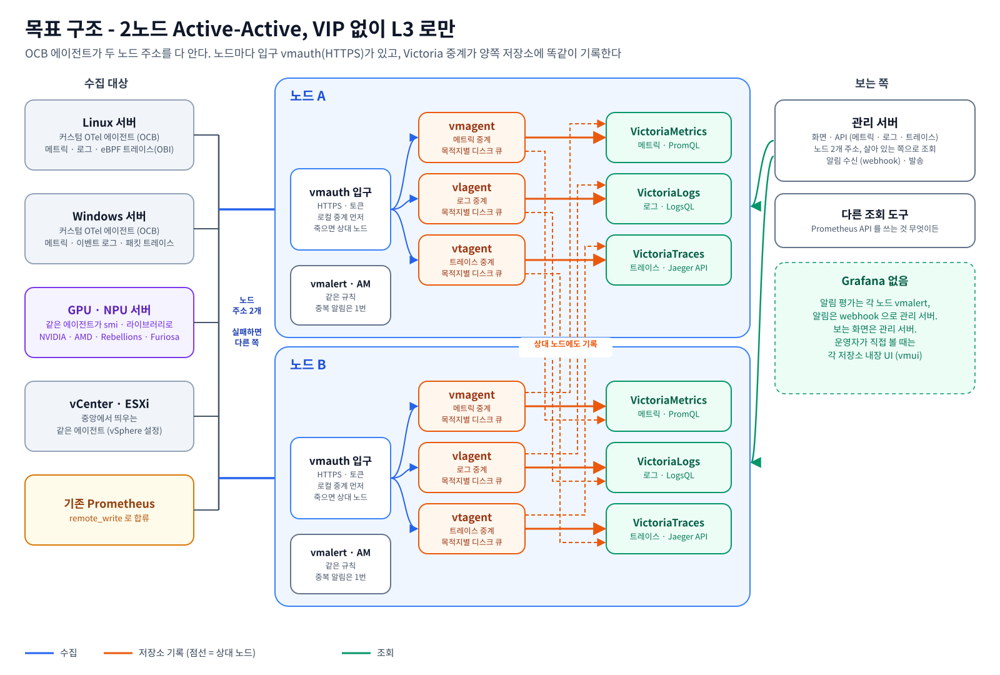

**노드 안 · 노드 사이 상세 흐름** (포트 · 경로 · 복제 방향, 5.1절에서 설명)

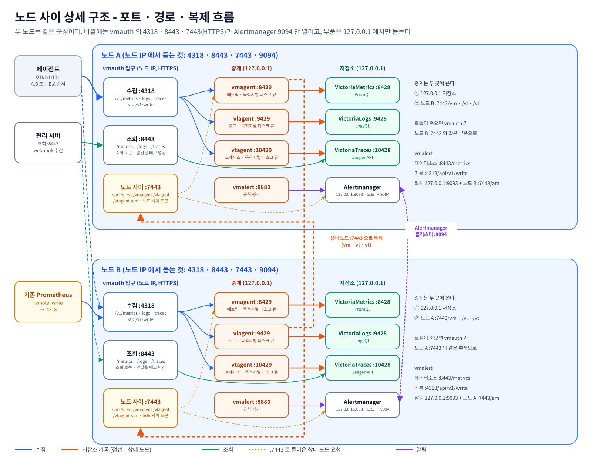

| 질문 | 답 |
|---|---|
| 무엇을 만드나 | 노드 2대가 똑같은 일을 하는 모니터링 백엔드. 메트릭은 VictoriaMetrics, 로그는 VictoriaLogs, 트레이스는 VictoriaTraces |
| 양쪽 저장소는 어떻게 같아지나 | 노드마다 있는 **Victoria 중계 에이전트(vmagent · vlagent · vtagent)가 양쪽 저장소에 똑같이 기록**한다. 한쪽이 죽으면 그쪽 몫을 디스크에 쌓았다가 돌아오면 보낸다 (4절) |
| 에이전트는 | **OCB 로 만든 커스텀 OpenTelemetry Collector** 하나. 공식 부품에 없는 기능(GPU · NPU 수집, 로그 원천 자동 선택, Windows 패킷 트레이스, vSphere, 노드 전환 출력)은 자체 부품으로 만든다 (3.5, 8절) |
| 중계를 OTel Collector 가 아니라 Victoria 에이전트로 하는 이유 | 기존 Prometheus(remote_write · scrape)와 Influx · Loki 형식 수집기를 받는 입구가 **Victoria 쪽에서는 기본 기능이고 OTel 쪽에서는 alpha** 다. 큐를 바이트 단위로 보고 남은 양으로 조회 복귀를 정하는 공식 HA 절차가 있다 (3.4) |
| VIP 는 | **쓰지 않는다.** VIP 는 같은 L2 대역 안에서만 넘어간다. 대신 **에이전트가 두 노드 주소를 다 알고, 실패하면 다른 쪽으로** 보낸다. 노드마다 입구 프록시(vmauth)가 있어 로컬 부품이 죽으면 상대 노드로 넘긴다 (3.3, 3.10) |
| 노드는 몇 대 | **2대.** 로드밸런서 전용 노드도, split-brain 판정 노드도 없다 (3.9) |
| 알림은 | **Victoria 계열.** 노드마다 vmalert, Alertmanager 두 대가 클러스터. Grafana 는 쓰지 않는다 (3.8) |
| Prometheus 와는 | 수집(remote_write 1.0 · OTLP), 조회(Prometheus HTTP API · PromQL), 규칙(Prometheus 형식), Alertmanager 가 그대로 맞는다. 관리 서버가 **두 저장소가 함께 지원하는 것만** 쓰면 메트릭 저장소를 Prometheus ↔ VictoriaMetrics 로 주소만 바꿔 오갈 수 있다 (9절) |
| AI 반도체는 | 에이전트 안의 수신기가 **벤더 도구를 직접 읽는다.** NVIDIA 는 nvidia-smi + NVML GPM, AMD 는 `amd-smi --json`, Rebellions 는 `rbln-smi -j`, Furiosa 는 순수 Go 라이브러리. **exporter 컨테이너 · podman · nvidia-container-toolkit 이 필요 없다** (3.6) |
| OS · SELinux | **CGO 를 끈 정적 바이너리 하나**(OCB 기본값). 컨테이너가 없어 SELinux 장치 라벨 문제가 없다. 라벨은 `semanage fcontext` 로 등록한다 (8.3) |

---

## 1. 목표와 요구사항

| # | 요구 | 이 설계에서 |
|---|---|---|
| R1 | 양쪽이 다 살아 있는 Active-Active | 노드 2대가 수집 · 중계 · 저장 · 조회 · 알림을 모두 한다 |
| R2 | 로드밸런싱으로 부하 분산 | 에이전트가 두 노드에 나눠 보내고, 관리 서버가 조회를 나눈다 |
| R3 | 양쪽 저장소가 항상 같은 내용 | 중계 에이전트의 이중 기록 + 목적지별 디스크 큐 |
| R4 | 프록시로 이중화, L2 에 묶이지 않기 | 노드마다 vmauth 입구. 진입 주소는 L3(라우팅)만 되면 된다 |
| R5 | AI 반도체(NVIDIA · AMD · NPU) 수집 | 에이전트 수신기가 벤더 CLI · 라이브러리를 직접 읽는다 |
| R6 | 저장소 · 중계 · 알림은 Victoria 계열, Prometheus · OTel 과 호환 | 14.1 호환표, 9절 |
| R7 | 메트릭 · 로그(journald · syslog · Windows 이벤트 로그) · 트레이스(eBPF · Windows) · vSphere | 에이전트 하나 + 중앙 vSphere 수집기 |
| R8 | OS 와 SELinux 에 상관없이 도는 에이전트 | 정적 바이너리 하나, 컨테이너 없음 |
| R9 | Grafana 없이 | 알림은 vmalert · Alertmanager, 화면은 관리 서버 |
| R10 | 나중에 Prometheus ↔ Victoria 를 오갈 수 있게 | 두 저장소의 공통 API 만 쓰는 조회 구조 (9.2) |

**처음 나오는 말**
- **L2 / L3**: L2 는 같은 네트워크 대역(같은 스위치 도메인) 안의 통신, L3 는 라우터를 거쳐 대역을 넘는 통신이다.
- **VRRP / VIP**: 두 서버가 가상 IP(VIP) 하나를 나눠 갖는 규약이다. keepalived 가 구현한다. VIP 가 넘어갈 때 GARP(같은 L2 안에 "이 IP 는 이제 내 MAC" 이라고 알리는 패킷)를 쓰므로 같은 L2 안에서만 동작한다.
- **OCB**(OpenTelemetry Collector Builder): OpenTelemetry Collector 에 필요한 부품만 골라 빌드하는 공식 도구. 포크가 아니라 부품 목록 파일로 만든다.
- **중계 에이전트**: 각 노드에서 데이터를 받아 양쪽 저장소에 나눠 쓰는 Victoria 쪽 프로그램(vmagent · vlagent · vtagent). 4절.
- **관리 서버**: 화면 · API 를 제공하고 알림 정책을 관리하는 애플리케이션. 이 문서에서는 저장소를 조회하고 알림 규칙을 내주는 쪽으로만 다룬다.

---

## 2. 전체 구조

| 층 | 무엇 | 어디서 |
|---|---|---|
| 수집 | OCB 에이전트 (서버마다 하나), OBI(eBPF 트레이스, 별도 프로세스), 중앙 vSphere 수집기 | 각 서버, 중앙 |
| 진입 | vmauth 하나가 입구 3개(수집 4318 · 조회 8443 · 노드 사이 7443)를 HTTPS 로 받음 | 노드 A · B 각각 |
| 중계 | vmagent · vlagent · vtagent | 노드 A · B 각각, 양쪽 저장소에 기록 |
| 저장 | VictoriaMetrics · VictoriaLogs · VictoriaTraces | 노드 A · B 각각, 같은 내용 |
| 알림 | vmalert, Alertmanager (클러스터) | 노드 A · B 각각 |
| 조회 · 관리 | 관리 서버 (Prometheus API · LogsQL · Jaeger API 로 조회) | 별도 |

---

## 3. 설계 결정 - 후보와 고른 이유

결정마다 **어떤 방법들이 있는지**, **무엇을 골랐는지**, **왜 골랐는지**, **무엇을 포기했는지**를 적는다.

### 3.1 양쪽 저장소를 같게 유지하는 방법

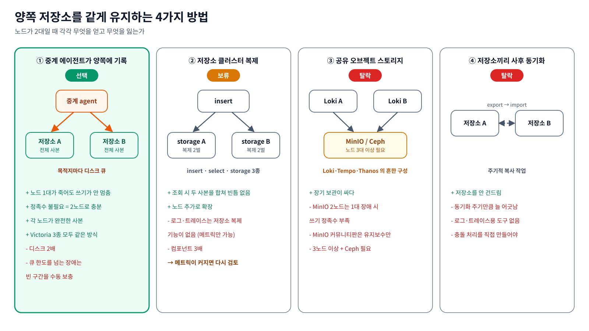

| 방법 | 어떻게 동작하나 | 얻는 것 | 잃는 것 |
|---|---|---|---|
| **① 중계 에이전트가 양쪽에 기록** (선택) | 중계 에이전트가 같은 데이터를 저장소 A · B 에 각각 보낸다. 목적지마다 디스크 큐가 따로 있어 한쪽이 죽으면 그쪽 몫만 쌓아 둔다 | 노드 1대가 죽어도 쓰기가 안 멈춘다. 정족수가 필요 없어 2노드로 충분하다. 각 노드가 완전한 사본이다 | 디스크 2배. 큐 한도를 넘는 장애는 빈 구간을 수동으로 보충해야 한다 |
| ② 저장소 클러스터의 복제 기능 | VictoriaMetrics 클러스터의 `replicationFactor=2` 처럼 저장소가 스스로 복제 | 조회 시 두 사본을 합쳐 빈틈이 없다. 노드 추가로 확장 | **로그 · 트레이스는 저장소 복제 기능이 없다.** VictoriaLogs 클러스터는 나눠 저장만 한다. 컴포넌트 수도 3배 |
| ③ 공유 오브젝트 스토리지 | Loki · Tempo · Thanos 가 같은 S3 버킷을 공유 | 장기 보관이 싸다 | 2노드 MinIO 는 노드 1대 장애에 쓰기가 멈춘다. 버티려면 3노드 이상 + Ceph 등이 필요하다 |
| ④ 저장소끼리 사후 동기화 | 주기적으로 export → import | 저장소를 안 건드린다 | 주기만큼 늘 어긋난다. 로그 · 트레이스용 도구가 없다 |

**고른 이유**
- 노드가 2대뿐이다. 정족수가 필요한 방식은 2대에서 1대가 죽으면 쓰기를 멈춘다. ①은 각 노드가 서로를 기다리지 않는다.
- **Victoria 쪽 공식 HA 권장안이 ①이다.** VictoriaLogs 문서는 독립된 인스턴스들에 사본을 보내는 것을 HA 로 적고, vlagent 로 복제 · 버퍼링한다. VictoriaTraces 문서도 "두 개 이상 인스턴스 + 여러 목적지로 보내기" 를 권한다.
- 메트릭 · 로그 · 트레이스가 **같은 방식**이라 운영 절차가 하나다.

**나중에 다시 볼 조건**: 메트릭이 한 노드 디스크에 안 들어갈 만큼 커지면 메트릭만 ②(VictoriaMetrics 클러스터)로 바꾼다. 중계 에이전트의 목적지 주소만 바꾸면 된다.

### 3.2 저장소 제품

| 후보 | 메트릭 | 로그 | 트레이스 | 판단 |
|---|---|---|---|---|
| **Victoria 계열** (선택) | VictoriaMetrics | VictoriaLogs | VictoriaTraces | 세 신호 모두 **같은 모양의 중계 에이전트(복제 + 디스크 큐)**가 공식으로 있다. 단일 바이너리, Apache-2.0 |
| InfluxDB v1 + Loki + Tempo | InfluxDB | Loki | Tempo | InfluxDB v1 OSS 는 클러스터가 없고 v3 HA 는 Enterprise 다 |
| Prometheus + Thanos | Prometheus/Thanos | Loki | Tempo | 메트릭 컴포넌트만 6종이고 오브젝트 스토리지가 필요하다 |
| Grafana LGTM | Mimir | Loki | Tempo | 셋 다 오브젝트 스토리지 + 정족수 링이 기본이라 2노드에 맞지 않다 |

**고른 이유**
- 복제를 저장소 밖(중계 에이전트)에서 한다는 3.1 의 결정을 세 신호 모두에 같은 도구로 적용할 수 있는 것이 Victoria 계열뿐이다.
- **Prometheus · OTel 호환**(R6): 메트릭은 Prometheus 의 수집 · 조회 · 규칙 형식을, 세 신호 모두 OTLP 를 받는다 (14.1).
- 라이선스와 관리 상태 (2026-10-31 GitHub 조회):

| 저장소 | 라이선스 | 최신 릴리스 | 비고 |
|---|---|---|---|
| VictoriaMetrics | Apache-2.0 | v1.155.0 (2026-10-26) | 별 17,976 |
| VictoriaLogs | Apache-2.0 | v1.53.0 (2026-10-01) | 별 2,436 |
| VictoriaTraces | Apache-2.0 | v0.12.1 (2026-10-23) | **0.x 버전**. README 에 "작업 중, 저장 형식과 API 가 바뀔 수 있다" 고 적혀 있다 |

**포기한 것**: 조회 언어가 셋으로 나뉜다. 메트릭은 PromQL(+MetricsQL), 로그는 LogsQL, 트레이스는 Jaeger API 다.

### 3.3 진입점 이중화 - L2 VIP 대신 L3

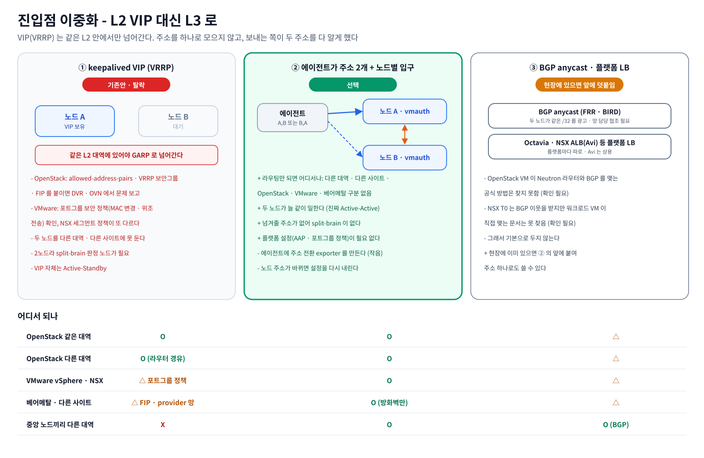

**질문**: keepalived VIP 는 VRRP 라 L2 에서만 동작한다. OpenStack 은 라우터 · 포트 설정을, VMware 는 포트그룹 정책을 따로 봐야 한다. HAProxy 같은 프록시로 L3 까지 고려한 이중화가 되나?

**답: 된다.** 주소를 하나(VIP)로 모으는 것을 그만두고, **보내는 쪽이 두 노드 주소를 다 알게** 했다. 그러면 라우팅만 되는 어디서나 같은 방식으로 동작한다.

| 후보 | 어떻게 | 얻는 것 | 잃는 것 | 판단 |
|---|---|---|---|---|
| ① keepalived VIP (VRRP) | VIP 를 한 노드가 갖고, 그 노드의 프록시가 양쪽에 나눈다 | 클라이언트는 주소 하나만 안다 | 두 노드가 같은 L2 여야 한다. OpenStack 은 allowed-address-pairs · VRRP 보안그룹, Floating IP 를 붙이면 DVR · OVN 에서 문제 보고가 있다. VMware 는 포트그룹 보안 정책을, NSX 는 세그먼트 정책을 따로 본다. 2노드 split-brain 판정 노드가 필요하다. VIP 자체는 Active-Standby 다 | 탈락 |
| **② 보내는 쪽이 주소 2개 + 노드마다 입구 프록시** (선택) | 에이전트 출력에 노드 A · B 주소를 둘 다 넣는다. 보내다 실패하면 다른 주소로 보낸다. 각 노드의 입구 프록시(vmauth)는 로컬 중계를 먼저 쓰고, 로컬이 죽었으면 상대 노드 중계로 보낸다 | 라우팅만 되면 다른 대역 · 다른 사이트 · OpenStack · VMware · 베어메탈 구분 없이 같다. 두 노드가 늘 같이 일한다. 넘겨줄 주소가 없어 split-brain 이 없다. 플랫폼 설정이 필요 없다 | 에이전트가 주소를 2개 알아야 한다. 에이전트에 주소 전환 exporter 를 만든다 (8.1). 노드 주소가 바뀌면 설정을 다시 내린다 | **선택** |
| ③ DNS 이름 하나에 IP 2개 | 에이전트가 이름으로 보낸다 | 설정이 짧다 | 현장마다 DNS 를 우리가 관리한다는 보장이 없다. 일반 DNS 는 죽은 노드를 빼지 않는다 | 보조. 사람이 쓰는 이름에만 |
| ④ BGP anycast (FRR · BIRD) | 두 노드가 같은 /32 주소를 라우터에 광고한다 | 주소 하나로 L3 이중화 | 망 담당과 라우터 협조가 필요하다. OpenStack VM 이 Neutron 라우터와 BGP 를 맺는 공식 방법은 찾지 못했다(neutron-dynamic-routing 은 바깥 라우터로 광고만 한다). NSX T0 는 BGP 이웃을 받지만 워크로드 VM 이 직접 맺는 문서는 찾지 못했다 | 현장에 있으면 ② 앞에 덧붙임 |
| ⑤ 플랫폼 로드밸런서 (Octavia, NSX ALB) | 플랫폼이 VIP 와 헬스 체크를 관리 | 우리가 VRRP 를 운영하지 않는다 | 플랫폼마다 설정이 다르다. Octavia OVN 프로바이더는 TCP · UDP 만, NSX 기본 LB 는 Avi(NSX ALB, 상용)로 넘어가는 중이다 | 현장에 있으면 ② 앞에 덧붙임 |

**고른 이유**
- 요구는 "L2 에 묶이지 않는 완벽한 이중화" 다. ②는 **에이전트와 노드 사이에 IP 라우팅만** 요구한다.
- **진짜 Active-Active 다.** VIP 방식은 VIP 를 가진 노드의 프록시 하나가 모든 진입을 받는다. ②는 에이전트가 처음부터 두 노드에 나눠 보낸다.
- **에이전트를 우리가 빌드하므로** 주소 전환을 에이전트에 넣는 비용이 작다 (8.1 `cmpotlp`).
- ④ · ⑤는 현장 망 · 플랫폼에 기대므로 기본으로 두지 않는다. 현장에 이미 있으면 ② 앞에 붙여 주소 하나로도 쓸 수 있다.

**알고 써야 할 점**
- **노드 간 단절 시**(6절 ③) 두 노드가 각자 받으므로 잠시 내용이 다르다. 복구되면 큐가 비며 같아진다. 조회는 단절 동안 한 노드에 고정한다.
- **방화벽**: 에이전트가 있는 대역에서 두 노드의 수집 포트(4318) 하나만 열려 있으면 된다 (5절).
- **OpenStack 밖에서 들어올 때**: 노드마다 Floating IP 를 따로 붙이면 된다. VIP 포트에 Floating IP 를 붙이는 방식에서 나던 DVR · OVN 문제는 생기지 않는다.

### 3.4 중계 - OTel Collector 가 아니라 Victoria 에이전트

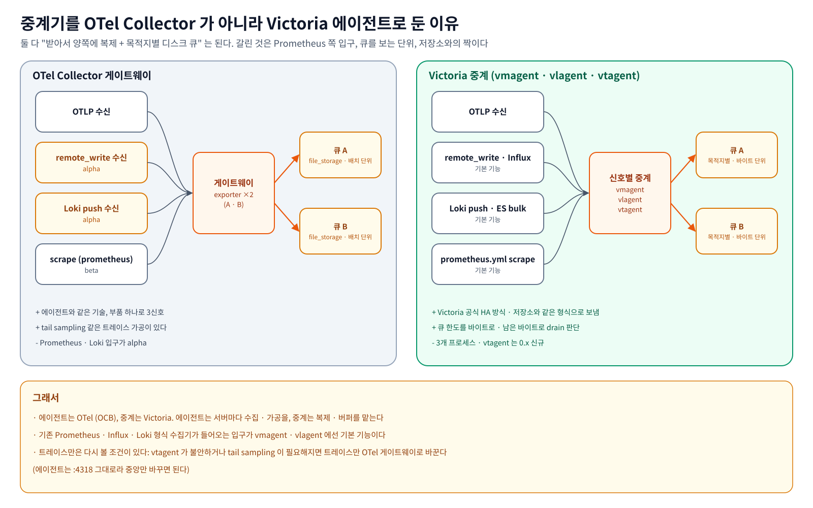

에이전트가 OTel 이니 중계도 OTel Collector 게이트웨이(중앙에 둔 Collector 가 exporter 2개로 양쪽에 보내는 구성)로 하는 길이 있다. **이 길도 된다.** OTel Collector 도 exporter 마다 `file_storage` 큐를 붙이면 재시작해도 남는 목적지별 큐가 생긴다. 그래도 Victoria 에이전트를 고른 이유는 아래다.

| 비교 | OTel Collector 게이트웨이 | Victoria 중계 (선택) |
|---|---|---|
| 기존 Prometheus 의 remote_write 받기 | `prometheusremotewrite` 수신기, **alpha** | vmagent 기본 기능 |
| prometheus.yml scrape 설정 그대로 | `prometheus` 수신기 (beta, 일부 설정 차이) | vmagent 가 `-promscrape.config` 로 그대로 읽음 |
| Influx · Loki 형식 수집기 받기 | Influx 수신기, `loki` 수신기 **alpha** | vmagent · vlagent 기본 기능 |
| 큐를 보는 단위 | 배치 개수(`queue_size` 기본 1000 배치). 가득 차면 버림 | 목적지별 **바이트**(`-remoteWrite.maxDiskUsagePerURL`). 넘으면 오래된 것부터 버림 |
| 복구 노드를 조회에 다시 넣는 판단 | 큐 크기 지표를 따로 해석 | 미전송 바이트 지표가 0 이 되면 복귀 (공식 절차) |
| 저장소로 보내는 형식 | OTLP (저장소가 다시 변환) | Victoria 내부 형식(`/insert/native`) · remote_write |
| 공식 HA 문서 | Victoria 문서에 없음 | VictoriaLogs · VictoriaTraces HA 문서가 이 구성을 적는다 |
| 메트릭 가공 | processor 가 풍부 | relabel, stream aggregation(미리 합쳐 줄이기) |
| 트레이스 가공 | **tail sampling**(끝난 트레이스를 보고 남길지 정하기)이 있다 | vtagent 에 없음 (예정) |
| 성숙도 | Collector 본체는 안정 | vmagent 오래됨, vlagent 표기 없음, **vtagent 는 2026-08 신규 0.x** |
| 프로세스 수 | 1개로 3신호 | 신호마다 1개, 3개 |

**정리하면**
- 에이전트(서버마다): 수집과 가공 → **OTel(OCB)**. 서버에서 무엇을 어떻게 읽는지가 중요한 자리다.
- 중계(중앙 2곳): 복제와 버퍼, 그리고 Prometheus 생태계의 입구 → **Victoria**. 저장소와 같은 방식이라 큐 · 복구 · 중복 제거 절차가 문서로 맞물린다.
- **다시 볼 조건 (트레이스만)**: vtagent 가 PoC 에서 불안하거나 tail sampling 이 필요해지면 트레이스만 OTel 게이트웨이로 바꾼다. 에이전트는 `:4318` 그대로라 중앙 vmauth 의 `/v1/traces` 행선지만 바꾸면 된다.

### 3.5 각 서버에 깔 에이전트 - OCB 커스텀 OTel Collector

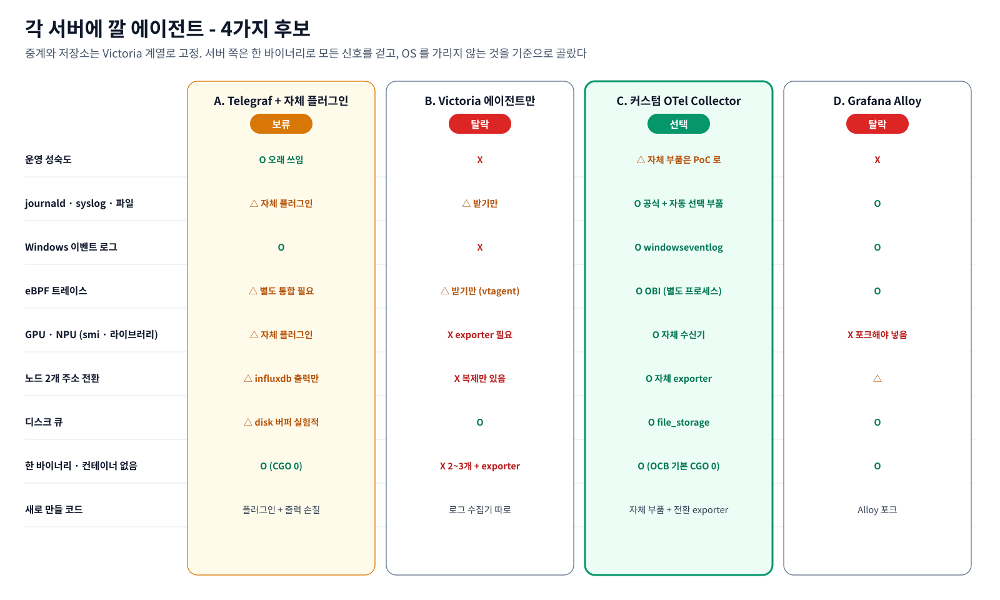

| 후보 | 판단 |
|---|---|
| A. Telegraf + 자체 플러그인 | 보류. 플러그인 생태계가 넓고 정적 바이너리다. 다만 로그를 메트릭 모양(필드 · 태그)으로 다루고, 트레이스는 기본 파이프라인 밖이며, 디스크 버퍼가 실험적 기능이다. 출력마다 노드 전환을 따로 손봐야 한다 |
| B. Victoria 에이전트만 | 탈락. vmagent 는 메트릭만, vlagent 는 받기 위주다. journald · Windows 이벤트 로그를 직접 읽지 못해 수집기가 따로 필요하고, 호스트 메트릭은 exporter 를 따로 깔아야 한다 |
| **C. 커스텀 OTel Collector (OCB)** | **선택.** 공식 부품으로 되는 것은 공식 부품으로, 없는 기능은 자체 부품으로 만든다 (8.1) |
| D. Grafana Alloy | 탈락. 자체 부품을 넣으려면 Alloy 를 포크해야 한다 |

**고른 이유**
- **세 신호가 한 체계다.** 로그 · 트레이스가 1급 자료형이고, 같은 파이프라인 · 큐 · 재시도를 쓴다.
- **디스크 큐가 성숙하다.** `file_storage` 로 재시작해도 남는 큐를 쓴다.
- **eBPF 권한을 분리할 수 있다.** OBI(OpenTelemetry eBPF Instrumentation, Beyla 를 기증한 것)를 별도 프로세스로 띄워 높은 권한을 그쪽에만 준다.
- **포크가 아니다.** 부품 목록 파일 + 자체 부품 저장소만 유지하므로 업스트림을 따라가기 쉽다.
- **원격 관리 규약(OpAMP)** 이 있어 나중에 배포 도구 없이 설정을 내릴 길이 있다.

**치르는 것**: 자체 부품을 만들고 검증해야 한다(8.1). 호스트 메트릭은 OTel 표준 이름을 쓴다(8.2).

### 3.6 AI 반도체 수집 - exporter 컨테이너 없이

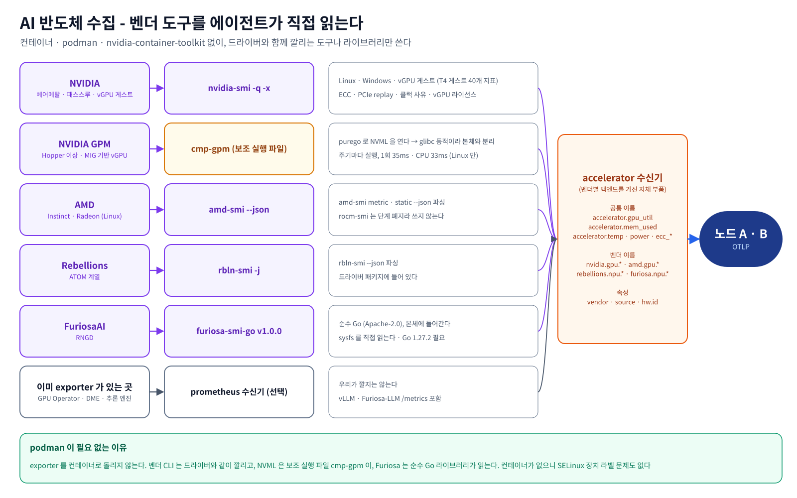

**질문 1**: 여러 관점에서 보면 dcgm-exporter 보다 nvidia-smi · GPM 을 직접 걷는 것이 낫지 않나?

**답: 고객 서버 · 하이퍼바이저에 에이전트를 까는 제품이라면 그렇다.** "설치 범위" 와 "어디서나 도는가" 가 지표 깊이보다 무겁다.

| 관점 | dcgm-exporter | nvidia-smi + NVML GPM (자체 수신기) |
|---|---|---|
| 서버에 더 까는 것 | 컨테이너 런타임 + nvidia-container-toolkit(최소 `-base`), 또는 DCGM 패키지(추천 패키지를 따라 openmpi · CUDA 라이브러리까지 끌어온다) | **없음.** nvidia-smi 와 libnvidia-ml 은 드라이버에 들어 있다 |
| 런타임 영향 | toolkit 이 컨테이너 런타임 설정을 바꾼다. `--gpus` 방식은 docker 재시작이 필요하다 | 없음 |
| vGPU | NVIDIA 문서상 호스트 · 게스트 모두 미지원 | 게스트는 nvidia-smi 일부 지표, 하이퍼바이저는 NVML GPM 으로 MIG 기반 vGPU 사용률 |
| MIG | 지원 | GPM 으로 MIG 인스턴스별 (Hopper 이상). nvidia-smi 의 사용률 조회는 MIG 에서 미지원 |
| Windows | 문서에 apt · dnf 설치만 있다 (확인 필요) | nvidia-smi 지원. GPM 은 Windows 미지원 |
| OS · SELinux | 컨테이너가 `/dev/nvidia*` 를 열려면 SELinux 에서 `label=disable` 이나 `nvidia-container-selinux` 가 필요하다 | 정적 바이너리가 실행만 한다 |
| 지표 깊이 | 프로파일 지표(`DCGM_FI_PROF_*`, Volta 이상), NVLink, 행 재매핑, 프로세스별 | nvidia-smi 로 사용률 · 메모리 · 온도 · 전력 · ECC · PCIe replay · 클럭 사유 · vGPU 라이선스. **GPM 은 Hopper 이상만**이라 Ampere(A100) 이하에서는 프로파일 지표(텐서 · DRAM 실가동률)를 잃는다 |
| 유지보수 | NVIDIA 가 유지. DCGM ↔ exporter 버전 짝 관리 | 우리 코드. nvidia-smi XML 스키마 버전 대응이 필요하다 |

**결정**: **nvidia-smi + GPM 을 기본**으로 한다. GPU Operator 처럼 dcgm-exporter 가 **이미 깔린 곳**만 `prometheus` 수신기로 긁는다. 우리가 깔지는 않는다.

**질문 2**: AMD · NPU exporter 를 쓰려면 똑같이 컨테이너 런타임(podman 등)이 필요하지 않나?

**답: exporter 를 쓰면 그렇다. 그래서 exporter 를 쓰지 않는다.**

| 벤더 | 벤더 exporter 배포 방식 | 컨테이너 없이 쓸 길 | 고른 것 |
|---|---|---|---|
| AMD | Device Metrics Exporter: 컨테이너 · Helm, 또는 **Ubuntu 22.04/24.04 전용 deb**(`amdgpu-exporter`, `gpuagent` 서비스 동반). rpm 은 문서에 없다 | `amd-smi metric --json` (사용률 · 메모리 · 전력 · 온도 · ECC · XGMI 등) | accelerator 수신기의 **AMD 백엔드** (JSON 파서) |
| Rebellions | rbln-metrics-exporter: Helm · docker, 사전 빌드 바이너리 없음, `rbln-smd` 데몬에 기댐, **사용권이 Apache 아님** | `rbln-smi -j` (드라이버 패키지에 포함) | **Rebellions 백엔드** |
| FuriosaAI | furiosa-metrics-exporter: Helm · apt (Ubuntu 22.04+ · 커널 6.3+) | `furiosa-smi-go`: README 상 순수 Go(CGO 없음), sysfs 를 직접 읽음, Apache-2.0 | **Furiosa 백엔드** (라이브러리를 바이너리에 넣음) |

- rocm-smi 는 AMD 가 단계 폐지하고 amd-smi 로 옮기라고 하므로 쓰지 않는다.
- **이름 맞추기**: 수신기가 공통 이름(`gpu_util`, `mem_used`, `temp`, `power`, `ecc_*`)과 `vendor`, `source` 속성을 붙인다. 벤더 원래 이름도 남긴다. NVIDIA ↔ AMD 대응표는 14.3.
- **추론 엔진**(vLLM · Furiosa-LLM `/metrics`)은 원래 HTTP 로 열려 있으니 `prometheus` 수신기로 긁는다.

### 3.7 조회를 어디로 보내나

| 후보 | 판단 |
|---|---|
| **관리 서버가 두 노드 주소를 알고 나눠 조회 + 노드마다 vmauth 입구 (선택)** | 수집과 같은 원칙이다. 조회 입구는 노드마다 `:8443` 하나다. 조회하는 쪽이 관리 서버 · vmalert 정도라 주소 2개를 아는 것이 어렵지 않다. vmauth 는 Victoria 문서가 조회 경로 앞단에 권하는 부품이다 |
| 공용 로드밸런서 하나 | 그것이 또 하나의 단일 장애점이 되고, 이중화하려면 다시 VIP 가 필요하다 |

**지켜야 할 규칙**: **복구된 노드는 큐를 다 받을 때까지 조회에서 빼야 한다.** Victoria 문서도 "버퍼가 다 전송된 뒤에 조회를 받게 한다" 고 적는다. vmauth 는 백엔드를 주기적으로 검사하지 않고 실패한 요청으로만 장애를 알아채므로(3.10), 이 판단은 관리 서버가 한다: 상대 노드 중계의 미전송 바이트 지표(`vmagent_remotewrite_pending_data_bytes` 등)가 0 이 될 때까지 복구된 노드에는 조회를 보내지 않는다. **아직 구현하지 않았다** (PoC 에서 정한다).

### 3.8 알림 - Victoria 계열로

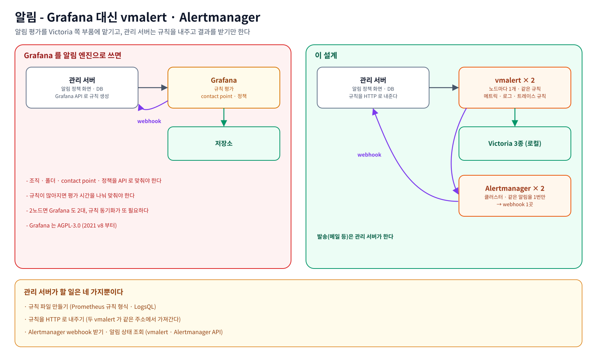

**Grafana 를 쓰지 않는 이유**
- 알림을 Grafana 로 평가하면 관리 서버가 조직 · 폴더 · contact point · 정책 · 규칙을 Grafana API 로 맞춰야 하고, 2노드면 Grafana 도 2대라 규칙 동기화가 또 필요하다.
- 3축(메트릭 · 로그 · 트레이스) 화면은 관리 서버가 그린다. 저장소마다 내장 UI 도 있다: 메트릭은 vmui(`:8428/vmui`), 로그는 VictoriaLogs UI(`:9428/select/vmui`), 트레이스는 VTUI(`:10428/select/vmui`, v0.12.0 부터). **셋을 한 화면에 묶은 공식 UI 는 찾지 못했다.** 운영자가 직접 들여다볼 때는 내장 UI 로 충분하다.
- Grafana 는 AGPL-3.0(v8.0.0 부터)이다.

**구성**

| 부품 | 어디서 | 하는 일 |
|---|---|---|
| vmalert | 노드 A · B 각각, 같은 규칙 | 메트릭 규칙(PromQL), 로그 · 트레이스 규칙(`type: vlogs`, VictoriaTraces 는 v1.106.0 부터)을 평가한다. 기록 규칙 결과는 `-remoteWrite.url` 로 다시 쓴다 |
| Alertmanager | 노드 A · B, 클러스터(`--cluster.peer`) | 두 vmalert 가 같은 알림을 보내도 라벨이 같으면 하나로 줄인다 |
| 관리 서버 | 별도 | 알림 정책을 관리하고 규칙 파일을 HTTP 로 내준다. Alertmanager webhook 을 받아 발송한다 |

- **공식 HA 방식 그대로다.** vmalert 문서: 같은 설정의 vmalert 를 여러 대 두고, `-notifier.url` 로 **모든** Alertmanager 를 가리킨다. VictoriaMetrics 쪽은 `-dedup.minScrapeInterval` 을 평가 주기와 같게 둔다. Alertmanager 문서: Alertmanager 앞에 로드밸런서를 두지 말고 목록으로 다 가리킨다.
- **규칙을 HTTP 로 내준다.** vmalert 의 `-rule` 은 HTTP 주소를 받는다. 관리 서버가 규칙을 HTTP 로 내주면 두 vmalert 가 같은 것을 가져가므로 파일 배포가 필요 없다.
- **상태 복구**: vmalert 는 시작할 때 `-remoteRead.url` 로 `ALERTS_FOR_STATE` 를 읽어 대기 중이던 알림 상태를 되살린다. `-remoteWrite.url` 과 같이 줘야 한다.
- **Prometheus 규칙 형식과 맞는다.** 다만 `eval_delay`, `concurrency`, `limit` 같은 vmalert 전용 필드와 MetricsQL 확장 함수를 쓰면 Prometheus 에서 그대로 안 돈다. 9.2 의 "오갈 수 있게" 를 지키려면 규칙에서 이것들을 쓰지 않는다.
- **라이선스**: vmalert Apache-2.0, Alertmanager Apache-2.0.

**확인 필요**: 한 vmalert 가 메트릭 규칙과 로그 규칙을 함께 평가하려면 데이터소스를 경로로 나눠야 한다. 로컬 vmauth 가 경로(`/metrics/...` → VictoriaMetrics, `/metrics/select/logsql/...` → VictoriaLogs)로 나눠 주는 것으로 잡았다. PoC 에서 본다.

### 3.9 노드는 몇 대인가

**2대다.** 저장소 2대에 로드밸런서 전용 노드 1대를 더하는 구조가 아니다.

| 역할 | 어디서 |
|---|---|
| 입구 (vmauth) | 노드 A · B 각각. 로컬 부품을 먼저 쓰고, 죽었으면 상대 노드로 넘긴다 |
| 중계 (vmagent · vlagent · vtagent) | 노드 A · B 각각. 각자 양쪽 저장소에 기록 |
| 저장 (Victoria 3종) | 노드 A · B 각각. 같은 내용 |
| 알림 (vmalert · Alertmanager) | 노드 A · B 각각. Alertmanager 둘이 클러스터 |
| split-brain 판정 | **필요 없다.** 넘겨줄 VIP 가 없다 |

로드밸런서를 따로 두면 그것이 또 하나의 단일 장애점이 되고, 그것을 이중화하려면 다시 VIP 가 필요해진다. 그래서 입구 프록시(vmauth)를 각 노드에 두고 에이전트가 두 노드를 다 알게 했다.

### 3.10 입구 프록시 - HAProxy 대신 vmauth

각 노드의 입구(수집 · 조회 · 노드 사이)를 맡는 프록시로 HAProxy 와 vmauth 를 비교했다. PoC 에서 처음에는 HAProxy 로 구성했다가 vmauth 로 바꿨다.

| 비교 | HAProxy (배포판 RPM) | **vmauth (선택)** |
|---|---|---|
| 배포 | 배포판마다 다른 패키지, 동적 링크 | **정적 Go 바이너리.** 이미 쓰는 vmutils 안에 있다. 설치 폴더 아래에 그대로 둔다 |
| SELinux | `haproxy_t` 에 갇힌다. **PoC(Rocky 10.2)에서 `haproxy_connect_any` 없이는 4318 · 7443 을 열지 못하고 시작에 실패했다.** 이 거부는 AVC 로도 남지 않았다 | 다른 Victoria 부품처럼 `unconfined_service_t` 로 돈다. 불리언이 필요 없다 (PoC 에서 AVC 0건) |
| 경로로 나누기 · 앞말 떼기 | 된다 | 된다 (`src_paths`, `drop_src_path_prefix_parts`) |
| 로컬 먼저, 죽으면 상대 노드 | 된다 (`backup`, `nbsrv`) | 된다 (`load_balancing_policy: first_available`) |
| 상태 검사 | 주기적으로 검사한다 | **실패한 요청으로만 알아챈다** (`-failTimeout`). 첫 실패 요청은 다음 백엔드로 다시 보낸다 (`retry_status_codes`) |
| HTTPS | 된다 | 된다 (`-tls`, PoC 에서 확인) |
| 출발지 IP 제한 | 된다 | **Enterprise 전용**(`ip_filters`). 그래서 경로를 토큰으로 막는다 (5.4) |
| 유지 | 배포판이 패치 | Victoria 릴리스와 같이 올린다. Apache-2.0 |

**고른 이유**: 설치 폴더 하나에 정적 바이너리만 두는 원칙(8.3)과 맞고, SELinux 를 따로 풀 필요가 없다. 출발지 제한이 없는 것은 토큰과 OS 방화벽으로 메운다.

---

## 4. Victoria 중계 에이전트는 어떻게 동작하나

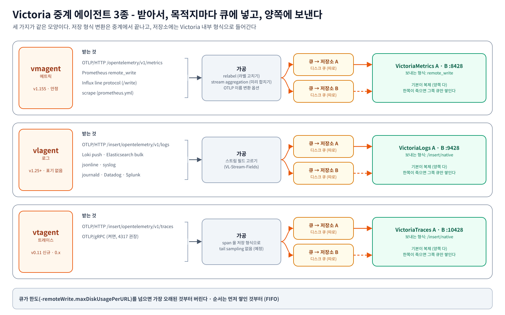

세 가지가 같은 모양이다. **받아서 → (가공) → 목적지마다 디스크 큐에 넣고 → 양쪽 저장소에 보낸다.** 형식 변환은 중계에서 끝나고 저장소에는 Victoria 내부 형식으로 들어간다.

| 항목 | vmagent | vlagent | vtagent |
|---|---|---|---|
| 신호 | 메트릭 | 로그 | 트레이스 |
| 받는 것 | OTLP/HTTP(`/opentelemetry/v1/metrics`), Prometheus remote_write, Influx line protocol(`/write`), Graphite · Datadog 등, Prometheus 형식 scrape | VictoriaLogs 가 받는 것 전부: OTLP/HTTP(`/insert/opentelemetry/v1/logs`), Loki push, Elasticsearch bulk, jsonline, syslog, journald, Datadog, Splunk | OTLP/HTTP(`/insert/opentelemetry/v1/traces`, :10429), OTLP/gRPC(`-otlpGRPCListenAddr` 를 주면) |
| 가공 | relabel(라벨 고치기 · 지우기), stream aggregation, OTLP 이름 변환 옵션 | 스트림 필드 고르기 | span 을 저장 형식으로 |
| 보내는 형식 | remote_write | `/insert/native` | `/insert/native` |
| 여러 목적지 | `-remoteWrite.url` 을 여러 번 주면 **기본이 복제**. `-remoteWrite.shardByURL` 을 켜면 나눠 보낸다(이 설계는 안 씀) | 복제. 목적지마다 버퍼 | 복제. 목적지마다 디스크 버퍼 |
| 디스크 큐 | 목적지마다 `-remoteWrite.tmpDataPath` 아래. 먼저 쌓인 것부터 보낸다 | 같음 | 같음 |
| 큐 한도 | `-remoteWrite.maxDiskUsagePerURL` 을 넘으면 버린다 | 넘으면 가장 오래된 로그부터 버린다 | 가장 오래된 span 부터 버린다 |
| 처음 나온 때 · 성숙도 | 오래된 부품, v1.155 | v1.25.0(2025-07) 배포본부터 들어 있음. 안정 · 실험 표기는 문서에 없다 | **v0.11.0(2026-08-14) 에 "basic vtagent" 로 처음 나옴.** OTLP 출력 · tail sampling 은 "곧" 으로 적혀 있다 |
| 라이선스 | Apache-2.0 | Apache-2.0 | Apache-2.0 |

**OpenTelemetry 와는 어떻게 맞물리나**

| 무엇 | 동작 |
|---|---|
| 들어오는 OTLP | 세 중계 모두 OTLP/HTTP 를 받는다. **gRPC 는 vtagent 만** 문서로 확인했다. 그래서 에이전트는 OTLP/HTTP 로 보낸다 |
| 메트릭 이름 | 기본은 OTel 이름(점 포함) 그대로다. `-opentelemetry.usePrometheusNaming` 을 주면 `process.cpu.time` → `process_cpu_time_seconds_total` 처럼 바꾼다. 이 설계는 켠다 (9.2 에서 Prometheus 와 이름을 맞추기 위해) |
| resource 속성 | 메트릭은 기본으로 전부 라벨이 된다. `-opentelemetry.promoteResourceAttributes` 등으로 고른다. 로그는 전부 스트림 필드가 되고 `VL-Stream-Fields` 헤더로 바꾼다. 트레이스는 확인 필요 |
| delta 지표 | VictoriaMetrics v1.132.0 부터 그대로 저장한다. 문서는 누적값으로 바꿔 보내라고 권한다. 에이전트에서 `deltatocumulative` 로 바꾼다 |

**알고 써야 할 점**
- 한 목적지가 오래 죽어 있을 때 다른 목적지로 보내는 것이 막히지 않는지는 문서에 분명히 적혀 있지 않다. PoC 시험 ②에서 본다.
- vmagent 는 디스크 큐를 끄면(`-remoteWrite.disableOnDiskQueue`) 과부하 때 버리거나 429 를 돌려준다. 이 설계는 디스크 큐를 켠다.

### 4.3 "동기화" 의 정확한 뜻

중계는 양쪽 저장소를 **쓸 때 복제**한다. 두 저장소를 비교해서 다른 부분을 맞추는 일은 하지 않는다.

| 하는 것 | 하지 않는 것 |
|---|---|
| 받은 데이터를 목적지마다 따로 보낸다 (로컬 저장소, 상대 노드) | 두 저장소의 내용을 비교하기 |
| 보내지 못한 몫은 목적지별 디스크 큐에 쌓았다가 다시 보낸다 | 큐 한도를 넘어 버려진 구간을 나중에 채우기 |
| 큐가 0 이면 그 시점까지는 양쪽이 같다고 볼 수 있다 | 중계를 거치지 않고 한쪽 저장소에만 들어간 데이터를 옮기기 |

그래서 **모든 쓰기는 중계를 거쳐야 한다.** 저장소에 직접 쓰면 그 노드에만 남는다. 이 설계에서 저장소가 `127.0.0.1` 에서만 듣는 것도 이 때문이다.

### 4.4 중계 에이전트만으로 서버 에이전트가 될 수 있나

**부분적으로만 된다.** vmagent · vlagent · vtagent 는 원래 서버에 까는 에이전트로도 쓰이고, Windows 빌드도 있다(vmutils · vlutils · vtutils 의 windows-amd64 배포본). 다만 각자 **받는 일** 이 중심이고, 서버에서 직접 **걷는 일** 은 일부만 한다.

| 무엇을 걷나 | Victoria 에이전트만으로 | 빈 곳 |
|---|---|---|
| 호스트 메트릭 (CPU · 메모리 · 디스크) | vmagent 는 직접 걷지 않는다. node_exporter · windows_exporter 를 따로 깔고 vmagent 가 긁는다 | 서버마다 exporter 하나 더 |
| GPU · NPU | 벤더 exporter 가 있어야 긁는다 | exporter 컨테이너 문제가 그대로 돌아온다 (3.6) |
| 로그 파일 | vlagent 가 직접 읽는다 (`-fileCollector.glob`) | |
| journald | vlagent 는 journald 를 **받는다** (systemd-journal-upload 가 보내는 것). 직접 읽지는 않는다 | 서버마다 journal-upload 설정 |
| syslog | vlagent 가 syslog 를 받는다 | |
| Windows 이벤트 로그 | 지원하지 않는다 (vlagent 도움말에 이벤트 로그 옵션 없음) | **수집기가 따로 필요** |
| 트레이스 | vtagent 는 OTLP 를 받기만 한다. eBPF · 앱 계측은 하지 않는다 | OBI 나 SDK 가 따로 필요 |
| 노드 2개 전환 | 목적지 여러 개는 **복제**다. 한쪽이 실패하면 다른 쪽으로 보내는 전환이 아니다 | 서버마다 양쪽 노드에 다 보내면 서버 쪽 트래픽이 2배 |

**그래서 서버 에이전트는 OTel(OCB) 로 했다** (3.5 후보 B). Victoria 에이전트만 쓰면 서버마다 node_exporter + vmagent + vlagent + (OBI) 를 깔아야 하고, Windows 이벤트 로그는 여전히 다른 수집기가 필요하다. 중계 자리에서는 복제와 디스크 큐가 바로 필요한 기능이라 Victoria 에이전트가 맞다 (3.4).

---

## 5. 입구와 포트

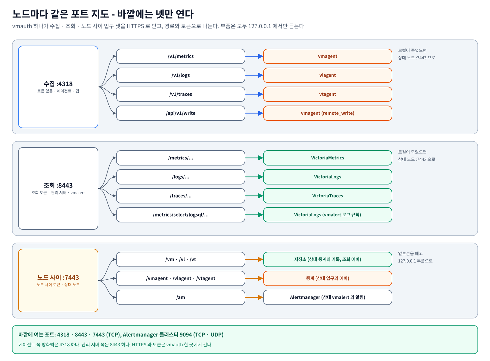

**vmauth 하나가 바깥 포트 셋을 HTTPS 로 받는다.** 나머지 부품은 모두 `127.0.0.1` 에서만 듣는다. 두 노드의 설정이 같고, 다른 것은 자기 주소와 상대 주소뿐이다.

| 바깥 포트 | 누가 쓰나 | 경로 → 부품 | 필요한 토큰 | 방화벽에서 열 출발지 |
|---|---|---|---|---|
| **4318** 수집 | 에이전트 · 앱 · 기존 Prometheus | `/v1/metrics` → vmagent, `/v1/logs` → vlagent, `/v1/traces` → vtagent, `/api/v1/write` → vmagent | 없음 | 에이전트가 있는 대역 |
| **8443** 조회 | 관리 서버 · vmalert | `/metrics/...` → VictoriaMetrics, `/logs/...` → VictoriaLogs, `/traces/...` → VictoriaTraces (앞말을 떼고 넘긴다) | 조회 토큰 | 관리 서버 |
| **7443** 노드 사이 | 상대 노드만 | `/vm` · `/vl` · `/vt` → 저장소, `/vmagent` · `/vlagent` · `/vtagent` → 중계, `/am` → Alertmanager | 노드 사이 토큰 | 상대 노드 |
| **9094** (TCP · UDP) | 상대 Alertmanager | Alertmanager 클러스터 상태 맞추기. UDP 라 vmauth 로 묶지 않는다 | - | 상대 노드 |

**노드 안에서만 쓰는 포트** (`127.0.0.1`)

| 부품 | 포트 | 하는 일 |
|---|---|---|
| VictoriaMetrics · VictoriaLogs · VictoriaTraces | 8428 · 9428 · 10428 | 저장 · 조회 |
| vmagent · vlagent · vtagent | 8429 · 9429 · 10429 | 중계. 로컬 저장소와 상대 노드 `:7443/vm` 등에 복제 |
| vmalert | 8880 | 규칙 평가. 데이터소스 `https://자기:8443/metrics`, 기록 `https://자기:4318/api/v1/write` |
| Alertmanager | 9093 | 상대 vmalert 는 `:7443/am` 으로 들어온다 |
| vmauth 자체 | 8427 | vmauth 의 상태 · 지표 · 재적재. 바깥 포트에서는 열지 않는다 |

**로컬 먼저, 죽으면 상대 노드로**: 경로마다 백엔드 목록을 `[로컬, 상대 노드 :7443/...]` 순서로 두고 `first_available` 로 쓴다. 로컬로 보낸 요청이 연결 실패나 502 · 503 · 504 로 끝나면 같은 요청을 상대 노드로 다시 보낸다.

**한 프로세스로 받는 이유**: 서비스가 하나라 관리가 쉽다. 대신 설정이 하나라 경로가 세 포트에 모두 열리므로, **누가 어느 경로를 쓸 수 있는지는 토큰으로 가른다** (5.4). vmauth 가 죽으면 세 입구가 같이 멈추지만, 수집은 에이전트가 상대 노드로, 조회는 관리 서버가 상대 노드로 넘어가므로 노드 하나가 죽은 것과 같다.

### 5.1 노드 사이 상세 구조


| 흐름 | 지나가는 길 |
|---|---|
| 에이전트 → 저장소 | 에이전트 → 노드 A `:4318` (vmauth) → `127.0.0.1:8429` vmagent → ① `127.0.0.1:8428` VictoriaMetrics, ② 노드 B `:7443/vm` → B 의 `127.0.0.1:8428` |
| 노드 A 의 중계가 죽었을 때 | 에이전트 → 노드 A `:4318` → (로컬 vmagent 가 없음) → 노드 B `:7443/vmagent` → B 의 vmagent → 양쪽 저장소 |
| 노드 A 가 통째로 죽었을 때 | 에이전트가 다음 주소(노드 B `:4318`)로 보낸다. B 의 중계는 A 몫을 디스크 큐에 쌓는다 |
| 관리 서버 → 조회 | 노드 A `:8443/metrics/...` → 앞부분을 떼고 `127.0.0.1:8428`. 로컬 저장소가 죽었으면 노드 B `:7443/vm` |
| vmalert | 데이터소스 `:8443/metrics`(로그 규칙은 `/metrics/select/logsql/` 이 VictoriaLogs 로), 기록 `:4318/api/v1/write`, 알림 `127.0.0.1:9093` 과 노드 B `:7443/am` |
| Alertmanager 끼리 | 노드 IP `:9094` (TCP · UDP) 로 상태를 맞춰 같은 알림을 한 번만 보낸다 |

로그(`/v1/logs` → vlagent → `/vl`)와 트레이스(`/v1/traces` → vtagent → `/vt`)도 메트릭과 같은 모양이다.

### 5.2 8443 과 7443 은 각각 무엇을 하나

**8443 (조회 입구)**: vmauth 가 조회 토큰을 확인하고, 경로 앞부분으로 저장소를 고르고, 앞부분을 떼고 노드 안의 `127.0.0.1` 저장소로 넘긴다. 로컬 저장소가 죽어 있으면 같은 요청을 상대 노드 `:7443/vm` 등으로 넘긴다.

| 들어온 경로 | 넘기는 곳 | 실제로 가는 경로 |
|---|---|---|
| `/metrics/api/v1/query?...` | VictoriaMetrics `127.0.0.1:8428` | `/api/v1/query?...` |
| `/logs/select/logsql/query?...` | VictoriaLogs `127.0.0.1:9428` | `/select/logsql/query?...` |
| `/traces/select/jaeger/api/...` | VictoriaTraces `127.0.0.1:10428` | `/select/jaeger/api/...` |
| `/metrics/select/logsql/...` | VictoriaLogs | vmalert 가 데이터소스 주소를 `/metrics` 하나로 쓰기 때문에 둔 예외 |

**7443 (노드 사이 입구)**: 상대 노드만 부르는 문이다. 노드 사이 토큰이 없으면 vmauth 가 거부한다 (출발지 IP 제한은 OS 방화벽 · 보안그룹으로). 경로의 첫 조각으로 노드 안의 부품을 고르고, 그 조각을 떼고 넘긴다.

| 누가 부르나 | 왜 | 경로 → 받는 부품 |
|---|---|---|
| 상대 노드의 중계(vmagent · vlagent · vtagent) | **평소 복제.** 같은 데이터를 이 노드 저장소에도 쓴다 | `/vm/api/v1/write` → VictoriaMetrics, `/vl/insert/native` → VictoriaLogs, `/vt/insert/native` → VictoriaTraces |
| 상대 노드의 vmauth :4318 | 상대 노드의 중계가 죽었을 때 수집 예비 | `/vmagent/...` · `/vlagent/...` · `/vtagent/...` → 이 노드의 중계 |
| 상대 노드의 vmauth :8443 | 상대 노드의 저장소가 죽었을 때 조회 예비 | `/vm/...` · `/vl/...` · `/vt/...` → 이 노드의 저장소 |
| 상대 노드의 vmalert | 알림을 두 Alertmanager 에 모두 보내기 | `/am/api/v2/alerts` → 이 노드의 Alertmanager |

### 5.3 평소 복제는 누가 하나

**저장소가 하는 것이 아니다. 중계 에이전트가 한다.**

- 두 노드의 VictoriaMetrics · VictoriaLogs · VictoriaTraces 는 서로를 모른다. 클러스터로 묶지 않은 단일 노드판이고, 저장소끼리 데이터를 주고받지 않는다.
- 데이터를 처음 받은 노드의 중계가 같은 데이터를 **두 번 보낸다.** 한 번은 자기 노드 저장소(`127.0.0.1`)로, 한 번은 상대 노드 `:7443` 을 거쳐 상대 저장소로 보낸다. vmagent 라면 `-remoteWrite.url` 을 두 개 주는 것이 전부다.
- 목적지마다 디스크 큐가 따로 있어서, 상대 노드가 죽어 있으면 그쪽 몫만 쌓아 두었다가 돌아오면 보낸다 (7절).
- 그래서 "양쪽이 같다" 는 보장은 중계와 그 큐에서 나온다. 저장소 쪽에서 맞춰 주는 것은 없다. 큐 한도를 넘는 장애는 사람이 보충해야 하는 이유다.
- 저장소 클러스터의 복제 기능(VictoriaMetrics 클러스터의 `replicationFactor`)을 쓰지 않은 이유는 3.1절에 있다. 로그 · 트레이스는 저장소 쪽 복제 기능이 없어서, 세 신호를 같은 방식으로 맞추려면 중계가 맡아야 한다.

### 5.4 HTTPS 와 토큰

**HTTPS**: 바깥 포트 셋은 모두 HTTPS 다. 설치할 때 작은 사설 CA 를 만들고, 그 CA 로 서명한 서버 인증서(SAN 에 두 노드 IP)를 두 노드에 같이 넣는다. 받는 쪽은 둘 중 하나를 고른다 (`TLS_VERIFY`).

| 방식 | 받는 쪽 설정 | 막는 것 |
|---|---|---|
| `skip` (PoC 기본) | 인증서를 검증하지 않는다 (`tlsInsecureSkipVerify`) | 엿보기 |
| `ca` | 사설 CA 파일로 검증한다 (`tlsCAFile`) | 엿보기, 다른 서버가 노드인 척하기 |

인증서 하나로 스스로 서명한 인증서는 CA 로 검증하면 거부된다(PoC 에서 curl 오류 60). 그래서 CA 와 서버 인증서를 나눴다.

**토큰**: 요청 헤더 `Authorization: Bearer <토큰>` 으로 보내는 긴 비밀 문자열이다. vmauth 는 토큰에 따라 열어 주는 경로가 다르다.

| 토큰 | 붙여 보내는 쪽 | 열리는 경로 |
|---|---|---|
| 없음 | 에이전트 · 앱 · 기존 Prometheus | 수집 경로만 |
| 조회 토큰 | 관리 서버, vmalert | `/metrics` · `/logs` · `/traces` |
| 노드 사이 토큰 | 두 노드의 중계 · vmalert · vmauth | `/vm` · `/vl` · `/vt` · `/vmagent` · `/vlagent` · `/vtagent` · `/am` |

- 토큰이 없으면 노드 사이 경로로 저장소에 바로 써서 복제를 건너뛸 수 있다. 토큰이 이것을 막는다.
- 중계는 목적지가 둘(로컬 · 상대)이라 토큰 · TLS 옵션을 목적지 순서대로 준다 (`-remoteWrite.bearerTokenFile=,<토큰 파일>`: 로컬은 비우고 상대에만).
- 토큰과 인증서는 배포할 때 한 번 만들어 두 노드에 같은 것을 넣는다. 저장소에는 넣지 않는다. 노드에서는 root 와 서비스 계정만 읽는다.
- PoC 에서 확인한 것: 조회 토큰 없이 401, 조회 토큰으로 노드 사이 경로를 부르면 거부(400).

### 5.5 설치 위치와 폴더 구조

**한 폴더 아래에 모두 둔다.** 기본은 `/cmp-mon` 이고 설치할 때 바꿀 수 있다 (`BASE_DIR`). 서비스 이름 앞말과 실행 계정도 같은 이름(`NAME`, 기본 `cmp-mon`)을 따른다.

```
/cmp-mon                     기준 폴더 (BASE_DIR)
├── bin/                     정적 바이너리 (victoria-*, vm*, vl*, vt*, vmauth, alertmanager)
├── conf/
│   ├── env                  노드마다 다른 값 (자기 · 상대 주소, 단일/이중화, 인자)
│   ├── install.env          지울 때 쓰는 설치 정보
│   ├── gateway.yml          vmauth 경로 · 토큰 (root 와 서비스 계정만 읽음)
│   ├── scrape.yml           노드 자체 감시
│   ├── alertmanager.yml
│   ├── rules/               vmalert 규칙
│   ├── tls/                 ca.pem · server.pem · server.key
│   └── tokens/              peer.token · query.token
├── data/
│   ├── victoria-metrics/    저장소 데이터
│   ├── victoria-logs/
│   ├── victoria-traces/
│   ├── vmagent-queue/       중계 디스크 큐 (목적지별: 1_ 로컬, 2_ 상대 노드)
│   ├── vlagent-queue/
│   ├── vtagent-queue/
│   └── alertmanager/
└── logs/                    서비스마다 로그 파일 하나 (logrotate 로 7일)
```

| 항목 | 기본 | 바꾸는 법 |
|---|---|---|
| 기준 폴더 | `/cmp-mon` | `BASE_DIR` |
| 서비스 이름 | `cmp-mon-vmagent` 등 | `NAME` |
| 실행 계정 | `cmp-mon` | `SERVICE_USER`. **이미 있는 계정이면 만들지 않고 그대로 쓴다.** 지울 때도 우리가 만든 계정만 지운다 |

폴더 밖에 두는 것은 systemd 유닛(`/etc/systemd/system/cmp-mon-*.service`), logrotate 설정(`/etc/logrotate.d/cmp-mon`), SELinux 라벨 모듈(8.3) 셋뿐이다.

### 5.6 단일 노드 · 이중화 전환

같은 설치물로 단일 노드와 이중화를 모두 만든다. 차이는 상대 노드 주소가 있는지 하나다.

| | 단일 노드 | 이중화 |
|---|---|---|
| 중계 목적지 | 로컬 저장소 하나 | 로컬 + 상대 노드 |
| vmauth 경로 | 수집 · 조회만 | 수집 · 조회 · 노드 사이 |
| Alertmanager | 클러스터 없음 | 두 대 클러스터 |
| 바깥 포트 | 4318 · 8443 | 4318 · 8443 · 7443 · 9094 |

- **단일 → 이중화**: 상대 노드를 정해 두 노드에 다시 설치한다. 새 노드에는 그 시점부터 데이터가 쌓인다. 과거 메트릭은 `vmctl` 로 기존 노드에서 복사한다(`poc/bin/backfill-metrics.sh`). 로그 · 트레이스의 과거 데이터 복사는 아직 정하지 않았다. 다 채울 때까지 새 노드에는 조회를 보내지 않는다.
- **이중화 → 단일**: 상대 노드 없이 남길 노드에 다시 설치한다. 상대 노드로 보내던 큐(`2_` 로 시작)는 지운다. 빠지는 노드는 지우기 스크립트로 정리한다.
- PoC 에서 이중화 → 단일 전환을 해 봤다 (11.1).

---

## 6. 장애가 나면

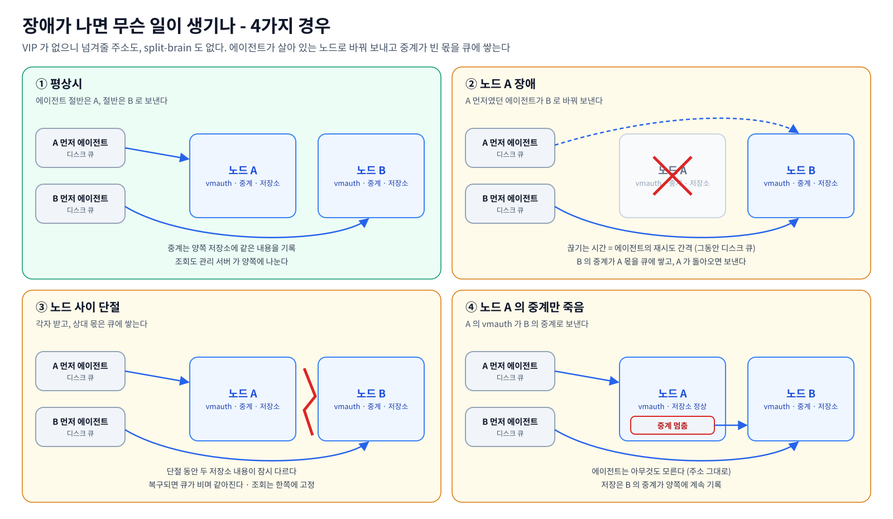

| 경우 | 수집 | 저장 | 조회 | 사람이 할 일 |
|---|---|---|---|---|
| ① 평상시 | 에이전트 절반은 A 먼저, 절반은 B 먼저 | 양쪽 같은 내용 | 관리 서버가 양쪽에 나눔 | 없음 |
| ② 노드 A 장애 | A 먼저였던 에이전트가 B 로 바꿔 보낸다. 끊기는 시간은 재시도 간격. 그동안 에이전트 디스크 큐가 받는다 | B 만 기록. B 의 중계가 A 몫을 큐에 쌓음 | B 만 | A 복구 후 큐가 비는 것만 확인 |
| ③ 노드 사이 단절 | 각자 받는다. VIP 가 없으니 split-brain 이 없다 | 각자 상대 몫을 큐에 쌓음. 단절 동안 두 저장소가 잠시 다르다 | 한 노드에 고정 | 연결 복구 후 큐 확인 |
| ④ 노드 A 의 중계만 죽음 | 에이전트는 모른다. A 의 vmauth 가 B 의 중계로 보낸다 | B 의 중계가 양쪽에 계속 기록 | 영향 없음 | 프로세스 재시작 |
| ⑤ 저장소만 죽음 | 영향 없음 | 양쪽 중계가 그 저장소 몫을 큐에 쌓음 | 그 노드 vmauth 가 상대 저장소로 | 저장소 재시작 |
| ⑥ vmalert · Alertmanager 한쪽 | 영향 없음 | 영향 없음 | 영향 없음 | 남은 쪽이 같은 규칙으로 알림을 계속 보낸다 |

---

## 7. 양쪽이 다시 같아지는 과정

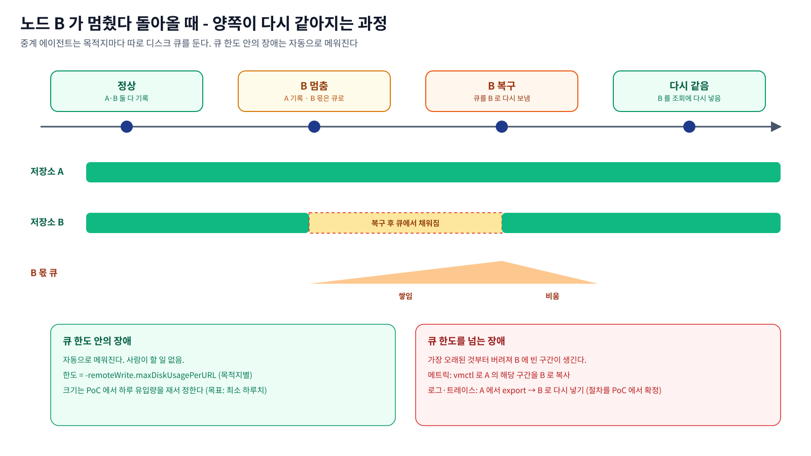

| 상황 | 결과 | 대응 |
|---|---|---|
| 장애가 큐 한도 안 | 복구되면 자동으로 채워진다 | 없음. 큐가 0 이 된 뒤 조회에 다시 넣는다 |
| 장애가 큐 한도를 넘음 | 가장 오래된 것부터 버려져 빈 구간이 생긴다 | 메트릭은 `vmctl` 로 살아 있던 쪽의 그 구간을 복사한다. 로그 · 트레이스는 살아 있던 쪽에서 export 해 다시 넣는다 (절차는 PoC 에서 확정) |

**큐 한도 정하기**: `-remoteWrite.maxDiskUsagePerURL` 를 목적지마다 준다. **목표는 최소 하루치.** 하루 유입량은 PoC 에서 재서 정한다.

**중복**: 에이전트가 재전송하면 같은 데이터가 두 번 들어갈 수 있다. 메트릭은 VictoriaMetrics 의 중복 제거(`-dedup.minScrapeInterval`)로 정리된다. 로그는 중복이 남을 수 있다. PoC 에서 빈도를 본다.

---

## 8. 에이전트 상세

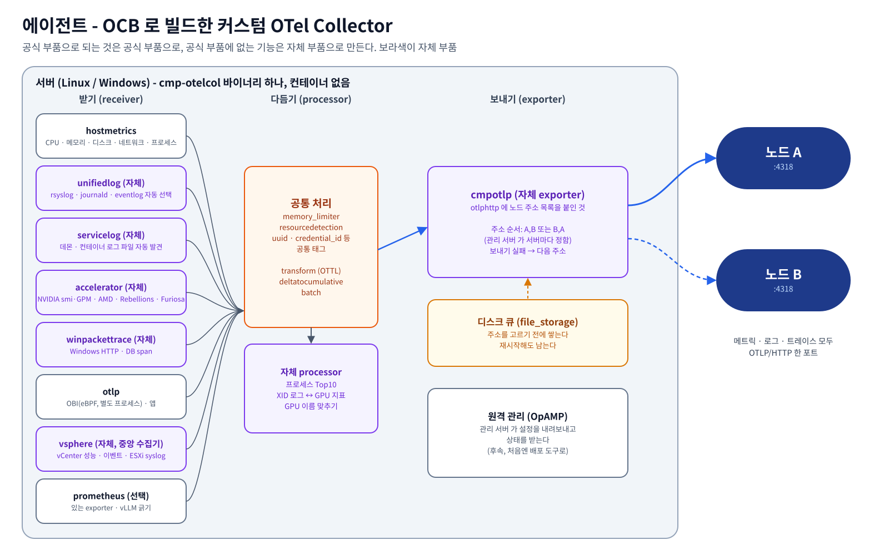

### 8.1 부품 구성

원칙: **공식 부품으로 같은 동작이 나오면 공식 부품, 아니면 자체 부품.**

| 기능 | 부품 | 종류 | 공식 / 자체 |
|---|---|---|---|
| CPU · 메모리 · 디스크 · 네트워크 · 프로세스 | hostmetrics | receiver | 공식 |
| 프로세스 Top N 만 남기기 | top10 | processor | 자체 (hostmetrics 는 고르기가 없다) |
| 시스템 로그: rsyslog 파일 · journald · Windows 이벤트 로그 중 **있는 것을 자동으로 고르기**, syslog 서버, 데몬 · 컨테이너가 연 로그 파일 자동 발견 | unifiedlog · servicelog | receiver | 자체. 원천 읽기는 공식 journald · filelog · syslog · windowseventlog 부품의 라이브러리를 쓸 수 있는지 PoC 에서 본다 |
| GPU · NPU | accelerator (NVIDIA nvidia-smi · NVML GPM, AMD amd-smi, Rebellions rbln-smi, Furiosa furiosa-smi-go) | receiver | 자체 |
| GPU 오류 로그(XID)와 GPU 지표 잇기 | gpujoin | processor 또는 connector | 자체 |
| Windows HTTP · DB 요청 트레이스 | winpackettrace | receiver | 자체 (OBI 는 Windows 를 지원하지 않는다) |
| Linux eBPF 트레이스 | OBI → 에이전트 `otlp` 수신기 | 별도 프로세스 | 공식. OBI 의 Collector 수신기는 alpha · Linux amd64/arm64 라 기본으로 두지 않는다 |
| 스크립트 실행 결과 | exec | receiver | 자체 (contrib 에 exec 수신기가 없다) |
| vSphere 성능 카운터 · 이벤트, ESXi syslog | vsphere + syslog | receiver | 자체 (공식 vcenter 수신기는 alpha 이고 지표가 정해져 있다. 호스트 CPU ready 같은 카운터가 없다) |
| 이미 있는 exporter · 추론 엔진 | prometheus | receiver | 공식 |
| 로그 가공 (레벨 판정 등) | transform (OTTL) | processor | 공식 |
| 노드 2개 중 살아 있는 쪽으로 보내기 | **cmpotlp** + `file_storage` | exporter | 자체 |

**`cmpotlp` 를 직접 만드는 이유**: 공식 부품으로는 깔끔하게 안 된다. failoverconnector 는 alpha 이고, 출력 쪽 큐를 켜면 실패를 큐가 찬 뒤에야 알아채 전환이 늦다(issue #50234). 큐 관련 panic 이슈(#47229)도 열려 있다. loadbalancingexporter 는 해시로 나누는 부품이라 실패한 데이터를 다른 곳으로 다시 보내지 않는다. 그래서 **큐에 먼저 쌓고, 꺼내서 보낼 때 살아 있는 주소를 고르는** 출력을 만든다. 죽은 노드 몫으로 데이터가 묶이지 않는다. 주소 순서(A,B 또는 B,A)는 관리 서버가 서버마다 정해 부하를 나눈다.

**빌드**: OCB 설정 파일(`builder-config.yaml`)에 자체 부품을 `gomod` · `path` 로 넣는다. 기본이 `CGO_ENABLED=0` 이다. 바이너리 이름은 `cmp-otelcol` 로 한다.

### 8.2 메트릭 이름

| 지표 | 이름 정책 |
|---|---|
| 호스트 메트릭 (hostmetrics) | OTel 표준 이름 (`system.cpu.time` → 저장 시 `system_cpu_time_seconds_total`) |
| 자체 수신기 (GPU · NPU · vSphere · Top N) | 수신기가 정한 이름 + 공통 이름(`gpu_util` 등) 병기 |
| exporter 를 긁은 것 | exporter 원래 이름 |

### 8.3 어느 OS 에서나 도는 에이전트

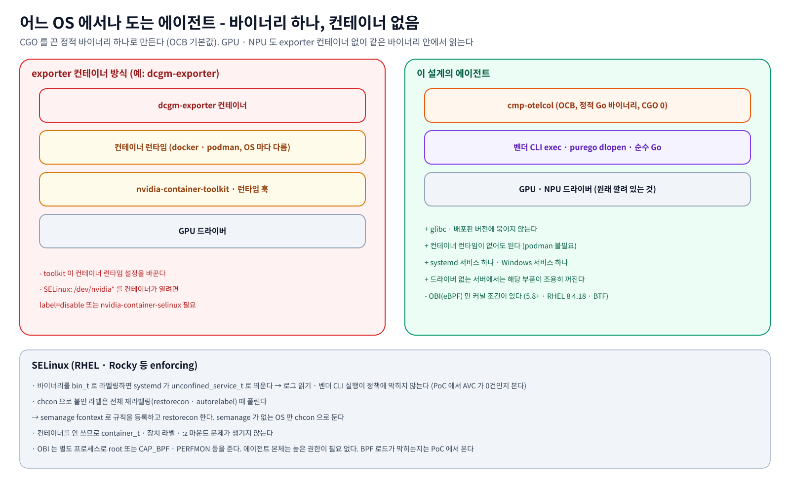

**원칙**: **바이너리 하나, 컨테이너 없음.** exporter 를 컨테이너로 돌리면 OS 마다 다른 컨테이너 런타임을 맞춰야 하고, GPU 장치를 컨테이너에 넘기는 일과 그 SELinux 라벨까지 따라온다. 컨테이너를 없애면 이 문제가 통째로 사라진다.

| 무엇 | 어떻게 |
|---|---|
| 배포판 독립 | CGO 를 끈 정적 Go 바이너리 (OCB 기본값). glibc 버전에 묶이지 않는다 |
| GPU 라이브러리 | NVML 을 **purego**(C 컴파일러 없이 공유 라이브러리를 여는 Go 라이브러리)로 dlopen 한다. GPU 가 없는 서버에서는 조용히 꺼진다 |
| 벤더 CLI | nvidia-smi · amd-smi · rbln-smi 를 실행만 한다. 드라이버와 같이 깔린다 |
| Windows | Collector 본체에 Windows 서비스 처리기가 있다. OCB 로 만든 바이너리가 서비스로 도는 것은 PoC 에서 본다 |
| eBPF | OBI 만 커널 조건이 있다. 커널 5.8 이상(RHEL 8 계열은 4.18 백포트), BTF 필요, amd64 · arm64. 조건이 안 되는 OS 에서는 트레이스만 빠지고 나머지는 돈다 |
| 사용자 이름 | 정적 바이너리는 LDAP · SSSD 처럼 NSS 로만 풀리는 사용자 이름을 못 풀어 `process.owner` 가 빠질 수 있다 |

**SELinux (RHEL · Rocky 등 enforcing)**
- **처음 나오는 말**: SELinux 는 파일과 프로세스에 라벨(type)을 붙이고 라벨끼리 무엇을 허용할지 정책으로 정한다. `bin_t` 는 실행 파일 라벨, `unconfined_service_t` 는 정책 제약을 거의 받지 않는 서비스 도메인이다.
- 실행 파일을 `bin_t` 로 라벨링하면 systemd 가 그 서비스를 `unconfined_service_t` 로 띄운다 (Red Hat 의 Dan Walsh 설명, RHEL 7 SELinux 가이드). 그러면 로그 읽기 · 벤더 CLI 실행이 정책에 막히지 않는다. **실제로 AVC(거부 기록)가 0건인지는 PoC 에서 `ausearch -m avc` 로 본다.**
- 라벨은 `chcon` 으로 붙이지 않는다. `chcon` 은 전체 재라벨링(`restorecon -R`, `/.autorelabel`) 때 정책 기본값으로 돌아간다.
- `semanage` 도 쓰지 않는다. `semanage` 는 `policycoreutils-python-utils` 패키지에 있어 **없는 서버가 있다.** 대신 라벨 규칙을 담은 작은 **CIL 정책 모듈**을 만들어, SELinux 를 쓰면 늘 있는 `semodule` 로 넣는다. 재라벨링해도 유지되고, 지울 때 `semodule -r` 로 뺀다. 설치 폴더(5.5)의 하위 폴더마다 라벨을 준다: `bin` 은 `bin_t`, `conf` 는 `etc_t`, `data` 는 `var_lib_t`, `logs` 는 `var_log_t`.
- 정책 기본값만으로 되는 위치도 있다. `/opt/<이름>/bin` 은 기본 정책이 처음부터 `bin_t` 로 잡는다. `/cmp-mon` 같은 위치는 기본값이 `default_t` 라서 모듈이 필요하다.
- 컨테이너를 안 쓰므로 `container_t` · `/dev/nvidia*` 장치 라벨(`xserver_misc_device_t`) · `:z` 마운트 문제가 생기지 않는다.
- OBI 는 별도 프로세스로 root 또는 CAP_BPF · PERFMON 등을 준다. 에이전트 본체는 높은 권한이 필요 없다. SELinux 가 BPF 로드를 막는지는 공식 문서에 언급이 없어 PoC 에서 본다.
- **입구 프록시**: 배포판 HAProxy 는 `haproxy_t` 도메인에 갇혀 `haproxy_connect_any` 없이는 4318 · 7443 을 열지 못했다(PoC). 그래서 입구를 정적 바이너리 vmauth 로 바꿨다(3.10). vmauth 는 다른 부품처럼 `unconfined_service_t` 로 돈다.

### 8.4 vSphere 수집

- ESXi 에는 에이전트를 깔 수 없어 중앙에서 vCenter API 를 폴링한다. 같은 `cmp-otelcol` 바이너리를 vSphere 설정으로 띄운다: `vsphere` 수신기 + syslog 서버(ESXi 원격 syslog) + `cmpotlp`.
- 수집기는 한 곳에서만 돈다. 두 곳에서 돌리면 vCenter 부하가 두 배가 되고 이벤트가 중복된다. 이 수집기를 어느 노드에서 돌리고 장애 때 어떻게 넘길지는 관리 서버 이중화와 함께 정한다.
- 설정을 바꿨을 때 다시 읽는 방식(파일 감시 또는 재시작)은 PoC 에서 정한다.

---

## 9. Prometheus 와 호환, 그리고 오가는 구조

### 9.1 Prometheus 와 같이 쓰기

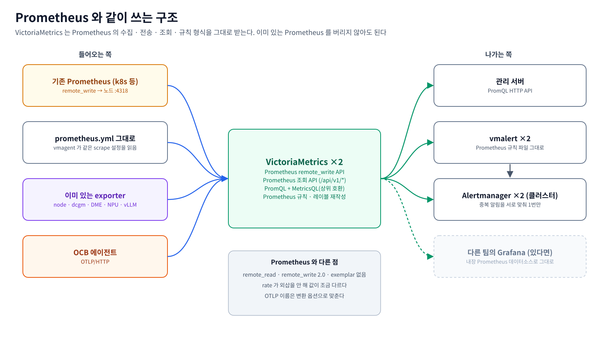

| 무엇 | 어떻게 |
|---|---|
| 이미 있는 Prometheus | `remote_write` 를 노드 A · B 의 `:4318/api/v1/write` 중 하나로 추가한다. Prometheus 의 remote_write 는 목적지마다 복사하므로 하나만 넣고, 그 노드가 죽으면 Prometheus 자체 WAL 이 재시도한다 |
| 이미 있는 scrape 설정 | vmagent 가 `prometheus.yml` 의 `scrape_configs` 를 그대로 읽는다 (`-promscrape.config`) |
| exporter | 에이전트 `prometheus` 수신기나 vmagent 가 긁는다 |
| 조회 | PromQL 이 그대로 돈다. MetricsQL 은 PromQL 의 상위 호환이다 |
| 알림 규칙 | Prometheus 규칙 파일을 vmalert 가 그대로 읽는다. Alertmanager 는 같은 것이다 |
| Grafana 를 쓰는 팀 | 내장 Prometheus 데이터소스로 그대로 붙는다 (VictoriaMetrics 전용 플러그인은 AGPL-3.0) |

**Prometheus 와 다른 점**: remote_read, remote_write 2.0, exemplar 를 받지 않는다. `rate` · `increase` 가 외삽을 하지 않아 값이 Prometheus 와 조금 다르다. 전체 표는 14.1.

### 9.2 Prometheus ↔ VictoriaMetrics 를 오갈 수 있게

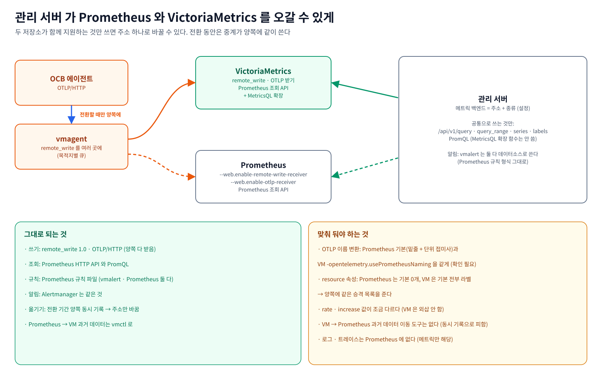

**질문**: 관리 서버를 Prometheus 와 Victoria 계열을 오가며 바로 전환할 수 있게 만들 수 있나?

**답: 메트릭은 된다.** 두 저장소가 **함께 지원하는 것만** 쓰면 관리 서버는 주소와 종류 설정만 바꾸면 된다. 로그 · 트레이스는 Prometheus 에 해당하는 것이 없어 이 질문의 범위가 아니다.

**두 저장소가 함께 지원하는 것**

| 영역 | Prometheus | VictoriaMetrics | 공통으로 쓸 것 |
|---|---|---|---|
| OTLP 받기 | `--web.enable-otlp-receiver`, `/api/v1/otlp/v1/metrics` | `/opentelemetry/v1/metrics` | OTLP/HTTP |
| remote_write 받기 | `--web.enable-remote-write-receiver` | 기본 | remote_write 1.0 |
| 조회 | Prometheus HTTP API | 같은 API (`/api/v1/query`, `query_range`, `series`, `labels`) | 이 API 와 **PromQL 만** |
| 규칙 | Prometheus 규칙 엔진 | vmalert (Prometheus 규칙 형식) | Prometheus 규칙 형식, vmalert 전용 필드 쓰지 않기 |
| 알림 평가기 | vmalert 는 Prometheus 도 데이터소스로 쓴다 ("any Prometheus-compatible storage", vmalert 문서) | 같음 | **vmalert 를 그대로 두고 데이터소스 주소만 바꾸는 것**이 가장 짧다 |
| Alertmanager | 같음 | 같음 | 같음 |

**관리 서버 설계 규칙**
1. **메트릭 백엔드를 설정 하나로 둔다**: 주소 + 종류(`prometheus` · `victoriametrics`). 조회 클라이언트는 Prometheus HTTP API 하나로 짠다.
2. **PromQL 만 쓴다.** MetricsQL 확장 함수(창 생략, `rollup_*` 등)는 쓰지 않는다. 꼭 필요하면 종류가 `victoriametrics` 일 때만 켜는 기능으로 따로 둔다.
3. **이름을 같게 만든다.** Prometheus OTLP 기본 변환(`UnderscoreEscapingWithSuffixes`: 밑줄로 바꾸고 단위 · 타입 접미사를 붙임)과 VictoriaMetrics `-opentelemetry.usePrometheusNaming` 이 같은 이름을 내는지는 **확인 필요**다. PoC 에서 같은 OTLP 를 두 곳에 보내 시계열 이름을 비교한다.
4. **resource 속성 승격을 같게 둔다.** Prometheus 는 기본으로 아무것도 라벨로 올리지 않고(`promote_resource_attributes`), VictoriaMetrics 는 기본으로 전부 올린다. 양쪽에 같은 목록을 준다.
5. **delta 는 에이전트에서 누적값으로 바꿔 보낸다.** Prometheus 의 delta 처리는 실험 기능(`otlp-deltatocumulative`)이다.

**전환 절차**: vmagent 에 `-remoteWrite.url` 로 새 저장소를 하나 더 넣어 **양쪽에 동시에 기록**한다 → 보관 기간만큼 쌓이면 관리 서버와 vmalert 의 주소를 바꾼다 → 옛 쪽을 뺀다. 과거 데이터를 옮길 필요가 없다. Prometheus → VictoriaMetrics 로 과거 데이터를 옮기는 도구(vmctl)는 있다. 반대 방향 도구는 찾지 못해서 동시 기록으로 피한다.

**그래도 남는 차이**
- `rate` · `increase` 값이 조금 다르다. 임계값이 걸린 규칙은 전환 전에 두 쪽 결과를 나란히 본다.
- Prometheus 단일 노드에는 이 설계의 이중 기록 · 디스크 큐가 없다. Prometheus 로 갈 때도 vmagent 를 앞에 두면 같은 HA 를 얻는다.
- 장기 보관 · 다운샘플링 방식은 서로 다르다.

---

## 10. 관리 서버가 지켜야 할 것

| 영역 | 할 일 |
|---|---|
| 메트릭 조회 | Prometheus HTTP API + PromQL. 노드 A · B 의 `:8443/metrics` 중 살아 있는 쪽. 백엔드 종류 설정 (9.2) |
| 로그 조회 | LogsQL, 노드 `:8443/logs` |
| 트레이스 조회 | Jaeger API, 노드 `:8443/traces` |
| 알림 | 규칙을 Prometheus 형식(MetricsQL 확장 없이) · LogsQL 로 만들어 HTTP 로 내주기, Alertmanager webhook 수신, 알림 상태 조회 |
| 에이전트 설정 | 서버마다 노드 주소 순서(A,B · B,A)를 정해 내려 부하를 나눈다. 처음에는 배포 도구로, 나중에는 OpAMP 로 |
| 이중화 | 관리 서버 자체의 이중화(스케줄러 분산 락, DB 이중화)와 vSphere 수집기 배치는 이 문서 범위 밖이다. 따로 설계한다 |

---

## 11. PoC

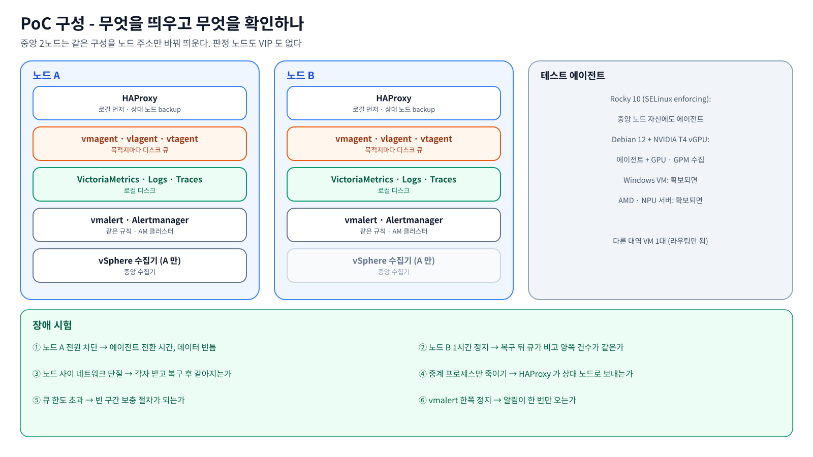

**구성**: 중앙 노드 2대(Rocky Linux 10, SELinux enforcing, 8 vCPU · 16GB · 80GB), 에이전트 시험 VM(Debian 12 + NVIDIA T4 vGPU). Windows · AMD · NPU 서버는 확보되면 더한다. 판정 노드는 필요 없다. Prometheus 1대(9.2 시험용).

**PoC 구성물은 `poc/` 에 둔다.** 노드별 설치 스크립트, 설정 파일, OCB 빌드 설정, 시험 절차가 들어간다. 접속 주소 같은 환경 값은 저장소에 넣지 않는다.

**성공 기준**

| # | 시험 | 통과 조건 |
|---|---|---|
| 1 | 노드 A 전원 차단 | `cmpotlp` 가 B 로 넘어가고 끊김이 재시도 간격 안. 메트릭 · 로그 · 트레이스 빈틈 0 (file_storage 큐) |
| 2 | 노드 B 1시간 정지 후 복구 | 큐가 자동으로 비고, 같은 구간의 메트릭 샘플 수 · 로그 건수 · 트레이스 수가 A · B 에서 같다. 한 목적지가 죽어 있는 동안 다른 목적지 전송이 밀리지 않는다 |
| 3 | 노드 사이 네트워크 단절 | 각자 받고, 연결 복구 후 양쪽 건수가 같아진다 |
| 4 | 중계 프로세스만 종료 | vmauth 가 상대 노드 중계로 보내고 수집이 계속된다 |
| 5 | 큐 한도 초과 | 빈 구간이 생기는 것을 확인하고, 보충 절차로 다시 같아진다 |
| 6 | 같은 쿼리를 A · B 에 각각 | 결과가 같다 (복구 직후 노드는 drain 상태여서 조회를 안 받는다) |
| 7 | GPU | nvidia-smi · GPM 지표가 공통 이름과 원래 이름으로 쌓인다 (vGPU 게스트) |
| 8 | SELinux | enforcing 에서 Victoria 부품 · vmauth · 에이전트가 돌고 `ausearch -m avc` 가 0건. `restorecon -R` 뒤에도 서비스가 뜬다 |
| 9 | 다른 대역 | 라우팅만 되는 다른 대역 VM 에서 두 노드로 보내고, 장애 전환 뒤에도 계속 된다 |
| 10 | 알림 | vmalert 한쪽을 멈춰도 알림이 한 번만 온다. 메트릭 · 로그 규칙을 한 vmalert 가 평가한다. 규칙을 HTTP 로 가져간다 |
| 11 | Prometheus 전환 | 같은 OTLP 를 Prometheus 와 VictoriaMetrics 에 보내 시계열 이름 · 라벨이 같다. 조회와 vmalert 를 주소만 바꿔 Prometheus 로 돌린다 |
| 12 | Windows | `cmp-otelcol` 이 Windows 서비스로 돌고 이벤트 로그 · 패킷 트레이스가 나온다 |
| 13 | 하루 유입량 측정 | 신호별 하루 바이트 → 큐 한도와 디스크 크기 결정 |

### 11.1 진행 결과 (2026-11-01)

| 항목 | 결과 | 근거 |
|---|---|---|
| 중앙 2노드 설치 (`/cmp-mon`, vmauth, HTTPS · 토큰) | 됨. 두 노드 모두 서비스 9개 `active`, 로컬 부품 `/health` 200 | `poc/checks/central-health.sh` |
| 바깥 포트 | 두 노드 모두 4318 · 7443 · 8443 · 9094 만 노드 IP 에서 듣는다 (SSH 등 기존 것 제외) | `ss -ltn` |
| 토큰 | 조회 경로: 조회 토큰 200, 토큰 없이 401. 노드 사이 경로: 노드 토큰 200, 조회 토큰으로는 거부 | 위 출력 |
| 복제 | vmagent 가 로컬과 상대 노드에 같은 바이트를 보냈고, 두 노드 VictoriaMetrics 의 같은 구간 샘플 수가 같다 (HAProxy 구성 때 확인) | `vmagent_remotewrite_bytes_sent_total`, `count_over_time` |
| 시험 4: 중계만 종료 | vmauth 구성에서 노드 A 의 vmagent 를 멈춘 100초 동안 B 의 vmagent 가 remote_write 로 받은 행이 30 → 42 로 늘었다 (A 의 기록이 A 의 입구를 거쳐 B 로 넘어감). 다시 켠 뒤 두 노드의 5분 구간 샘플 수 173,398 로 같음 | `checks/failover-suite.sh 4` |
| 시험 2: 노드 B 정지 · 복구 | B 의 서비스를 모두 멈춘 3분 동안 A 는 조회 200, A 의 B 몫 큐 902,392 바이트. B 를 켜자 5초 안에 큐 0, 두 노드의 8분 구간 샘플 수 216,319 · ALERTS 16 으로 같음 | `checks/failover-suite.sh 2` |
| 시험 3: 노드 사이 통신 차단 | 노드 A 에서 B 로 가는 경로를 3분 막자(`ip route blackhole`) 각자 받으면서 A 큐 449,443 · B 큐 469,701 바이트가 쌓였다. 풀린 뒤 두 노드 모두 5초 안에 큐 0, 8분 구간 샘플 수 272,221 · ALERTS 16 으로 같음 | `checks/failover-suite.sh 3` |
| 이중화 → 단일 전환 | 노드 A 를 단일로 다시 설치: 상대 노드 몫 큐 3개 삭제, 바깥 포트 4318 · 8443 만, 서비스 정상 | 설치 출력, 점검 |
| SELinux | Enforcing 에서 모든 부품(vmauth 포함)이 `unconfined_service_t`, AVC 0건. 라벨은 CIL 모듈로. 배포판 HAProxy 는 `haproxy_connect_any` 없이 시작 못 함 | `ps -eZ`, `ausearch -m avc` |
| 시험 1 · 5 · 6, 단일 → 이중화 복구와 과거 메트릭 채우기, 에이전트 | 아직 안 함 | |

## 12. 도입 순서

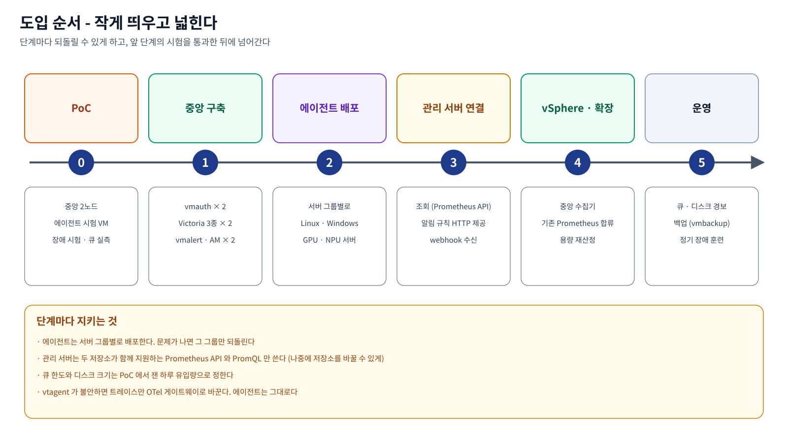

| 단계 | 내용 | 되돌리기 |
|---|---|---|
| 0 | PoC (11절) | - |
| 1 | 중앙 구축: vmauth · Victoria 3종 · vmalert · Alertmanager ×2 | 중앙을 내리면 끝 |
| 2 | 에이전트 배포: 서버 그룹별로 | 그룹별로 되돌림 |
| 3 | 관리 서버 연결: 조회 · 알림 규칙 HTTP 제공 · webhook 수신 | 연결만 끊음 |
| 4 | vSphere 수집기, 기존 Prometheus 합류, 용량 재산정 | 개별로 되돌림 |
| 5 | 운영: 큐 · 디스크 경보, vmbackup, 정기 장애 훈련 | - |

---

## 13. 위험과 확인이 필요한 것

| 위험 | 영향 | 대응 |
|---|---|---|
| 자체 부품의 동작 · 품질 | 값이 틀리거나 빠짐 | 부품마다 시험 자료(벤더 도구 출력 원문)로 단위 시험, PoC 시험 7 |
| VictoriaTraces · vtagent 가 0.x, vtagent 는 2026-08 신규 | 큰 변경 · 버그 가능성 | 트레이스만 OTel 게이트웨이로 바꿀 길을 열어 둔다 (3.4) |
| `cmpotlp` 를 직접 만듦 | 전환 로직 버그 | 큐에 먼저 쌓고 보낼 때 주소를 고르는 단순한 구조. PoC 시험 1 · 2 |
| `file_storage` 큐가 가득 참 | 넘친 것은 버려진다 | 큐 크기를 하루 유입량 기준으로 (시험 13) |
| 디스크 2배 | 비용 | 대신 오브젝트 스토리지 · 정족수 노드가 필요 없다. **다운샘플링은 Enterprise 전용**이라 `-retentionPeriod` 하나로 기간만 정한다 |
| Ampere 이하 GPU 프로파일 지표 없음 | 텐서 · DRAM 실가동률을 못 봄 | 필요한 현장만 dcgm-exporter 가 이미 있으면 긁는다 |
| Rebellions exporter 사용권 | Apache 아님 | exporter 를 안 쓰고 rbln-smi 만 실행한다 |
| Prometheus 와 다른 계산(rate 외삽 없음), exemplar 없음 | 알림 임계값이 조금 달라짐 | 핵심 규칙은 두 저장소에 같은 쿼리를 돌려 비교한다 |
| 노드 사이 단절 동안 두 저장소가 다름 | 조회 결과가 노드마다 다름 | 단절 동안 조회를 한 노드에 고정. 복구 후 큐로 같아진다 |

**확인이 필요한 것**
- vmagent · vlagent 의 OTLP/gRPC 수신. 이 설계는 HTTP 만 쓴다.
- vmagent 의 목적지별 큐에서 한 목적지가 오래 죽어 있을 때 다른 목적지 전송이 막히지 않는지 (PoC 시험 2).
- VictoriaTraces 의 resource 속성 처리 방식.
- 한 vmalert 가 메트릭 · 로그 규칙을 함께 평가하는 구성 (PoC 시험 10).
- Prometheus OTLP 이름 변환과 VictoriaMetrics `usePrometheusNaming` 이 같은 이름을 내는지 (PoC 시험 11).
- OCB 로 만든 바이너리의 Windows 서비스 동작, 정적 바이너리가 오래된 배포판에서 도는지 (`ldd` 로 "not a dynamic executable").
- `unconfined_service_t` 에서 BPF 로드가 허용되는지 (OBI).
- vmauth 가 쓰기 요청(POST)을 상대 노드로 다시 보낼 때 본문을 온전히 다시 보내는지 (`-requestBufferSize`).
- 복구된 노드를 큐가 빌 때까지 조회에서 빼는 방법 (3.7, 아직 구현 안 함).
- `furiosa-metrics-exporter` 가 고정한 `furiosa-smi-go` 버전이 이미 순수 Go 인지, furiosa-smi CLI 의 JSON 출력.
- amd-smi 가 드라이버 쪽 패키지에 들어 있는지.
- AMD 파티션(CPX)이 MIG 처럼 격리되는지, NPU 도구가 VM 게스트 안에서 도는지.
- VictoriaMetrics → Prometheus 과거 데이터 이동 도구 (찾지 못함. 동시 기록으로 피한다).

---

## 14. 가능한지 조사

질문마다 결론과 근거를 적는다. 출처는 공식 문서와 공개 저장소다(부록 B). 실제로 돌려 본 것은 아니다.

### 14.1 저장소를 모두 Victoria 계열로 해도 되나 - Prometheus · OTel 호환

**결론: 된다.** Prometheus 쪽과 OTel 쪽 모두 수집 · 조회 경로가 있다. 아래 "안 되는 것" 은 설계에서 피해 간다.

**Prometheus 쪽**

| 항목 | 지원 | 조건 · 차이 |
|---|---|---|
| remote_write 1.0 수신 | 된다 | `/api/v1/write` |
| remote_write 2.0 수신 | **안 된다** | 기존 Prometheus 는 RW 1.0 으로 고정한다 |
| remote_read | **안 된다** | 조회는 Prometheus 조회 API 로 한다. 과거 데이터는 vmctl 로 옮긴다 |
| prometheus.yml scrape 설정 | 대부분 된다 | vmagent 가 읽는다. rule_files 는 vmalert 로 간다 |
| PromQL | 대체로 된다 | MetricsQL 은 상위 호환이지만 `rate` · `increase` 가 외삽을 안 한다 |
| native histogram | 된다 (v1.143.0~) | 받을 때 일반 버킷으로 바꿔 저장한다 |
| exemplar | **안 된다** | 메트릭에서 트레이스로 가는 링크는 관리 서버 화면에서 잇는다 |
| 규칙 · Alertmanager | 된다 | vmalert 가 Prometheus 규칙 형식을 읽고 Alertmanager 로 보낸다 |

**OTel 쪽**

| 항목 | 지원 | 조건 · 차이 |
|---|---|---|
| OTLP 메트릭 | HTTP 된다, gRPC 문서 없음 | `/opentelemetry/v1/metrics`, protobuf |
| delta 지표 | 저장은 된다 (v1.132.0~) | 문서는 누적값으로 바꿔 보내길 권한다 |
| 메트릭 이름 | 옵션 | `-opentelemetry.usePrometheusNaming` |
| OTLP 로그 | HTTP 된다 | `/insert/opentelemetry/v1/logs`. resource 속성은 스트림 필드가 된다 |
| OTLP 트레이스 | HTTP · gRPC 된다 | gRPC 는 v0.5.0 부터, `-otlpGRPCListenAddr` |
| 로그 조회 | LogsQL 만 | LogQL · Loki 조회 API 는 없다. Loki **push** 수신만 된다 |
| 트레이스 조회 | Jaeger API | Tempo API 는 실험적이다 |

**문제가 될 수 있는 것**

| 무엇 | 영향 | 대응 |
|---|---|---|
| 다운샘플링 · 시리즈별 보관이 Enterprise 전용 | 오래된 데이터를 줄여 보관할 수 없음 | `-retentionPeriod` 하나로 기간만 정한다 |
| 자동 백업 스케줄러(vmbackupmanager)가 Enterprise 전용 | 백업을 직접 돌려야 함 | vmbackup(오픈소스)을 cron 으로 돌린다 |
| VictoriaTraces 가 0.x | 변경이 잦을 수 있음 | 13절 위험표의 대응 |
| 단일 노드 규모 | 문서 예시는 초당 150만 샘플 이상 | PoC 에서 하루 유입량을 재서 확인한다 |

### 14.2 NVIDIA - nvidia-smi · GPM 의 범위

| 항목 | 내용 | 출처 |
|---|---|---|
| GPM 대상 | Hopper 이상. Ampere 에서는 값이 0 이나 "-" 로 나온다 | NVML GPM 문서, NVIDIA 포럼 답변 |
| GPM 두 샘플 간격 | 100ms 보다 커야 한다 | NVML GPM 문서 |
| GPM 을 CLI 로 | `nvidia-smi dmon --gpm-metrics` (csv 만, JSON 없음). Windows 미지원 | nvidia-smi 문서, vGPU 사용자 가이드 |
| GPM 을 라이브러리로 | NVML 의 `nvmlGpmSampleGet` · `nvmlGpmMigSampleGet` 을 purego 로 dlopen 해 부르면 CGO 없이 빌드된다 | NVML GPM 문서, purego |
| vGPU 게스트 | nvidia-smi 는 할당된 vGPU 만 보이고, 3D/compute · 메모리 컨트롤러 · 인코더 · 디코더 · 프레임버퍼 외는 0 이나 N/A | vGPU 사용자 가이드 |
| MIG | nvidia-smi 의 사용률 조회는 MIG 에서 미지원 → GPM 으로 받는다 | nvidia-smi 문서 |
| Windows | nvidia-smi 는 64비트 Windows Server 2008 R2 이후. 경로가 PATH 에 없을 수 있다 (`%ProgramW6432%\NVIDIA Corporation\NVSMI\` 또는 `System32`) | NVML 문서 |
| NVIDIA 공식 go-nvml | cgo 를 쓴다. 정적 빌드를 위해 쓰지 않는다 | go-nvml 소스 |
| dcgm-exporter | vGPU 미지원, 설치는 컨테이너 · Helm · `datacenter-gpu-manager-exporter` 패키지, 프로파일 지표에 SYS_ADMIN | NVIDIA 문서 |

**nvidia-container-toolkit 이 필요한가**: 이 설계에서는 **필요 없다.** 컨테이너를 쓰지 않기 때문이다. dcgm-exporter 를 컨테이너로 돌리는 경우라면 CDI 방식에 `nvidia-container-toolkit-base` 가 최소로 필요하다.

### 14.3 AMD GPU

| 항목 | 내용 |
|---|---|
| 고른 방식 | accelerator 수신기의 AMD 백엔드가 `amd-smi metric --json` 을 실행해 파싱 |
| amd-smi | `metric` · `static` · `monitor` 가 `--json` 을 지원. 항목: mem-usage, usage, power, clock, temperature, pcie, ecc, ecc-blocks, voltage, fan, energy, xgmi-err, violation(MI300 이상), partition |
| 위치 · 라이선스 | 소스가 `ROCm/rocm-systems` 로 옮겨졌다. 옛 저장소는 MIT. ROCm 6.4.3 노트에 amd-smi-lib 를 드라이버 설치와 함께 배포한다고 적혀 있다 (지금 상태 확인 필요) |
| OS | Linux 베어메탈과 Linux VM 게스트. Windows 는 가상화용 별도 AMD SMI 만 |
| rocm-smi | 유지보수 모드, amd-smi 로 옮기라는 권고 |
| Device Metrics Exporter | 컨테이너 · Helm, Ubuntu 22.04/24.04 deb(`amdgpu-exporter` + `gpuagent`). 쓰지 않는다 |
| 파티셔닝 | MI300X 는 compute 파티션(SPX · CPX)과 memory 파티션(NPS)이 있다. 전력 · 온도 같은 물리 센서는 파티션 0 에만 나온다 |

**NVIDIA ↔ AMD 지표 대응** (공통 이름으로 맞출 때의 기준. AMD 쪽은 Device Metrics Exporter 이름이고, amd-smi JSON 키와의 대응은 백엔드를 만들 때 맞춘다)

| 공통 이름 (안) | NVIDIA | AMD | 메모 |
|---|---|---|---|
| gpu_util | utilization_gpu | gpu_gfx_activity | 파티션 시 gfx_busy_instantaneous |
| mem_used / mem_free | memory_used / memory_free | gpu_used_vram / gpu_free_vram | 단위 MiB ↔ MB |
| temp | temperature_gpu | gpu_edge_temperature / gpu_junction_temperature | 모델마다 다름 |
| mem_temp | memory_temp | gpu_memory_temperature | |
| power | power_draw | gpu_package_power / gpu_power_usage | |
| ecc_corrected / uncorrected | ECC SBE / DBE | gpu_ecc_correct_total / uncorrect_total | |
| interconnect | NVLink (GPM) | gpu_xgmi_link_rx/tx | 의미만 대응 |
| pcie_replay | pcie replay counter | pcie_replay_count | |

### 14.4 NPU

| 벤더 | 고른 방식 | 근거 | 참고 |
|---|---|---|---|
| Rebellions | `rbln-smi -j` 파싱 | rbln-smi 는 RBLN 드라이버 패키지에 들어 있고 `-j, --json` 이 있다. 필드: temperature, card_power, pstate, memory, util 등. rbln-stat 은 rbln-smi 로 대체됨 | exporter 는 Rebellions 자체 사용권, 사전 빌드 바이너리 없음, `rbln-smd` 데몬에 기댐. VM 은 KVM PCI 패스스루만 |
| FuriosaAI | `furiosa-smi-go` 를 바이너리에 넣음 | README 상 순수 Go, sysfs · devfs 를 직접 읽음, CGO_ENABLED=0 으로 빌드, Apache-2.0 | exporter 는 Helm · apt. furiosa-smi CLI 의 JSON 출력은 문서에 없다. RNGD 는 SR-IOV 8 VF |
| 추론 엔진 | `prometheus` 수신기 | Furiosa-LLM · vLLM `/metrics` | TTFT, 토큰 처리량 |

### 14.5 네트워크 환경별로 되나

| 환경 | ② 주소 2개 + 노드마다 vmauth 입구 (선택) | ① VIP (참고) |
|---|---|---|
| OpenStack, 에이전트가 같은 대역 | 된다 | 된다 (allowed-address-pairs, VRRP 보안그룹, unicast) |
| OpenStack, 에이전트가 다른 대역 | 된다 (라우터 경유) | 된다 (라우터 경유) |
| OpenStack 밖에서 들어옴 | 노드마다 Floating IP 또는 provider 네트워크 | VIP 포트에 Floating IP. DVR(neutron bug 1583694) · OVN 에서 문제 보고 |
| VMware vSphere · NSX | 된다 (방화벽만) | 포트그룹 보안 정책, NSX 세그먼트 정책 확인 필요 |
| 베어메탈 · 다른 사이트 | 된다 (라우팅 · 방화벽만) | 같은 L2 일 때만 |
| **중앙 노드 A · B 가 서로 다른 대역** | **된다** | **안 된다** (GARP 는 대역을 넘지 못함) |

---

## 부록 A. 설정 초안

PoC 에서 실제로 쓰는 설정은 `poc/` 에 있다. 아래는 구조를 보여 주는 초안이다.

### vmauth 입구 (노드 A, 발췌. 만드는 곳은 `poc/central/gen-gateway.sh`)

```yaml
users:
  - name: query                                   # 조회 토큰
    bearer_token: "<조회 토큰>"
    url_map:
      - src_paths: ["/metrics/.*"]
        drop_src_path_prefix_parts: 1             # /metrics 를 떼고 넘긴다
        load_balancing_policy: first_available    # 로컬 먼저, 죽으면 다음
        retry_status_codes: [502, 503, 504]
        headers: ["Authorization: Bearer <노드 사이 토큰>"]   # 상대 노드로 넘길 때 쓴다
        url_prefix: ["http://127.0.0.1:8428", "https://<상대>:7443/vm"]
      # /metrics/select/logsql/.* (먼저), /logs/.*, /traces/.* 도 같은 모양
  - name: peer                                    # 노드 사이 토큰
    bearer_token: "<노드 사이 토큰>"
    url_map:
      - src_paths: ["/vm/.*"]
        drop_src_path_prefix_parts: 1
        url_prefix: ["http://127.0.0.1:8428"]
      # /vl, /vt, /vmagent, /vlagent, /vtagent, /am 도 같은 모양
unauthorized_user:                                # 토큰 없음 = 수집
  url_map:
    - src_paths: ["/v1/metrics"]
      load_balancing_policy: first_available
      headers: ["Authorization: Bearer <노드 사이 토큰>"]
      url_prefix: ["http://127.0.0.1:8429/opentelemetry", "https://<상대>:7443/vmagent/opentelemetry"]
    # /v1/logs, /v1/traces, /api/v1/write 도 같은 모양
```

```sh
vmauth -auth.config=/cmp-mon/conf/gateway.yml \
       -httpListenAddr=<자기>:4318,<자기>:8443,<자기>:7443 \
       -tls=true,true,true -tlsCertFile=<server.pem ×3> -tlsKeyFile=<server.key ×3> \
       -httpInternalListenAddr=127.0.0.1:8427 \
       -backend.tlsInsecureSkipVerify            # TLS_VERIFY=ca 면 -backend.TLSCAFile=ca.pem
```

### 중계 에이전트 (노드 A, 노드 B 도 같음)

```sh
vmagent  -httpListenAddr=127.0.0.1:8429 \
         -remoteWrite.url=http://127.0.0.1:8428/api/v1/write \
         -remoteWrite.url=https://<상대>:7443/vm/api/v1/write \
         -remoteWrite.bearerTokenFile=,/cmp-mon/conf/tokens/peer.token \   # 목적지 순서대로: 로컬은 비움
         -remoteWrite.tlsInsecureSkipVerify=false,true \
         -remoteWrite.tmpDataPath=/cmp-mon/data/vmagent-queue \
         -remoteWrite.maxDiskUsagePerURL=<PoC 실측 후> \
         -opentelemetry.usePrometheusNaming
# vlagent (/vl/insert/native), vtagent (/vt/insert/native) 도 같은 모양
```

### 알림 (노드 A)

```sh
vmalert       -httpListenAddr=127.0.0.1:8880 \
              -datasource.url=https://<자기>:8443/metrics -datasource.bearerTokenFile=<조회 토큰> \
              -remoteRead.url=https://<자기>:8443/metrics -remoteRead.bearerTokenFile=<조회 토큰> \
              -remoteWrite.url=https://<자기>:4318 \
              -notifier.url=http://127.0.0.1:9093 -notifier.url=https://<상대>:7443/am \
              -notifier.bearerTokenFile=,<노드 사이 토큰> -notifier.tlsInsecureSkipVerify=false,true \
              -datasource.tlsInsecureSkipVerify -remoteRead.tlsInsecureSkipVerify -remoteWrite.tlsInsecureSkipVerify \
              -rule=/cmp-mon/conf/rules/*.yml
alertmanager  --web.listen-address=127.0.0.1:9093 \
              --cluster.listen-address=<자기>:9094 --cluster.peer=<상대>:9094
# receiver 는 webhook 1개: 관리 서버
```

### OCB 에이전트 (발췌)

```yaml
extensions:
  file_storage: { directory: <설치경로>/queue }
receivers:
  hostmetrics: { collection_interval: 10s, scrapers: { cpu: {}, memory: {}, disk: {}, filesystem: {}, network: {}, process: {} } }
  unifiedlog: {}          # 자체. OS 에 따라 rsyslog · journald · eventlog 를 고른다
  accelerator: {}         # 자체. 드라이버가 있는 벤더만 켜진다
  otlp: { protocols: { http: { endpoint: 127.0.0.1:4318 } } }   # OBI · 앱
processors:
  resource: { attributes: [ { key: host.id, value: "<서버 id>", action: upsert } ] }
  deltatocumulative: {}
  batch: {}
exporters:
  cmpotlp:                # 자체
    endpoints: ["https://<노드A>:4318", "https://<노드B>:4318"]   # 서버마다 A,B 또는 B,A
    tls: { insecure_skip_verify: true }   # 또는 ca_file: 사설 CA
    sending_queue: { storage: file_storage }
service:
  extensions: [file_storage]
  pipelines:
    metrics: { receivers: [hostmetrics, accelerator, otlp], processors: [resource, deltatocumulative, batch], exporters: [cmpotlp] }
    logs:    { receivers: [unifiedlog, otlp], processors: [resource, batch], exporters: [cmpotlp] }
    traces:  { receivers: [otlp], processors: [resource, batch], exporters: [cmpotlp] }
```

## 부록 B. 참고 문서

**Victoria 계열**
- vmagent: https://docs.victoriametrics.com/victoriametrics/vmagent/
- VictoriaMetrics OTLP 수신: https://docs.victoriametrics.com/victoriametrics/integrations/opentelemetry/
- vlagent: https://docs.victoriametrics.com/victorialogs/vlagent/
- VictoriaLogs 수집 프로토콜: https://docs.victoriametrics.com/victorialogs/data-ingestion/
- VictoriaLogs OTLP 수신: https://docs.victoriametrics.com/victorialogs/data-ingestion/opentelemetry/
- VictoriaLogs 클러스터 HA: https://docs.victoriametrics.com/victorialogs/cluster/
- vtagent: https://docs.victoriametrics.com/victoriatraces/vtagent/
- VictoriaTraces 릴리스: https://github.com/VictoriaMetrics/VictoriaTraces/releases
- VictoriaTraces 조회 · UI: https://docs.victoriametrics.com/victoriatraces/querying/
- VictoriaTraces OTLP 수신: https://docs.victoriametrics.com/victoriatraces/data-ingestion/opentelemetry/
- Victoria 와 OpenTelemetry 개요: https://docs.victoriametrics.com/opentelemetry/
- vmalert: https://docs.victoriametrics.com/victoriametrics/vmalert/
- vmalert 로 VictoriaLogs · VictoriaTraces 규칙: https://docs.victoriametrics.com/victorialogs/vmalert/ , https://docs.victoriametrics.com/victoriatraces/vmalert/
- VictoriaMetrics Prometheus 연동: https://docs.victoriametrics.com/victoriametrics/integrations/prometheus/
- MetricsQL: https://docs.victoriametrics.com/victoriametrics/metricsql/
- Enterprise 기능: https://docs.victoriametrics.com/victoriametrics/enterprise/
- exemplar 미지원 논의: https://github.com/VictoriaMetrics/VictoriaMetrics/issues/1169
- VictoriaMetrics Grafana 플러그인 (AGPL-3.0): https://github.com/VictoriaMetrics/victoriametrics-datasource

**Prometheus · 알림 · 라이선스**
- Prometheus OTLP 수신: https://prometheus.io/docs/guides/opentelemetry/
- Alertmanager HA: https://github.com/prometheus/alertmanager
- Alertmanager receiver: https://prometheus.io/docs/alerting/latest/configuration/
- Grafana AGPLv3 전환: https://grafana.com/blog/2021/04/20/grafana-loki-tempo-relicensing-to-agplv3/

**OpenTelemetry**
- OCB: https://github.com/open-telemetry/opentelemetry-collector/blob/main/cmd/builder/README.md
- exporter 큐 (file_storage): https://github.com/open-telemetry/opentelemetry-collector/blob/main/exporter/exporterhelper/README.md
- failoverconnector: https://github.com/open-telemetry/opentelemetry-collector-contrib/tree/main/connector/failoverconnector , https://github.com/open-telemetry/opentelemetry-collector-contrib/issues/50234
- loadbalancingexporter: https://github.com/open-telemetry/opentelemetry-collector-contrib/tree/main/exporter/loadbalancingexporter
- prometheusremotewrite 수신기: https://github.com/open-telemetry/opentelemetry-collector-contrib/tree/main/receiver/prometheusremotewritereceiver
- loki 수신기: https://github.com/open-telemetry/opentelemetry-collector-contrib/tree/main/receiver/lokireceiver
- vcenter 수신기: https://github.com/open-telemetry/opentelemetry-collector-contrib/blob/main/receiver/vcenterreceiver/README.md
- hostmetrics 수신기: https://github.com/open-telemetry/opentelemetry-collector-contrib/blob/main/receiver/hostmetricsreceiver/README.md
- OBI 지원 표: https://github.com/open-telemetry/opentelemetry-ebpf-instrumentation/blob/main/SUPPORT_MATRIX.md , https://opentelemetry.io/docs/zero-code/obi/
- purego: https://github.com/ebitengine/purego

**네트워크**
- neutron-dynamic-routing: https://docs.openstack.org/neutron/latest/admin/config-bgp-dynamic-routing.html
- Octavia 기능표: https://docs.openstack.org/octavia/latest/user/feature-classification/index.html
- NSX T0 BGP: https://docs.vmware.com/en/VMware-NSX/4.1/administration/GUID-7A0F6D44-4AE8-411F-8D33-2560819699CA.html
- NSX 기본 LB 종료와 Avi: https://blogs.vmware.com/load-balancing/2022/06/22/native-nsx-load-balancing-is-going-away-time-to-migrate-to-avi-load-balancing/
- Neutron VIP + DVR 버그: https://bugs.launchpad.net/neutron/+bug/1583694
- OVN 에서 VIP 포트 + FIP 문제 보고: https://gitlab.com/yaook/k8s/-/issues/659
- VIP 는 대역을 넘지 못함 (L2 GARP): https://github.com/acassen/keepalived/issues/941

**GPU · NPU**
- NVML GPM: https://docs.nvidia.com/deploy/nvml-api/api/group__nvmlGpmFunctions.html
- nvidia-smi: https://docs.nvidia.com/deploy/nvidia-smi/index.html
- vGPU 성능 모니터링: https://docs.nvidia.com/vgpu/latest/grid-vgpu-user-guide/performance-monitoring-gpu.html
- GPM pre-Hopper 미지원 답변: https://forums.developer.nvidia.com/t/nvidia-smi-gpm-metrics-not-populated/242711
- vGPU 에서 DCGM 제약: https://docs.nvidia.com/ai-enterprise/release-8/latest/infra-software/vgpu/limitations.html
- dcgm-exporter 설치: https://docs.nvidia.com/datacenter/dcgm/latest/installation/install-dcgm-exporter.html
- go-nvml: https://github.com/NVIDIA/go-nvml
- amd-smi CLI: https://rocm.docs.amd.com/projects/amdsmi/en/latest/how-to/amdsmi-cli-tool.html
- ROCm 6.4.3 노트: https://rocm.docs.amd.com/en/docs-6.4.3/about/release-notes.html
- AMD Device Metrics Exporter deb: https://instinct.docs.amd.com/projects/device-metrics-exporter/en/latest/installation/deb-package.html
- AMD MI300X 파티셔닝: https://instinct.docs.amd.com/projects/amdgpu-docs/en/latest/gpu-partitioning/mi300x/overview.html
- rbln-smi: https://docs.rbln.ai/latest/software/system_management/management_tools/rbln_smi.html
- Rebellions exporter: https://github.com/rebellions-sw/rbln-metrics-exporter , https://docs.rbln.ai/latest/software/system_management/kubernetes/metrics_exporter.html
- furiosa-smi-go: https://github.com/furiosa-ai/furiosa-smi-go
- Furiosa exporter: https://github.com/furiosa-ai/furiosa-metrics-exporter

**SELinux**
- RHEL 7 SELinux 가이드 (unconfined_service_t): https://docs.redhat.com/es/documentation/red_hat_enterprise_linux/7/html-single/selinux_users_and_administrators_guide/index
- bin_t · usr_t 전이 설명 (Dan Walsh): https://danwalsh.livejournal.com/70577.html
- container_use_devices 수정: https://bugzilla.redhat.com/show_bug.cgi?id=2214569
- NVIDIA 컨테이너 SELinux: https://docs.nvidia.com/dgx/dgx-rhel-install-guide/running-containers.html
